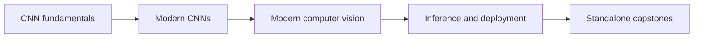

# Visual Neural Networks

A beginner-friendly course on how computers interpret images, from pixels and CNN fundamentals to modern vision models and practical inference. Lessons pair visual explanations with runnable PyTorch examples.

## Overview

The course is for learners building a foundation in neural networks and computer vision. It progresses from image tensors and convolution to modern architectures, model optimization, and real-time inference.

## Features

- 15 numbered lessons and an optional TensorBoard supplement.
- Visual, step-by-step explanations, quizzes, exercises, and runnable examples.
- Optional Netron lab for inspecting ONNX graphs and comparing theoretical compute with measured latency.
- Standalone projects for MNIST-to-ONNX, an MNIST Vision Transformer, GTSRB traffic-sign classification, ResNet paper-to-code, and MobileNetV2 paper-to-deployment.

## Architecture



Lessons live in `docs/modules/`; runnable demonstrations live in `examples/`; standalone learning and design decisions are documented in `design/`.

## Requirements

**Software**

- Python 3.12 or newer.
- [`uv`](https://docs.astral.sh/uv/) for the site environment and commands.
- PyTorch, TorchVision, and Matplotlib for vision examples; follow Setup Lab for a PyTorch build compatible with your machine.
- ONNX and ONNX Runtime packages only for the relevant capstones.

**Hardware**

- The course site and CPU examples run on a standard computer.
- CUDA and TensorRT experiments are optional and require compatible NVIDIA hardware, drivers, and runtime packages.

## Installation

From the repository root, install the site dependencies:

```bash
uv sync
```

The repository's public clone URL is unspecified. Install PyTorch and TorchVision following [Setup Lab](docs/lesson-00-setup-lab/index.md).

## Quick Start

Serve the course site locally:

```bash
uv run mkdocs serve
```

Open the address printed by MkDocs. Stop the server with `Ctrl+C`.

## Usage

### Follow the course

Start with the [roadmap](docs/roadmap.md), [syllabus](docs/syllabus.md), and [Setup Lab](docs/lesson-00-setup-lab/index.md), then work through the lessons in order.

### Run the MobileNetV2 capstone

The [step-by-step guide](docs/capstone-mobilenetv2-gtsrb/index.md) explains how to read the paper, implement the network, train and compare it on GTSRB, and export and optimize it with ONNX. From the repository root:

```bash
uv run python examples/capstone-mobilenetv2-gtsrb/model.py
uv run python examples/capstone-mobilenetv2-gtsrb/train.py --model baseline
uv run python examples/capstone-mobilenetv2-gtsrb/train.py --model mobilenetv2
uv run python examples/capstone-mobilenetv2-gtsrb/evaluate.py
```

See the example [README](examples/capstone-mobilenetv2-gtsrb/README.md) for ONNX, optional CUDA, and TensorRT commands.

### Read and implement ResNet-20

The [ResNet-20 capstone](docs/capstone-resnet-cifar10/index.md) teaches how to read the original ResNet paper, understand each operator, implement its CIFAR-10 network, and read training graphs. Run the model shape check and training from the repository root:

```bash
uv run python examples/capstone-resnet-cifar10/resnet_cifar.py
uv run python examples/capstone-resnet-cifar10/train.py --model resnet20
uv run python examples/capstone-resnet-cifar10/train.py --model baseline
```

## Configuration

Site dependencies and Python version are declared in `pyproject.toml`; navigation and MkDocs settings are in `mkdocs.yml`. Example-specific settings are named constants near the top of each script. There is no separate application configuration file.

## Project Structure

```text
docs/       Course lessons, capstone guides, syllabus, and roadmap
examples/   Runnable lesson examples and standalone projects
design/     Course and architecture decision notes
```

## Development

Install the project dependencies with `uv sync`. Install the vision packages described by Setup Lab to run examples. Dataset and optional runtime prerequisites are listed in each example README.

## Testing

Build the documentation in strict mode from the repository root:

```bash
uv run mkdocs build --strict
```

Automated test-runner configuration is unspecified. Runnable examples include their own checks where appropriate; see their READMEs for commands and hardware prerequisites.

## Documentation

- [Roadmap](docs/roadmap.md) and [syllabus](docs/syllabus.md)
- [Vocabulary](docs/vocabulary.md)
- [MobileNetV2 Paper-to-Deployment capstone](docs/capstone-mobilenetv2-gtsrb/index.md)
- [Optional Netron Network Optimization Lab](docs/modules/04-practical-computer-vision/netron-network-optimization-lab/index.md)
- [Netron Lab 2 — Channel Width](docs/modules/04-practical-computer-vision/netron-network-optimization-lab/lab-2-channel-width/index.md)
- [Netron Lab 3 — Kernel Size and Receptive Field](docs/modules/04-practical-computer-vision/netron-network-optimization-lab/lab-3-kernel-receptive-field/index.md)
- [ResNet-20 Paper-to-Code capstone](docs/capstone-resnet-cifar10/index.md)
- [German Traffic Sign Recognition capstone](docs/capstone-gtsrb/index.md)
- [MNIST MLP to ONNX capstone](docs/capstone-mnist-onnx/index.md)

## Troubleshooting

For missing PyTorch, TorchVision, or device compatibility issues, follow [Setup Lab](docs/lesson-00-setup-lab/index.md). For ONNX Runtime CUDA provider requirements and compatible CUDA/cuDNN versions, see the [ONNX Runtime installation guide](https://onnxruntime.ai/docs/install/). Each example README documents its dataset and runtime limitations.

## Roadmap

The current learning path and capstone list are maintained in the [course roadmap](docs/roadmap.md). No separate release roadmap is specified.

## Contributing

Contribution instructions are unspecified. The repository's authoring and design conventions are documented in [AGENTS.md](AGENTS.md).

## License

The repository does not currently specify a license file.
