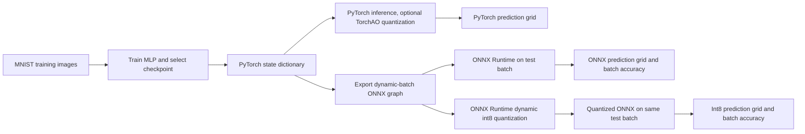

# MNIST MLP to ONNX capstone

- **Created:** 2026-11-20
- **Revised:** 2026-11-21
- **Status:** Implemented
- **Description:** Add a second standalone capstone that classifies MNIST with a multilayer perceptron and carries its weights through ONNX export and ONNX Runtime inference.

## Key decisions

- Use a fully connected MLP rather than another CNN so the capstone demonstrates a genuinely different image-classification architecture. Flattening makes the MLP simple to follow but removes the image's explicit 2D neighborhood structure.
- Reuse TorchVision MNIST. Split its official training set into deterministic train and validation subsets, choose the checkpoint using validation accuracy, and use the official test set only in the ONNX Runtime inference step.
- Keep training, export, and deployment inference in three small scripts so each stage has a visible artifact and a clear command.
- Provide direct full-precision PyTorch inference as well as ONNX Runtime inference. Offer TorchAO dynamic int8 inference on the MLP's `Linear` weights and ONNX Runtime dynamic int8 quantization of the exported graph as separate optional experiments; neither is a training dependency.
- Export with the current `torch.onnx.export` Dynamo-based exporter and a dynamic batch dimension. Validate the ONNX graph with `onnx.checker` and compare runtime logits with PyTorch logits on a small batch.
- Use the CPU `onnxruntime` package as the portable default. Save a graph of training curves and a PNG of predictions from a random test batch.
- Keep ONNX-related dependencies in the example README instead of the site dependency list. Store model files and generated figures under ignored `outputs/`.

## Related page and examples

- [Capstone guide](../../docs/capstone-mnist-onnx/index.md)
- [Training script](../../examples/capstone-mnist-onnx/train_mnist_mlp.py)
- [ONNX export script](../../examples/capstone-mnist-onnx/export_onnx.py)
- [ONNX Runtime inference script](../../examples/capstone-mnist-onnx/infer_onnx.py)
- [ONNX quantization script](../../examples/capstone-mnist-onnx/quantize_onnx.py)
- [PyTorch inference and optional quantization script](../../examples/capstone-mnist-onnx/infer_torch.py)
- [Example run guide](../../examples/capstone-mnist-onnx/README.md)

## Artifact flow

