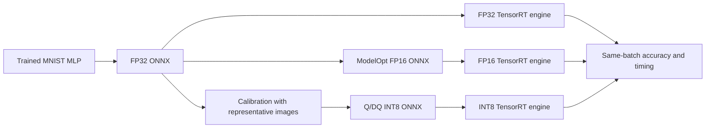

# MNIST TensorRT optimization path

- **Created:** 2026-11-22
- **Status:** Implemented
- **Description:** Extend the model-optimization lesson with a trained MNIST classifier that can be exported to ONNX, built as TensorRT FP32/FP16/INT8 engines, and measured on the same inputs.

## Key decisions

- Reuse the existing MNIST MLP and ONNX export rather than introduce a second trained model.
- Keep portable ONNX Runtime CPU timing as a baseline and make TensorRT an optional NVIDIA GPU workflow.
- Teach FP-to-INT8 mapping with scale and zero point, then use representative MNIST images for calibration and check test-set accuracy after conversion.
- Follow TensorRT 11's strongly typed ONNX workflow: ModelOpt prepares FP16 and calibrated Q/DQ INT8 ONNX graphs, and `trtexec` builds and benchmarks engines. TensorRT 10 command flags differ, so document the target version explicitly.
- Compare engine build time, engine load/startup time, inference latency, throughput, and accuracy as separate measurements.

## Related page and examples

- [Lesson 14](../../docs/modules/04-practical-computer-vision/lesson-14-model-optimization/index.md)
- [MNIST ONNX example](../../examples/capstone-mnist-onnx/README.md)
- [ONNX export](../../examples/capstone-mnist-onnx/export_onnx.py)

## Artifact flow

