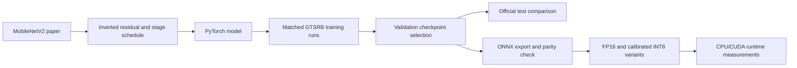

# MobileNetV2 paper-to-GTSRB capstone

- **Created:** 2026-11-22
- **Revised:** 2026-11-22
- **Status:** Implemented
- **Description:** Teach the path from reading the MobileNetV2 architecture paper to implementing and deploying a reduced-width classifier on GTSRB.

## Key decisions

- Keep this as a new standalone capstone, alongside the custom-CNN GTSRB project.
- Use GTSRB and its recording-track-aware training/validation split; reserve its official test set for final model comparison.
- Implement the MobileNetV2 inverted residual stage schedule at width multiplier 0.5 and 96×96 input. Use a matched compact CNN baseline.
- Train both models from scratch with the same preprocessing, augmentation, optimizer, and epoch budget so architecture is the main comparison.
- Export MobileNetV2 to dynamic-batch ONNX, verify FP32 parity, make FP16 and training-calibrated static INT8 variants, and benchmark supported CPU/CUDA provider combinations. Make TensorRT optional because it requires compatible NVIDIA software and hardware.
- Use diagrams and tensor-shape walkthroughs to connect the publication terms to the PyTorch block.

## Related page and examples

- [Capstone guide](../../docs/capstone-mobilenetv2-gtsrb/index.md)
- [Model implementation](../../examples/capstone-mobilenetv2-gtsrb/model.py)
- [Example run guide](../../examples/capstone-mobilenetv2-gtsrb/README.md)

## Experiment flow

