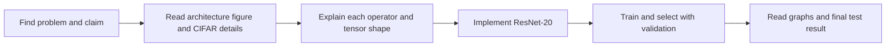

# ResNet-20 paper-to-code capstone

- **Created:** 2026-11-22
- **Status:** Implemented
- **Description:** Teach a beginner to read the original ResNet paper's CIFAR experiments, map its architecture into PyTorch, and interpret a short CIFAR-10 training run.

## Key decisions

- Use the original *Deep Residual Learning for Image Recognition* paper and its CIFAR-style 20-layer network as a stepping stone before the MobileNetV2 capstone.
- Keep the project standalone and use CIFAR-10, with a from-scratch ResNet-20 and a plain CNN comparison trained under the same split and settings.
- Teach each operator through plain-language intuition, a diagram or concrete value example, tensor shapes, the minimal math, and the matching PyTorch code.
- Visualize the network and residual paths in the guide, save a CIFAR-10 sample grid and training/validation graphs, and keep the official test set for the final evaluation.
- Use a short educational run rather than claiming to reproduce the paper's training recipe or results.

## Related guide and example

- [Capstone guide](../../docs/capstone-resnet-cifar10/index.md)
- [Model and training example](../../examples/capstone-resnet-cifar10/README.md)

## Learning flow

