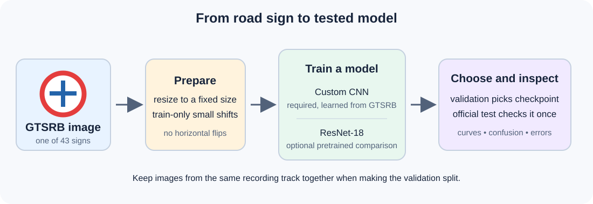

# Capstone — German Traffic Sign Recognition

Build and evaluate a model that classifies small road-sign images into 43 categories. This standalone project applies ideas from the course to a new dataset; it does not add a numbered lesson.

## By the end, you will be able to

- Explain **[GTSRB and its class labels](#1-a-new-task-traffic-sign-recognition)**.
- Build a **[custom CNN](#3-design-the-network)** for a new dataset.
- Compare the custom model with **[optional transfer learning](#3-design-the-network)**.
- Read **[validation and test results](#5-check-the-results-visually)** without mixing their roles.

## Project path

- Inspect a new image dataset and its label classes.
- Design and train a custom CNN baseline.
- Use a track-aware validation split to select a checkpoint.
- Inspect model errors, then evaluate the selected checkpoint on the official test set.
- Optionally compare with an ImageNet-pretrained ResNet-18.

---

## 1. A new task: traffic-sign recognition

The German Traffic Sign Recognition Benchmark (GTSRB) contains road-sign photographs from 43 categories. Images vary in size, lighting, blur, angle, and background. Unlike MNIST or CIFAR-10, the task is tied to a realistic application: a vehicle camera must identify a sign from a small crop.



For this capstone, treat each image as one crop that contains a sign and predict its category. This is **classification**, not object detection: the sign location is already provided by the crop.

---

## 2. Keep validation fair

The official GTSRB training data includes images captured in recording tracks. Neighboring frames from a single track can look very similar. If those frames appear in both training and validation sets, validation may look better than performance on genuinely new captures.

The example groups files by their recording-track filename prefix and creates a deterministic split within each class. It keeps the official test set separate until the validation-selected checkpoint is ready. This is a practical teaching split; for a production evaluation, check the dataset's official protocol and deployment data distribution.

| Set | Used for | When the model sees it |
|---|---|---|
| Training | Update network weights | During every training epoch |
| Validation | Compare epochs and choose saved checkpoint | After each epoch |
| Official test | Final performance estimate | Once, after checkpoint selection |

<div class="quiz" data-answer="b" data-explanation="Keeping related frames together makes validation less likely to reward recognition of near-duplicates from the training tracks.">
  <p><strong>Checkpoint 1:</strong> Why group images by recording track before splitting?</p>
  <label><input type="radio" name="capstone-gtsrb-split" value="a"> It makes every image the same size</label><br>
  <label><input type="radio" name="capstone-gtsrb-split" value="b"> It reduces leakage from near-duplicate frames</label><br>
  <label><input type="radio" name="capstone-gtsrb-split" value="c"> It increases the number of sign classes</label><br>
  <button class="quiz-check" type="button">Check answer</button>
  <p class="quiz-result" aria-live="polite"></p>
</div>

---

## 3. Design the network

Start with a compact CNN built from convolution, Batch Normalization, ReLU, and pooling blocks. A global average pool turns its final feature maps into a vector; the last linear layer returns 43 class scores.

```text
Sign crop [3, 48, 48]
        ↓
Conv → BatchNorm → ReLU → Pool
        ↓
Conv → BatchNorm → ReLU → Pool
        ↓
Conv → BatchNorm → ReLU → Pool
        ↓
Global average pool → Linear
        ↓
43 class scores → predicted sign
```

Small random rotations and translations make training images less repetitive. Do not flip traffic signs horizontally: flipping can change or distort the meaning of a sign. Validation and test images use deterministic preprocessing only.

The required model is the custom CNN. As an optional extension, `--model resnet18` loads pretrained ImageNet weights and fine-tunes the ResNet-18 classifier for 43 sign categories. This comparison asks whether reusable features help this dataset; it does not guarantee better results.

<div class="quiz" data-answer="a" data-explanation="A 43-class classifier needs one output score per traffic-sign category.">
  <p><strong>Checkpoint 2:</strong> How many scores should the final classifier return?</p>
  <label><input type="radio" name="capstone-gtsrb-outputs" value="a"> 43</label><br>
  <label><input type="radio" name="capstone-gtsrb-outputs" value="b"> 3, one per RGB channel</label><br>
  <label><input type="radio" name="capstone-gtsrb-outputs" value="c"> 224, the ResNet input size</label><br>
  <button class="quiz-check" type="button">Check answer</button>
  <p class="quiz-result" aria-live="polite"></p>
</div>

---

## 4. Run the capstone

Install PyTorch, TorchVision, and Matplotlib in the course `.venv` as described in [Setup Lab](../lesson-00-setup-lab/index.md). From the repository root, run:

```bash
uv run python examples/capstone-gtsrb/train_gtsrb.py --help
uv run python examples/capstone-gtsrb/train_gtsrb.py
```

The first full run downloads GTSRB under `data/gtsrb/`. The script uses CUDA when available and CPU otherwise. The default custom CNN trains for a few epochs and saves the best validation checkpoint and plots under `examples/capstone-gtsrb/outputs/`.

To try pretrained ResNet-18, use:

```bash
uv run python examples/capstone-gtsrb/train_gtsrb.py --model resnet18
```

This option downloads pretrained weights on its first run. Runtime depends on device and model. `examples/capstone-gtsrb/README.md` lists the prerequisites, output files, and limitations.

---

## 5. Check the results visually

The run saves four views of the experiment:

- `class_samples.png` shows one training image from each class, so you can see the dataset's visual variety.
- `training_curves.png` compares training and validation loss and accuracy across epochs. A widening gap can be a sign of overfitting.
- `confusion_matrix.png` shows which categories the final test evaluation confuses. The diagonal is correct classification; off-diagonal cells are errors.
- `test_errors.png` shows misclassified test crops with predicted and correct class IDs. Similar-looking signs, blur, crop quality, and lighting can help explain mistakes.

The confusion matrix and error gallery are generated from the official test set after model selection; use them to understand the final result, not to tune more training choices against that same test set.

<div class="quiz" data-answer="c" data-explanation="Validation data guides choices such as which epoch to save. The official test set is reserved for estimating final performance after those choices.">
  <p><strong>Checkpoint 3:</strong> Which split should choose the saved checkpoint?</p>
  <label><input type="radio" name="capstone-gtsrb-checkpoint" value="a"> The official test set</label><br>
  <label><input type="radio" name="capstone-gtsrb-checkpoint" value="b"> The training set only</label><br>
  <label><input type="radio" name="capstone-gtsrb-checkpoint" value="c"> The validation set</label><br>
  <button class="quiz-check" type="button">Check answer</button>
  <p class="quiz-result" aria-live="polite"></p>
</div>

---

## 6. Hands-on project

1. Train the custom CNN and inspect all four output images.
2. Choose one pair of confused classes from the matrix and inspect their test examples.
3. Change one setting at a time, such as the number of epochs or the CNN channel widths. Compare validation curves and keep the test set for the final evaluation.
4. If your hardware supports it, run ResNet-18 and compare its validation-selected test accuracy and error gallery with the custom CNN.
5. Write a short report with the model choice, validation accuracy, final test accuracy, one observed confusion, and one limitation.

### Checkpoint

Have you completed these project outcomes?

- [ ] Trained a custom CNN on GTSRB.
- [ ] Selected a checkpoint using validation data.
- [ ] Looked at the learning curves and at least one test error.
- [ ] Reported final metrics from the official test set.
- [ ] (Optional) Compared pretrained ResNet-18 with the custom model.

---

## Key takeaways

- A new dataset requires checking its labels, image variation, and evaluation split.
- Related frames should remain together when splitting by recording track.
- Validation guides model selection; the official test set estimates final performance.
- A custom CNN provides a baseline, while transfer learning is a comparison to test.

**Continue exploring:** [Roadmap](../roadmap.md) · [Syllabus](../syllabus.md) · [Vocabulary](../vocabulary.md)
