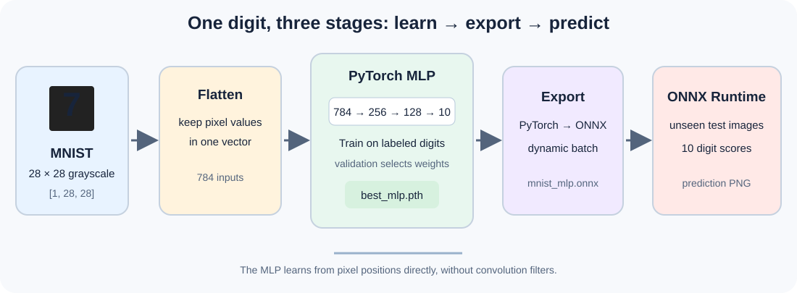
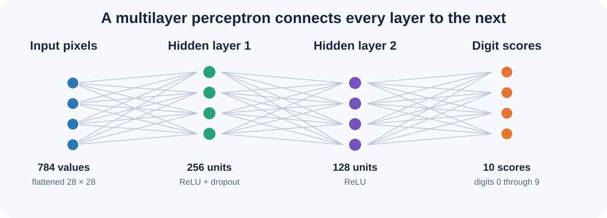
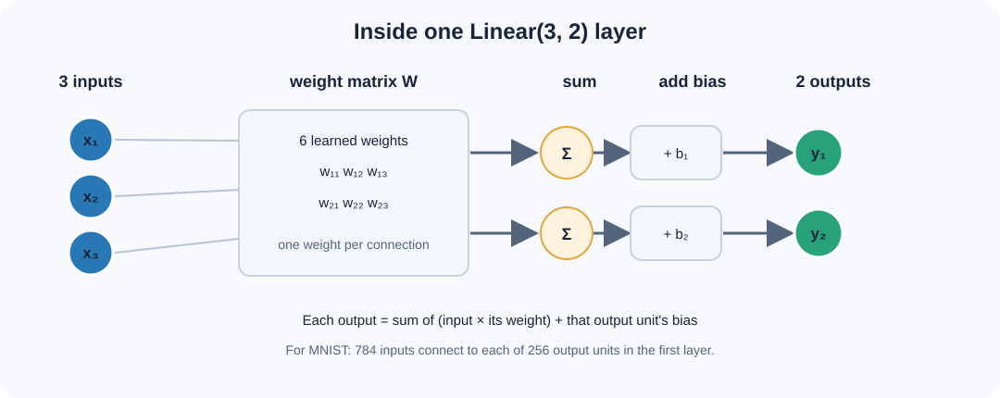

# Capstone — MNIST MLP to ONNX

Train a **different kind of network** on MNIST, export it to ONNX, and use ONNX Runtime to classify a random batch of handwritten digits. This project is standalone and does not add another numbered lesson.

## By the end, you will be able to

- Explain how an **[MLP](#2-design-a-fully-connected-network)** classifies flattened digit pixels.
- **[Train and select](#4-train-and-choose-a-checkpoint)** a model using separate training and validation data.
- Run **[PyTorch inference](#5-run-inference-with-pytorch)** and optionally **[quantize](#6-quantize-the-linear-layers)** the MLP.
- **[Export](#7-export-to-onnx)** trained PyTorch weights to the ONNX format.
- Run **[ONNX Runtime inference](#8-predict-a-random-test-batch)** and inspect its digit predictions.
- **[Quantize the ONNX model](#9-quantize-the-onnx-model)** and compare its predictions with the float model.

## Steps in this project

- Set up the example dependencies and load MNIST.
- Build and train a multilayer perceptron (MLP), not a CNN.
- Save the best validation checkpoint.
- Run the trained model directly in PyTorch and optionally quantize its linear layers.
- Export a batch-flexible ONNX model.
- Use ONNX Runtime to predict labels for unseen test images and save a visual result.
- Create a separate dynamic int8 ONNX model and compare its inference results.



---

## 1. Prepare the environment and dataset

Complete [0 - Setup Lab](../lesson-00-setup-lab/index.md) to create the course `.venv` and install PyTorch 2.6 or newer, TorchVision, and Matplotlib. Add ONNX export and CPU inference packages from the repository root:

```bash
uv pip install --python .venv/bin/python onnx onnxscript onnxruntime
```

MNIST contains 60,000 training and 10,000 test images. The example downloads the dataset to the repository's ignored `data/mnist/` directory if needed. Each image is grayscale and has tensor shape `[1, 28, 28]`.

---

## 2. Design a fully connected network

The Lesson 4 CNN uses filters that scan local image neighborhoods. This capstone uses a **multilayer perceptron (MLP)**. It flattens each image into 784 numbers, then connects every value to learned hidden units.



```text
Image [1, 28, 28]
       ↓ flatten
784 pixel values
       ↓ Linear + ReLU + Dropout
256 hidden values
       ↓ Linear + ReLU
128 hidden values
       ↓ Linear
10 digit scores (0–9)
```

The MLP has no convolution or pooling. It can learn from the position of each pixel, but flattening does not explicitly preserve which pixels are neighbors. A CNN's shared filters provide that local image structure. Comparing these models helps show why architecture matters.

The final layer returns **logits**, one raw score for each digit. We choose the index of the largest score as the predicted digit.

<div class="quiz" data-answer="c" data-explanation="A 28 by 28 image contains 784 pixel values, which form the MLP's flattened input vector.">
  <p><strong>Checkpoint 1:</strong> How many pixel values does one 28 × 28 MNIST image provide to the MLP?</p>
  <label><input type="radio" name="mnist-onnx-mlp-input" value="a"> 28</label><br>
  <label><input type="radio" name="mnist-onnx-mlp-input" value="b"> 10</label><br>
  <label><input type="radio" name="mnist-onnx-mlp-input" value="c"> 784</label><br>
  <button class="quiz-check" type="button">Check answer</button>
  <p class="quiz-result" aria-live="polite"></p>
</div>

---

## 3. Read the model code

The model is defined in `examples/capstone-mnist-onnx/train_mnist_mlp.py`:

```python
--8<-- "examples/capstone-mnist-onnx/train_mnist_mlp.py:model"
```

`__init__` declares the layers and their trainable weights. `forward` sends each batch through that sequence. If the batch has 128 images, the shapes progress as follows:

| Operation | Batch shape | What changed |
|---|---|---|
| MNIST input | `[128, 1, 28, 28]` | 128 grayscale images |
| `Flatten` | `[128, 784]` | Each image becomes one row of pixel values |
| `Linear(784, 256)` | `[128, 256]` | Each image becomes 256 learned values |
| `Linear(256, 128)` | `[128, 128]` | The representation becomes 128 values |
| `Linear(128, 10)` | `[128, 10]` | One raw score (logit) for each digit |

The first dimension always counts images in the batch. `ReLU` changes values but not shape. `Dropout` randomly masks some hidden values while training; `model.eval()` disables it for validation and inference. `nn.Sequential` means the input passes through these layers in the order shown.

### What do the two sizes in `Linear` mean?

In PyTorch, `nn.Linear(input_size, output_size)` means: **take this many input values and produce that many output values**. The batch size is not one of these numbers.

For example, if a batch contains 64 images, their shape is `[64, 1, 28, 28]`. `Flatten` changes it to `[64, 784]`: 64 images, each represented by 784 pixel values. The first linear layer then changes `[64, 784]` into `[64, 256]`. It creates 256 learned values for each image.

| Code setting or layer | Input values per image | Output values per image | Why this size? |
|---|---:|---:|---|
| `INPUT_FEATURES = 1 × 28 × 28` | — | 784 | One grayscale channel with 28 × 28 pixels. |
| `nn.Linear(INPUT_FEATURES, HIDDEN_UNITS[0])` | 784 | 256 | Each hidden unit learns a different combination of all 784 pixels. |
| `nn.Linear(HIDDEN_UNITS[0], HIDDEN_UNITS[1])` | 256 | 128 | Combines the previous 256 learned values into a smaller representation. |
| `nn.Linear(HIDDEN_UNITS[1], NUM_CLASSES)` | 128 | 10 | Produces one score for each digit from 0 through 9. |

`256` and `128` are design choices for the two hidden layers, not values imposed by MNIST. We choose a moderate size to keep the example simple. Wider layers can learn more combinations but use more parameters and computation; they do not guarantee better accuracy. The final size **must** be 10 for this task because MNIST has ten digit classes.

Each `Linear` layer learns connections between all inputs and outputs. ReLU lets the model build nonlinear combinations. Dropout is used only while training to reduce reliance on any single hidden unit; it does not change the layer size. The last layer returns 10 logits, and the training loss consumes those logits directly.

### What happens inside one `Linear` layer?

Every output unit has one learned **weight** for every input value, plus one learned **bias**. It multiplies each input by its matching weight, adds the products, then adds the bias. That gives one output value. The layer repeats this for every output unit.



For an easy-to-read toy example, imagine a layer with 3 inputs and 2 outputs:

```text
input values:       [x₁, x₂, x₃]

weights for unit 1: [w₁₁, w₁₂, w₁₃]   bias: b₁
weights for unit 2: [w₂₁, w₂₂, w₂₃]   bias: b₂

output 1 = x₁w₁₁ + x₂w₁₂ + x₃w₁₃ + b₁
output 2 = x₁w₂₁ + x₂w₂₂ + x₃w₂₃ + b₂
```

In compact notation, the operation is **`output = input × weightsᵀ + bias`**. The weights and biases are learned during training. In a MNIST example, the input values are pixels or learned values from the previous layer.

For the capstone's first layer, `nn.Linear(784, 256)` stores a weight matrix shaped `[256, 784]` and a bias vector shaped `[256]`. Each of its 256 output units has 784 weights and one bias, for `256 × 784 + 256 = 200,960` learnable values. For a batch, PyTorch applies those same learned weights to every row, so `[64, 784]` becomes `[64, 256]`.

<div class="quiz" data-answer="b" data-explanation="The first number is how many features arrive from the previous step; the second is how many values this layer produces.">
  <p><strong>Checkpoint 2:</strong> What shape change does <code>nn.Linear(256, 128)</code> make for each image?</p>
  <label><input type="radio" name="mnist-onnx-linear-size" value="a"> 128 values become 256</label><br>
  <label><input type="radio" name="mnist-onnx-linear-size" value="b"> 256 values become 128</label><br>
  <label><input type="radio" name="mnist-onnx-linear-size" value="c"> 256 images become 128 images</label><br>
  <button class="quiz-check" type="button">Check answer</button>
  <p class="quiz-result" aria-live="polite"></p>
</div>

---

## 4. Train and choose a checkpoint

Run training from the repository root:

```bash
uv run python examples/capstone-mnist-onnx/train_mnist_mlp.py
```

The script splits MNIST's 60,000 training images into 55,000 training examples and 5,000 validation examples. It saves the model weights from the epoch with the highest validation accuracy as `outputs/best_mlp.pth`. It also saves `outputs/training_curves.png`.

### Load MNIST and make batches

The loader downloads the official training split, converts each image to a float tensor, then separates training and validation examples. The fixed seed makes the split repeatable. The official test split is not loaded here, so it cannot influence training or checkpoint selection.

```python
--8<-- "examples/capstone-mnist-onnx/train_mnist_mlp.py:loaders"
```

`DataLoader` groups examples into batches of 128. Each batch contains images shaped `[batch, 1, 28, 28]` and labels shaped `[batch]`. Only the training loader shuffles the order each epoch.

### What one training or validation pass does

Both modes call the same function. Passing an optimizer means “train this epoch”; leaving it out means “measure this epoch without changing weights.”

```python
--8<-- "examples/capstone-mnist-onnx/train_mnist_mlp.py:run_epoch"
```

During training, `zero_grad()` clears old gradients, the forward pass produces ten logits per image, and `CrossEntropyLoss` compares them with the true digit labels. `backward()` computes gradients, then `optimizer.step()` adjusts the model's weights. During validation, gradients are disabled and Dropout is off, so the script only measures loss and accuracy.

Loss is averaged across all examples rather than averaging batch means equally. This matters because the final batch may contain fewer than 128 images. Accuracy counts correct predictions from `argmax`, the index of the largest logit.

### Train and keep the best epoch

Each epoch calls `run_epoch` once with the optimizer to update weights, then again without it to measure validation performance. The loop keeps the weights from the epoch with the highest validation accuracy:

```python
--8<-- "examples/capstone-mnist-onnx/train_mnist_mlp.py:epoch_loop"
```

```text
Training images ──► update MLP weights
Validation images ──► choose the best epoch
Test images ──► held back for ONNX inference
```

Do not use test accuracy to choose epochs or adjust the network. Keep the test images aside until the inference steps.

The loop stores one training and validation loss and accuracy value per epoch. When validation accuracy improves, `state_dict()` saves just the learned parameters to `best_mlp.pth`. The model structure is recreated by the export and inference scripts before those weights are loaded. After the last epoch, Matplotlib writes the four metric curves to `training_curves.png`.

<div class="quiz" data-answer="a" data-explanation="Validation performance is used for model selection, while the test set is reserved for the final evaluation.">
  <p><strong>Checkpoint 3:</strong> Which split should decide which training epoch to save?</p>
  <label><input type="radio" name="mnist-onnx-checkpoint" value="a"> Validation</label><br>
  <label><input type="radio" name="mnist-onnx-checkpoint" value="b"> Test</label><br>
  <label><input type="radio" name="mnist-onnx-checkpoint" value="c"> Neither; choose randomly</label><br>
  <button class="quiz-check" type="button">Check answer</button>
  <p class="quiz-result" aria-live="polite"></p>
</div>

---

## 5. Run inference with PyTorch

The checkpoint can run directly in PyTorch too. This loads `best_mlp.pth`, switches the model to evaluation mode, disables gradient tracking, and predicts a reproducible batch from the test set.

```bash
uv run python examples/capstone-mnist-onnx/infer_torch.py
```

```python
--8<-- "examples/capstone-mnist-onnx/infer_torch.py:torch_inference"
```

It saves and opens `outputs/torch_predictions.png`, with the true digit and PyTorch prediction above each image. This is inference: the weights are loaded, but not updated.

---

## 6. Quantize the linear layers

Yes. This MLP is a reasonable quantization candidate because most of its learned parameters are in `Linear` layers. **Dynamic int8 quantization** stores linear weights in a lower-precision form and determines activation scales at inference time. It does not retrain the model or change its ten output classes.

The project uses TorchAO's current quantization API. Install a TorchAO build compatible with the PyTorch version in your `.venv` using the [official TorchAO installation guidance](https://docs.pytorch.org/ao/stable/), then run:

```bash
uv pip install --python .venv/bin/python torchao
uv run python examples/capstone-mnist-onnx/infer_torch.py --quantized
```

The `--quantized` option applies the dynamic int8 configuration to the loaded PyTorch model in memory:

```python
--8<-- "examples/capstone-mnist-onnx/infer_torch.py:quantization"
```

The script saves `outputs/torch_quantized_predictions.png` and prints accuracy for the same reproducible 16-image test batch. Compare it with `torch_predictions.png`. Quantization can slightly change scores or predictions. The MLP is small, so reduced weight storage is possible, but faster inference is not guaranteed; measure it on your target device. The original checkpoint remains full precision, and ONNX export still uses that checkpoint. Quantizing an ONNX model is a separate workflow.

<div class="quiz" data-answer="c" data-explanation="Dynamic quantization is a post-training option for the MLP's Linear layers. Compare accuracy and runtime on the target device because quantization can affect results and does not guarantee a speedup.">
  <p><strong>Checkpoint 5:</strong> What should you check after quantizing the MLP?</p>
  <label><input type="radio" name="mnist-onnx-quantization" value="a"> Only whether the model still has ten output classes</label><br>
  <label><input type="radio" name="mnist-onnx-quantization" value="b"> Nothing; quantization guarantees identical results and faster inference</label><br>
  <label><input type="radio" name="mnist-onnx-quantization" value="c"> Accuracy and runtime on the intended device</label><br>
  <button class="quiz-check" type="button">Check answer</button>
  <p class="quiz-result" aria-live="polite"></p>
</div>

---

## 7. Export to ONNX

Once the best PyTorch checkpoint is saved, export it:

```bash
uv run python examples/capstone-mnist-onnx/export_onnx.py
```

The exporter writes `outputs/mnist_mlp.onnx`. It marks the batch dimension as dynamic, so the same exported graph can accept one image or a batch of images. The script checks the ONNX graph and compares its output with PyTorch for a small sample batch.

```python
--8<-- "examples/capstone-mnist-onnx/export_onnx.py:export"
```

**ONNX** is a model exchange format. Exporting stores the learned computation and parameters in a graph that supported runtimes can load. ONNX Runtime executes that graph; the PyTorch training code is not needed for inference.

<div class="quiz" data-answer="b" data-explanation="ONNX lets a supported runtime load the exported model graph and weights without using the original PyTorch training loop.">
  <p><strong>Checkpoint 4:</strong> What does the ONNX file contain for this project?</p>
  <label><input type="radio" name="mnist-onnx-export" value="a"> The original MNIST image files only</label><br>
  <label><input type="radio" name="mnist-onnx-export" value="b"> The model computation and learned parameters</label><br>
  <label><input type="radio" name="mnist-onnx-export" value="c"> A copy of the Python virtual environment</label><br>
  <button class="quiz-check" type="button">Check answer</button>
  <p class="quiz-result" aria-live="polite"></p>
</div>

---

## 8. Predict a random test batch

Run the exported model with ONNX Runtime:

```bash
uv run python examples/capstone-mnist-onnx/infer_onnx.py
```

The script loads a shuffled batch from MNIST's official test set, runs it through `mnist_mlp.onnx`, and saves `outputs/onnx_predictions.png`. Each image shows the correct label and the ONNX Runtime prediction; green titles are correct and red titles are mistakes. The script also prints the batch accuracy and opens the saved figure when a graphical display is available.

```python
--8<-- "examples/capstone-mnist-onnx/infer_onnx.py:inference"
```

Open `examples/capstone-mnist-onnx/outputs/onnx_predictions.png` after the script runs. The output folder is ignored by Git, so the image appears on your computer after inference rather than in the published course site.

---

## 9. Quantize the ONNX model

The earlier optional quantization step changes the PyTorch model in memory. Here, ONNX Runtime quantizes the **exported ONNX file** directly. Dynamic int8 quantization stores supported weights in 8-bit form and calculates activation scales during inference. This MLP is a reasonable model to try because its learned weights are concentrated in fully connected layers. ONNX Runtime provides this through `quantize_dynamic()`; this dynamic workflow does not require a calibration dataset. [Official ONNX Runtime quantization guide](https://onnxruntime.ai/docs/performance/model-optimizations/quantization.html).

First, export the trained model as described above. Then create a separate quantized file:

```bash
uv run python examples/capstone-mnist-onnx/quantize_onnx.py
```

The script reads `outputs/mnist_mlp.onnx`, writes `outputs/mnist_mlp_int8.onnx`, and checks the resulting ONNX graph. It leaves the original float model unchanged:

```python
--8<-- "examples/capstone-mnist-onnx/quantize_onnx.py:quantization"
```

Use the same reproducible test batch to compare full-precision and quantized ONNX inference:

```bash
uv run python examples/capstone-mnist-onnx/infer_onnx.py
uv run python examples/capstone-mnist-onnx/infer_onnx.py --quantized
```

The second command loads `mnist_mlp_int8.onnx` and saves `outputs/onnx_int8_predictions.png`. Compare its printed batch accuracy and image titles with `onnx_predictions.png`. The batch is useful for inspection, but it is not a full test-set evaluation.

Quantization can change scores and predictions. A smaller file does not guarantee faster inference: this model is small, and integer-operation support and conversion overhead depend on the CPU. Measure both models on the hardware where you plan to run them.

---

## Hands-on: compare an MLP with a CNN

1. Run the MLP training, export, and inference commands in order.
2. Note the validation accuracy and the test-batch accuracy printed by the ONNX script.
3. Compare the architecture with [Lesson 4's CNN](../modules/01-cnn-fundamentals/lesson-04-build-first-cnn-pytorch/index.md). What spatial information does flattening make less explicit?
4. Change one MLP hidden-layer width in the named constants and retrain. Compare the training curves and the same test-batch predictions.
5. As a next experiment, run the Lesson 4 CNN and compare both models on the same test images.

## Key takeaways

- An MLP is a valid image classifier that learns from flattened pixel values.
- Training selects weights; ONNX export packages the model for a separate runtime.
- ONNX Runtime can make predictions without loading the original PyTorch training code.
- ONNX Runtime can create and run an int8 version of the exported model; compare its accuracy and speed with the float model.
- The visual test batch helps inspect mistakes, while the larger test set should be used for a final accuracy measurement.

**Official references:** [PyTorch ONNX exporter](https://docs.pytorch.org/docs/stable/onnx.html) · [ONNX Runtime Python guide](https://onnxruntime.ai/docs/get-started/with-python.html) · [TorchAO quantization](https://docs.pytorch.org/ao/stable/workflows/inference.html)

**Related:** [Lesson 4 — Build a CNN in PyTorch](../modules/01-cnn-fundamentals/lesson-04-build-first-cnn-pytorch/index.md) · [German Traffic Sign Recognition capstone](../capstone-gtsrb/index.md)
