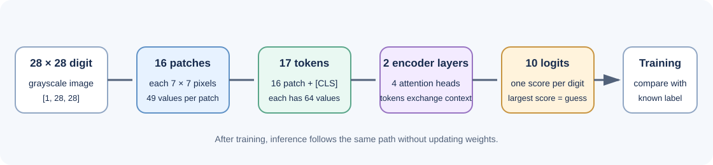
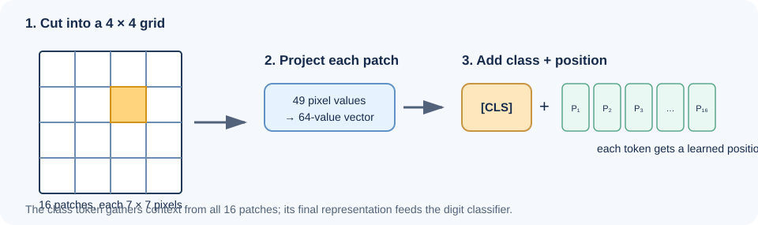

# Capstone — Recognize MNIST with a Vision Transformer

Build a small **Vision Transformer (ViT)**, train it to recognize handwritten digits, and run PyTorch inference on unseen examples.

## By the end, you will be able to

- Explain how **[patches become tokens](#2-cut-the-image-into-patches)** and why a ViT adds position information.
- Trace a **[class token through the encoder](#3-build-the-transformer-input)** to ten digit scores.
- **[Train and select](#5-train-the-model)** a model using training and validation data.
- Run **[inference in PyTorch](#6-classify-unseen-digits)** and inspect the predictions visually.

## Is a capstone enough, or do I need a full Transformer course?

For this project, a step-by-step capstone is enough. The course's [Vision Transformer lesson](../modules/03-modern-computer-vision/lesson-11-vision-transformers/index.md) introduces patches and attention; here we connect those ideas to a complete training and inference workflow. You do not need to study every Transformer equation first.

A dedicated Transformer course becomes useful if you want to derive attention mathematically, compare encoder and decoder models, understand language models, or study large-scale pretraining and modern ViT variants. This capstone uses PyTorch's reference encoder layers so you can focus on how the parts fit together.

This is a learning model, not a claim that ViTs are better than CNNs on MNIST. MNIST is small and simple, and a compact CNN is usually a more natural baseline.



---

## 1. Prepare the environment

Complete [0 - Setup Lab](../lesson-00-setup-lab/index.md) and install PyTorch, TorchVision, and Matplotlib in the course `.venv`. Then run commands from the repository root. The scripts download MNIST into `data/mnist/` if it is not already there.

```bash
uv run python examples/capstone-mnist-vit/train_vit_mnist.py
uv run python examples/capstone-mnist-vit/infer_vit_mnist.py
```

The first command trains and saves `examples/capstone-mnist-vit/outputs/best_vit.pth` and `training_curves.png`. The second loads the checkpoint, evaluates a shuffled batch from MNIST's official test split, and saves `vit_predictions.png`.

---

## 2. Cut the image into patches

MNIST provides one-channel images shaped `[1, 28, 28]`. This model uses non-overlapping **7 × 7 patches**. Each side has `28 / 7 = 4` patches, giving 16 patches total. A patch contains `7 × 7 = 49` grayscale pixel values.



`nn.Unfold` extracts each patch. A linear projection turns its 49 pixel values into a 64-value **patch embedding**. The embedding size is a design choice: it gives each patch a shared feature representation for attention.

For a batch of 32, patchification has shape `[32, 49, 16]`. Transposing makes it `[32, 16, 49]`: 32 images, 16 patches, and 49 values per patch. After projection, the shape is `[32, 16, 64]`.

---

## 3. Build the Transformer input

The model prepends a learned **class token** (`[CLS]`) to the 16 patch embeddings. It is a summary slot: self-attention lets it gather information from the image patches. A learned position vector is added to every token so the model can distinguish, for example, the top-left patch from the bottom-right patch.

```text
16 patch embeddings [batch, 16, 64]
                  + [CLS] token
                  + position embeddings
                  ↓
17 tokens [batch, 17, 64]
```

The Transformer encoder processes tokens as `[batch, sequence, feature]`. PyTorch's `batch_first=True` uses this ordering, and `TransformerEncoder` stacks the requested number of encoder layers. [PyTorch TransformerEncoderLayer](https://docs.pytorch.org/docs/stable/generated/torch.nn.TransformerEncoderLayer.html) · [PyTorch TransformerEncoder](https://docs.pytorch.org/docs/stable/generated/torch.nn.TransformerEncoder.html).

The complete model definition is in `examples/capstone-mnist-vit/mnist_vit.py`:

```python
--8<-- "examples/capstone-mnist-vit/mnist_vit.py:model"
```

This example uses two encoder layers, four attention heads, and 64 features per token. The classifier reads the encoded `[CLS]` vector and maps its 64 values to ten **logits**, one per digit. Training uses the raw logits with cross-entropy loss.

---

## 4. Understand the shape changes

For one image, the important sizes are:

| Step | Shape | Meaning |
|---|---|---|
| Input | `[1, 1, 28, 28]` | One image, grayscale channel, height, width |
| Patchify | `[1, 16, 49]` | 16 patches with 49 pixels each |
| Project | `[1, 16, 64]` | Each patch represented by a 64-value embedding |
| Add `[CLS]` and positions | `[1, 17, 64]` | 16 image tokens plus one summary token |
| Encoder output | `[1, 17, 64]` | Contextualized token vectors |
| Select `[CLS]` | `[1, 64]` | One vector summarizes image context |
| Classifier | `[1, 10]` | Ten digit scores |

The batch dimension stays at the front. A batch of 128 images follows the same path with `128` in place of `1`.

---

## 5. Train the model

The training script reserves 5,000 images from MNIST's 60,000-image training split for validation. The official 10,000-image test split stays unseen during training and checkpoint selection.

```bash
uv run python examples/capstone-mnist-vit/train_vit_mnist.py
```

For every batch, it predicts logits, compares them with the correct digit labels, backpropagates the loss, and updates the parameters. At each epoch, it checks validation accuracy and saves the best checkpoint. It also saves a graph of training and validation loss and accuracy.

```text
Training images → update ViT weights
Validation images → choose checkpoint
Test images → final visual inference
```

The run uses five epochs as a compact demonstration. Accuracy and training time depend on hardware and random initialization; the goal is to understand the workflow, not to promise a benchmark.

---

## 6. Classify unseen digits

Run the inference script after training:

```bash
uv run python examples/capstone-mnist-vit/infer_vit_mnist.py
```

It loads the best checkpoint, switches to evaluation mode, disables gradient calculation, and predicts a reproducibly shuffled batch of 16 images from MNIST's official test set. Correct predictions appear with green titles; mistakes appear in red. The PNG is saved in the example's `outputs/` directory and displayed by Matplotlib.

Batch accuracy is only a visual sample, not full test-set accuracy. Training changes model weights; inference uses the saved weights without updating them.

---

## Hands-on: change the patch size

1. Run the example with `PATCH_SIZE = 7` and note that each image gives 16 patch tokens.
2. Change `PATCH_SIZE` to 4. The image now gives 49 patch tokens, each containing 16 pixel values.
3. Retrain and compare the training curve and prediction grid. Smaller patches create more tokens, which means more attention computation.

The image size must be divisible by the patch size in this simple example. The checkpoint must be retrained after changing patch size because the model's patch projection and position embedding shapes change.

---

## Check your understanding

<div class="quiz" data-answer="b" data-explanation="A 28 by 28 image has four 7-pixel patches along each side, for 4 × 4 = 16 patches.">
  <p><strong>Checkpoint 1:</strong> How many 7 × 7 patches come from a 28 × 28 MNIST image?</p>
  <label><input type="radio" name="mnist-vit-patch-count" value="a"> 7</label><br>
  <label><input type="radio" name="mnist-vit-patch-count" value="b"> 16</label><br>
  <label><input type="radio" name="mnist-vit-patch-count" value="c"> 49</label><br>
  <button class="quiz-check" type="button">Check answer</button>
  <p class="quiz-result" aria-live="polite"></p>
</div>

<div class="quiz" data-answer="a" data-explanation="The learned class token is prepended to the patch tokens and gathers image context through self-attention. Its final vector is sent to the classifier.">
  <p><strong>Checkpoint 2:</strong> What does the classifier use to produce the ten digit scores?</p>
  <label><input type="radio" name="mnist-vit-class-token" value="a"> The encoded class token</label><br>
  <label><input type="radio" name="mnist-vit-class-token" value="b"> The first raw 7 × 7 patch only</label><br>
  <label><input type="radio" name="mnist-vit-class-token" value="c"> The validation labels</label><br>
  <button class="quiz-check" type="button">Check answer</button>
  <p class="quiz-result" aria-live="polite"></p>
</div>

<div class="quiz" data-answer="c" data-explanation="The validation split helps choose a checkpoint during training. The test split stays held out for final inference and evaluation.">
  <p><strong>Checkpoint 3:</strong> Which dataset split should be used to choose the best training checkpoint?</p>
  <label><input type="radio" name="mnist-vit-split" value="a"> The official test split</label><br>
  <label><input type="radio" name="mnist-vit-split" value="b"> The inference batch</label><br>
  <label><input type="radio" name="mnist-vit-split" value="c"> The validation split</label><br>
  <button class="quiz-check" type="button">Check answer</button>
  <p class="quiz-result" aria-live="polite"></p>
</div>

---

## What you learned

- A ViT turns image patches into embedded tokens and adds position information.
- A class token gathers context from image patches through self-attention.
- A compact PyTorch ViT can be trained with the same prediction, loss, backpropagation, and optimizer cycle used for CNNs.
- Inference loads trained weights and predicts unseen digits without updating them.

**Related:** [Lesson 11 — Vision Transformers](../modules/03-modern-computer-vision/lesson-11-vision-transformers/index.md) introduces the concepts. Compare this capstone with [MNIST MLP to ONNX](../capstone-mnist-onnx/index.md) and the [CNN workflow in Lesson 4](../modules/01-cnn-fundamentals/lesson-04-build-first-cnn-pytorch/index.md).
