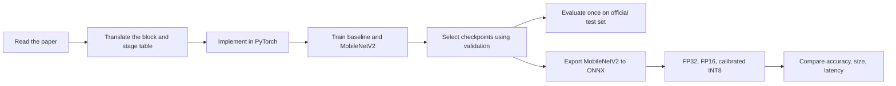
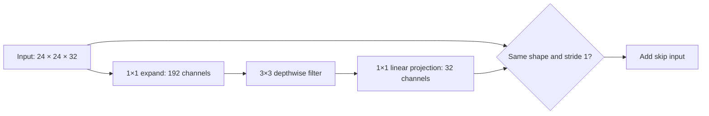

# Capstone — From MobileNetV2 Paper to GTSRB Deployment

## By the end, you will be able to

- Read a research paper for its **[problem, idea, and evidence](#1-read-the-paper-with-a-purpose)**.
- Explain the **[inverted residual block](#2-understand-one-block-before-the-whole-network)** and its tensor shapes.
- Implement a **[small MobileNetV2](#3-turn-the-paper-into-pytorch)** from the paper's stage schedule.
- Train and compare it with a **[small CNN baseline](#4-train-and-compare)** on GTSRB.
- **[Export and optimize](#5-export-to-onnx-and-change-precision)** the trained model with ONNX Runtime.
- Interpret **[latency, accuracy, and model-size results](#6-read-the-results-and-optionally-use-tensorrt)** for the hardware that ran them.

## Project path

- Read the publication's architecture contribution and separate it from its ImageNet training experiment.
- Trace a single inverted residual block with concrete shapes.
- Train the baseline and MobileNetV2 on the same track-aware GTSRB split.
- Export the MobileNetV2 checkpoint, validate ONNX outputs, then compare available precision/runtime combinations.
- Inspect plots and predictions, and write down the hardware and runtime with each measurement.



---

## 1. Read the paper with a purpose

Start with the original [MobileNetV2 paper](https://arxiv.org/abs/1801.04381), *Inverted Residuals and Linear Bottlenecks*. The first read is not a memory test. Find three things:

1. **Problem:** mobile vision models need to use fewer operations and less memory while retaining useful accuracy.
2. **Main idea:** expand a narrow feature representation, filter it with a depthwise convolution, then project it back through a linear bottleneck.
3. **Evidence:** the authors compare accuracy and computation on ImageNet and also adapt the network to detection and segmentation. This capstone implements the classifier architecture; it does not reproduce the full training recipe or paper results.

When reading a model paper, skim the abstract and introduction for the problem and claimed contribution. Then inspect the architecture figure and table for the recipe. Read the block-specific explanation next. Leave training details and result tables until you know what the model computes. Ask, “Which operation or connection in the paper becomes which line in my model?”

| Paper clue | Implementation question |
|---|---|
| Inverted residual | Which tensors are connected by the skip? |
| Expansion ratio `t` | How many channels does the block temporarily create? |
| Depthwise convolution | Does each channel have its own spatial filter? |
| Linear bottleneck | Is there an activation after the final projection? |
| Stage table | How many blocks, output channels, and first-block stride are used? |

**Checkpoint 1:** Why implement the architecture without reproducing the ImageNet training setup? It isolates the paper's model design as a teachable, runnable experiment on available data.

---

## 2. Understand one block before the whole network

The block begins with a narrow tensor, expands its channels, applies a depthwise spatial filter, and projects back to a narrow tensor. The skip connection links the narrow endpoints, so the residual is “inverted” compared with the familiar wide-middle ResNet bottleneck. The projection is linear: there is no ReLU after it. A skip can add the input only when stride and tensor shape allow it.



Here is a tiny shape example. A batch starts as `[4, 32, 24, 24]`, where the dimensions are `[batch, channels, height, width]`. With expansion ratio `6`, the expansion layer produces `[4, 192, 24, 24]`. A stride-two depthwise filter reduces the spatial dimensions to `[4, 192, 12, 12]`; projection to 32 channels gives `[4, 32, 12, 12]`. That block cannot add its original input because the spatial shape changed. In a stride-one block with matching channel counts, the residual addition is valid.

The depthwise operation is cheap because it filters each channel independently. For example, a full 3×3 convolution mapping 32 input channels to 192 output channels has `3 × 3 × 32 × 192 = 55,296` weights. A depthwise 3×3 convolution over 192 channels has `3 × 3 × 192 = 1,728` weights. The following 1×1 projection mixes information across channels.

<div class="quiz" data-answer="b" data-explanation="The linear projection deliberately has no ReLU, and the skip is only added when both spatial size and channel count match.">
  <p><strong>Checkpoint 2:</strong> Which condition makes a residual addition shape-safe?</p>
  <label><input type="radio" name="mnv2-residual-shape" value="a"> The block must always have stride two</label><br>
  <label><input type="radio" name="mnv2-residual-shape" value="b"> Stride is one and input and output channels are equal</label><br>
  <label><input type="radio" name="mnv2-residual-shape" value="c"> The expansion ratio must be one</label><br>
  <button class="quiz-check" type="button">Check answer</button>
  <p class="quiz-result" aria-live="polite"></p>
</div>

---

## 3. Turn the paper into PyTorch

The full runnable implementation is `examples/capstone-mobilenetv2-gtsrb/model.py`. We build it in four steps so each code choice answers a question found in the paper.

### Step 1: Turn the paper's stage table into data

The paper lists each stage by expansion ratio `t`, output channels `c`, number of blocks `n`, and stride `s` for the first block. We record those values directly, in order. Keeping this as data makes the architecture recipe visible without hiding it in a long list of manually written layers.

```python
--8<-- "examples/capstone-mobilenetv2-gtsrb/model.py:stage_settings"
```

For example, `(6, 24, 2, 2)` means: expand by 6, produce 24 output channels before width scaling, repeat the block twice, and downsample in the first block. The second block uses stride 1 so it preserves the stage's new resolution. The first stage `(1, 16, 1, 1)` does not need an expansion layer because its expansion ratio is 1.

### Step 2: Scale channel counts for a small model

The **width multiplier** scales the stage channels. With `WIDTH_MULTIPLIER = 0.5`, a paper stage with 24 channels asks for 12 channels. The helper rounds this to 16, a multiple of 8 that keeps the requested width from shrinking too far. This alignment is a practical implementation choice for efficient kernels; it does not change the operation defined by the paper.

```python
--8<-- "examples/capstone-mobilenetv2-gtsrb/model.py:channel_rounding"
```

The project keeps the 1280-channel final feature head used in the paper's standard classifier recipe. It changes the class-specific final layer from ImageNet's 1000 outputs to GTSRB's 43 outputs.

### Step 3: Implement the inverted residual block

Now translate the paper's block into PyTorch layers. Read the code from top to bottom:

```python
--8<-- "examples/capstone-mobilenetv2-gtsrb/model.py:inverted_residual"
```

| Code choice | What it means |
|---|---|
| `hidden_channels = input_channels * expansion` | Choose the wide inner representation. For 32 channels and `t=6`, this is 192 channels. |
| Optional `Conv2d(..., kernel_size=1)` | A pointwise convolution mixes channels and expands them. It is omitted for `t=1`. |
| `groups=hidden_channels` in the 3×3 convolution | Each of the 192 channels gets its own spatial filter: a depthwise convolution. |
| `stride=stride` and `padding=1` | Stride 2 halves height and width; padding keeps them unchanged at stride 1. |
| Final 1×1 convolution and BatchNorm | Project the wide features back to the narrow output channel count. There is intentionally no ReLU here. |
| `images + output` only when `use_residual` | Add the shortcut only if input and output have matching channels and unchanged spatial dimensions. |

In the earlier shape example, `[4, 32, 24, 24]` expands to `[4, 192, 24, 24]`. With stride 2, depthwise filtering yields `[4, 192, 12, 12]`, and projection returns `[4, 32, 12, 12]`. The original input is `[4, 32, 24, 24]`, so adding it would be invalid. A later stride-one block with equal input and output channels can use the skip.

### Step 4: Stack stages and replace the classifier

The network applies a stride-two stem, walks through the stage schedule, then averages each final feature map to one value. Global average pooling avoids hard-coding a flattened spatial size. The final linear layer emits one score for each sign class.

```python
--8<-- "examples/capstone-mobilenetv2-gtsrb/model.py:mobilenetv2"
```

For the 96×96 input in this project, the feature-map sizes progress like this. Channel counts show the width-scaled model; spatial dimensions are height by width.

| Part | Channels | Spatial size | Why it changes |
|---|---:|---:|---|
| Input | 3 | 96×96 | RGB traffic-sign crop |
| Stem | 16 | 48×48 | 3×3 convolution, stride 2 |
| Stage `t=1, c=16` | 8 | 48×48 | Width-scaled; no downsampling |
| Stage `t=6, c=24` | 16 | 24×24 | First block uses stride 2 |
| Stage `t=6, c=32` | 16 | 12×12 | First block uses stride 2 |
| Stage `t=6, c=64` | 32 | 6×6 | First block uses stride 2 |
| Stage `t=6, c=96` | 48 | 6×6 | Stride 1 preserves size |
| Stage `t=6, c=160` | 80 | 3×3 | First block uses stride 2 |
| Stage `t=6, c=320` | 160 | 3×3 | Stride 1 preserves size |
| Final feature head | 1280 | 3×3 | 1×1 convolution changes channels only |
| Adaptive average pool | 1280 | 1×1 | Average each channel's 3×3 map |
| Classifier | 43 scores | — | One logit per GTSRB class |

### Step 5: Check the contract before training

Both MobileNetV2 and the comparison `SmallCNN` accept `[batch, 3, 96, 96]` and return `[batch, 43]`. This is the interface the training loop relies on. Run the self-check from the repository root:

```bash
uv run python examples/capstone-mobilenetv2-gtsrb/model.py
```

Expected shape output:

```text
baseline: (2, 3, 96, 96) → (2, 43)
mobilenetv2: (2, 3, 96, 96) → (2, 43)
```

The small baseline is a stack of ordinary convolution, BatchNorm, ReLU, and pooling blocks. Keeping the input, class count, training loop, and split the same makes the comparison focus on architecture. It does not make the two models equal in size or compute: those differences are part of what we measure.

---

## 4. Train and compare

GTSRB has 43 traffic-sign categories. The example groups related recording-track frames before splitting the official training data into training and validation sets. This lowers the chance that near-duplicate frames appear on both sides of the split. The official test set stays untouched until both models have finished training.

Install the course environment dependencies from Setup Lab, then add ONNX packages for the later steps:

```bash
uv pip install --python .venv/bin/python onnx onnxscript onnxruntime onnxconverter-common
```

Run from the repository root:

```bash
uv run python examples/capstone-mobilenetv2-gtsrb/train.py --model baseline
uv run python examples/capstone-mobilenetv2-gtsrb/train.py --model mobilenetv2
uv run python examples/capstone-mobilenetv2-gtsrb/evaluate.py
```

Both models use the same 96×96 preprocessing, sign-safe random affine augmentation, split, optimizer, batch size, and epoch count. The best checkpoint is selected by validation accuracy. `evaluate.py` then measures each saved checkpoint on the official test set and saves sample predictions plus a comparison plot. The test result is for reporting, not for choosing more training settings.

| Model | What it helps compare |
|---|---|
| Small CNN baseline | A compact stack of ordinary convolutions and pooling |
| MobileNetV2 width 0.5 | Inverted residual blocks and depthwise filtering |

Accuracy alone is not a speed measure. Parameter count and checkpoint size describe storage; measured latency describes one hardware/runtime/input setup. The comparison script reports all of these together.

---

## 5. Export to ONNX and change precision

Export the best MobileNetV2 checkpoint and check that ONNX Runtime FP32 agrees with PyTorch:

```bash
uv run python examples/capstone-mobilenetv2-gtsrb/export_onnx.py
```

Then create an FP16 graph and a static INT8 Q/DQ graph:

```bash
uv run python examples/capstone-mobilenetv2-gtsrb/optimize_onnx.py
```

The INT8 conversion calibrates with 256 deterministically sampled training images. Calibration estimates activation ranges and writes quantization scales into the graph; it does not use labels or test examples. The guide to [FP-to-INT8 mapping in Lesson 14](../modules/04-practical-computer-vision/lesson-14-model-optimization/index.md#7-how-float-values-map-to-int8) explains scale, zero point, rounding, and clipping.

Run the same precision comparison on the official test split:

```bash
uv run python examples/capstone-mobilenetv2-gtsrb/benchmark_onnx.py
```

The benchmark reports model/session load time, median batch latency, latency per image, throughput, test accuracy, and ONNX file size. CPU FP32 and INT8 are the portable path. CUDA FP32 and FP16 run when a compatible `onnxruntime-gpu` provider is installed. CPU FP16 is skipped because ONNX Runtime CPU does not support FP16 operators. CUDA INT8 is attempted only when the CUDA provider exists and the installed runtime supports the quantized graph; an unsupported combination is reported as skipped.

For CUDA, install a GPU ONNX Runtime build compatible with the machine's CUDA and cuDNN versions. Do not install the CPU and GPU ONNX Runtime distributions together in one environment; see [ONNX Runtime's provider installation matrix](https://onnxruntime.ai/docs/install/).

---

## 6. Read the results and optionally use TensorRT

Compare the two models' official test accuracy with their parameter counts, checkpoint sizes, and PyTorch latency. Compare ONNX variants by provider using the benchmark table. A faster result is meaningful only with its device, runtime, input size, batch size, and accuracy beside it. Small models can be slower on a GPU because launch and transfer overhead can outweigh compute savings.

**TensorRT extension:** On a compatible NVIDIA GPU with TensorRT 11 and NVIDIA Model Optimizer installed, build TensorRT engines from the FP32, FP16, and calibrated INT8 ONNX graphs with `trtexec`, then benchmark loaded engines. The example README gives the commands. Treat engine-build time as an offline cost and record device/runtime versions. `trtexec` timing does not measure task accuracy, so keep the ONNX Runtime test-accuracy table as the quality comparison.

<div class="quiz" data-answer="c" data-explanation="Only representative training inputs should determine calibration ranges; the official test set is reserved for final evaluation.">
  <p><strong>Checkpoint 3:</strong> Which data should be used to calibrate INT8 activation ranges?</p>
  <label><input type="radio" name="mnv2-calibration-split" value="a"> The official test set, because it gives final accuracy</label><br>
  <label><input type="radio" name="mnv2-calibration-split" value="b"> Validation labels only</label><br>
  <label><input type="radio" name="mnv2-calibration-split" value="c"> Representative images from the training split</label><br>
  <button class="quiz-check" type="button">Check answer</button>
  <p class="quiz-result" aria-live="polite"></p>
</div>

### Hands-on report

1. Read the abstract and block diagram, then annotate where each idea appears in `model.py`.
2. Run both training commands and compare the learning curves. Note one difference in convergence.
3. Compare model accuracy, size, parameter count, and latency. Explain why the smallest model is not automatically the best choice.
4. Export and optimize ONNX. Report any precision/provider combinations skipped by the runtime.
5. Write a short deployment recommendation that includes the measured device and runtime, not only the model name.

### Limits

This is an educational reproduction of the MobileNetV2 classifier structure at reduced width and resolution. It does not reproduce ImageNet training or the paper's accuracy claims. GTSRB image crops already contain traffic signs, and this classifier does not find signs in full road scenes. Results vary with the random seed, runtime, drivers, and hardware.
