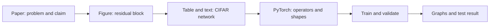
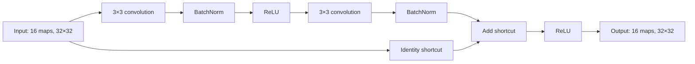
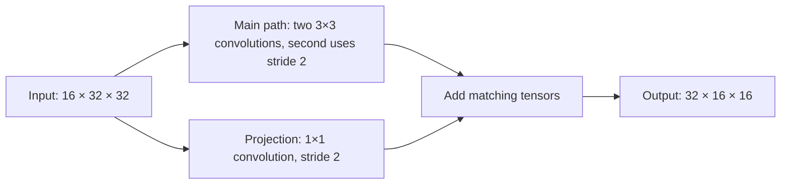

# Capstone — Read the ResNet Paper, Build ResNet-20

This project is a guided bridge between learning what a residual block does in Lesson 9 and reading a full architecture paper. We will use a small CIFAR-10 version of ResNet so you can follow the shape changes without handling huge images.

## By the end, you will be able to

- Find the **[main idea](#1-read-for-the-question-and-the-claim)** and useful implementation details in a research paper.
- Trace **[convolution, BatchNorm, and ReLU](#4-understand-the-operators-inside-a-block)** through a residual block.
- Explain when an **[identity or projection shortcut](#5-follow-the-shortcut-and-addition)** can be added safely.
- Build a **[20-layer CIFAR ResNet](#6-turn-the-paper-into-a-network)** and check its tensor shapes.
- Read **[training graphs](#8-read-the-graphs-and-results)** and compare the network with a plain CNN.

## Project path

- Read the paper to find the problem, the residual-learning idea, and evidence for the claim.
- Sketch one block and predict what happens to its input shape.
- Translate the paper’s CIFAR architecture into a small PyTorch model.
- Train on CIFAR-10, choose a checkpoint with validation data, then inspect the test result once.
- Compare the learning graphs and sample images, and explain what they show.



---

## 1. Read for the question and the claim

Open the original paper, [Deep Residual Learning for Image Recognition](https://arxiv.org/abs/1512.03385). A research paper can feel dense because it is written for other researchers. You do not need to understand every sentence on your first read. Read with a job to do: find the problem, the proposed idea, and the evidence.

1. **Abstract:** What problem do the authors say they are solving? They say that very deep neural networks can be hard to train.
2. **Introduction:** What is their proposed change? Instead of making a stack learn a whole new answer, let it learn a change to the input and add that change back.
3. **Architecture figure and CIFAR section:** What operations and connections make that idea real?
4. **Results:** What evidence do the authors use? They compare networks of different depths and show that residual networks can be easier to optimize.

Keep three things separate while reading:

- **Problem:** deep plain networks can become harder to optimize as layers are added.
- **Main idea:** learn a residual change `F(x)` and combine it with the block input `x`.
- **Evidence:** experiments test whether residual networks train and perform better. A paper’s result is evidence for its experiment, not a promise that every new dataset will get the same accuracy.

The capstone follows the paper’s CIFAR-style architecture, but uses a short training run for learning. We are not reproducing all the paper’s experiments or its reported scores.

<div class="quiz" data-answer="b" data-explanation="The paper's central architecture idea is to learn a change to the input and add it back through a shortcut. The training setup and result tables provide evidence, but they are not the architecture idea itself.">
  <p><strong>Checkpoint 1:</strong> Which statement best describes the paper’s main architecture idea?</p>
  <label><input type="radio" name="resnet-paper-claim" value="a"> Use a larger dataset so every image is easier</label><br>
  <label><input type="radio" name="resnet-paper-claim" value="b"> Learn a change to the input and add it to the input</label><br>
  <label><input type="radio" name="resnet-paper-claim" value="c"> Replace every convolution with a fully connected layer</label><br>
  <button class="quiz-check" type="button">Check answer</button>
  <p class="quiz-result" aria-live="polite"></p>
</div>

---

## 2. Turn a paper into questions you can answer

When you look at a paper figure or table, turn each detail into a question for the code. This keeps you from copying a diagram without knowing what its parts do.

| What you find in the paper | Ask this before coding |
|---|---|
| Two convolutions inside a block | What does each one change about the tensor? |
| A line that goes around the convolutions | What input is carried along that line? |
| An addition symbol | Do both paths have exactly the same shape? |
| A stride or a new channel width | Where does the image grid shrink or the number of feature maps grow? |
| Three CIFAR stages | How many blocks go in each stage, and where does each new stage begin? |
| A final classifier | How many class scores must the model return? |

Write a one-line answer next to each question before opening the code. Later, you can check whether the code matches the paper and your answer.

---

## 3. A tensor is a stack of number grids

The input is a batch of color pictures with shape `[batch, channels, height, width]`. For two CIFAR-10 pictures, that is `[2, 3, 32, 32]`: two images, three color channels, and a 32 by 32 pixel grid.

As the model works, it makes new **feature maps**. You can think of each feature map as a grid that records how strongly one learned pattern appears at each location. A layer may change how many grids there are or how large each grid is.

| Network location | Tensor shape | What changed? |
|---|---:|---|
| Input | `[2, 3, 32, 32]` | Two RGB pictures |
| Stem | `[2, 16, 32, 32]` | 16 learned feature maps; same image grid size |
| Stage 1 | `[2, 16, 32, 32]` | More feature processing; size stays the same |
| Stage 2 | `[2, 32, 16, 16]` | Twice the channels; half the height and width |
| Stage 3 | `[2, 64, 8, 8]` | Twice the channels again; half the height and width again |
| Global average pool | `[2, 64, 1, 1]` | One average number per feature map |
| Classifier | `[2, 10]` | Ten scores for each picture |

The model keeps the smaller grid at later stages because it has already combined information from nearby pixels. More channels give the network more feature maps to represent different patterns.

---

## 4. Understand the operators inside a block

An **operator** is a step that takes numbers in and returns numbers out. In PyTorch, `nn.Conv2d`, `nn.BatchNorm2d`, and `nn.ReLU` are layers that perform these steps. Follow one tensor through them instead of trying to memorize names.



### Convolution: look for local patterns

A **convolution** uses small learned windows, often 3 by 3, that slide across the feature maps. Each window looks at nearby values and computes a new value. Early in training, the values are mostly guesses; training adjusts them so useful visual patterns produce stronger responses.

The first convolution in this block reads 16 input maps and makes 16 output maps. Its `3×3` window looks at a small neighborhood at a time. With `stride=1` and `padding=1`, the window moves one pixel at a time and the border is padded, so height and width stay 32. The second convolution keeps the same shape so its result can later be added to the original input.

Imagine a tiny filter that responds to a bright-to-dark edge. At each location, it combines the values under its 3 by 3 window. In the real network, there are many filters, and training learns what patterns they respond to. Lesson 2 explains this sliding-window idea in more detail.

**Tiny number example:** Use a 3×3 input containing `1 2 3 / 4 5 6 / 7 8 9` and a 3×3 filter filled with ones. With no padding, there is one place for the filter to sit. It multiplies matching positions and adds them: `1+2+3+4+5+6+7+8+9 = 45`. The real network learns its filter values; this all-ones filter only makes the calculation easy to check.

### Batch normalization: keep values on a useful scale

**Batch normalization** (BatchNorm) looks at the values in a channel across the current group of training images. It adjusts their scale and center, then learns a small extra scale and shift. A simple analogy is turning the volume down when one layer is shouting much louder than the next.

This makes it easier for the next layer to learn while the network is training. BatchNorm behaves differently during training and evaluation: during training it uses the current batch statistics and updates running averages; during evaluation it uses those saved averages. PyTorch’s `model.train()` and `model.eval()` select those modes.

**Tiny number example:** Suppose one channel in a training batch contains `2, 4, 6`. Its mean is `4`. BatchNorm subtracts the mean and divides by the standard deviation, making values roughly `-1.22, 0, 1.22` before its learned scale and shift. The real layer calculates this over all batch and image positions in each channel.

### ReLU: keep positive responses

**ReLU** is short for rectified linear unit. It changes negative values to zero and leaves zero or positive values alone. If a filter says “this pattern is present” with a positive number, that response continues; a negative response becomes zero.

```text
Before ReLU:  -2, 0, 3
After ReLU:    0, 0, 3
```

ReLU lets the network build more complex rules than a sequence of simple linear calculations. Here it follows the first convolution and also follows the final residual addition.

### Stride: choose how far the filter moves

**Stride** is the number of pixels the filter moves each time. A stride of 1 checks neighboring positions. A stride of 2 skips positions, making the output grid about half as wide and half as tall. In this network, the first block of stages 2 and 3 uses stride 2 to shrink the feature grid from 32 to 16, then from 16 to 8.

**Tiny shape example:** A 4×4 grid sampled with a 1×1 filter and stride 2 becomes a 2×2 grid. The real stage transition uses a 3×3 filter on the main path, but the stride still reduces its grid.

### Check the main math symbols

- **`×`** means multiply. A 3 by 3 filter has 9 positions: `3 × 3 = 9`.
- **`+`** means add matching values. A residual block adds the shortcut value at each channel and pixel to the learned-change value at that same channel and pixel.
- **`/`** means divide. Global average pooling adds the values in a feature map and divides by the number of locations.

In the code, `bias=False` is used for convolutions followed by BatchNorm because BatchNorm already learns a shift. It removes an extra set of numbers the next layer would make unnecessary.

---

## 5. Follow the shortcut and addition

A residual block has two paths. The main path uses convolutions to calculate a change, written `F(x)`. The shortcut carries the original input `x` around those convolutions. The block combines them:

```text
output = ReLU(F(x) + x)
```

This lets the block preserve useful information while learning what to change. If the new change is small, the shortcut still carries the original values forward.

An **identity shortcut** passes its input through unchanged. You can use it only when the main path and shortcut have matching shapes. Adding a 16-channel `[16, 32, 32]` tensor to a 32-channel `[32, 16, 16]` tensor cannot work: there is no one-to-one matching position for every value.

When a stage changes the shape, a **projection shortcut** uses a `1×1` convolution with the same stride as the main path. The `1×1` window does not look around neighboring pixels; it mixes channel values at each location and changes the channel count. Its stride can also skip locations so the height and width shrink. BatchNorm follows it, matching the main path’s scale adjustment.



The first block in a new stage uses this projection. Blocks inside a stage keep the same number of channels and grid size, so they use an identity shortcut.

**Tiny number example:** Let the input at one location have two channels, `[2, 4]`. A toy 1×1 projection with weights `[1, 1]` makes one output channel with value `2+4=6`. A second filter with weights `[1, -1]` would make another channel with value `2-4=-2`. The real projection has 32 or 64 output channels and learned weights; its stride also reduces the grid when entering a new stage.

For an identity block, imagine the shortcut value is `[2, 1]` and the convolution layers make the learned change `[1, -3]`. Addition gives `[3, -2]`. The last ReLU turns that into `[3, 0]`. This is the same sequence as the network, but with two numbers instead of thousands.

<div class="quiz" data-answer="a" data-explanation="Element-by-element addition needs matching channel, height, and width dimensions. The projection shortcut changes the shortcut shape to match the main path.">
  <p><strong>Checkpoint 2:</strong> Why does a stage-changing block need a projection shortcut?</p>
  <label><input type="radio" name="resnet-projection" value="a"> The main path changes shape, so the shortcut must match it before addition</label><br>
  <label><input type="radio" name="resnet-projection" value="b"> The model must turn every feature map into a picture</label><br>
  <label><input type="radio" name="resnet-projection" value="c"> The shortcut trains the network without labels</label><br>
  <button class="quiz-check" type="button">Check answer</button>
  <p class="quiz-result" aria-live="polite"></p>
</div>

---

## 6. Turn the paper into a network

The CIFAR version starts with a small convolution, then uses three stages. Each stage has three residual blocks. Each block has two 3 by 3 convolutions. The first block of stages 2 and 3 shrinks the grid and increases the channel count.

That makes 18 convolutions inside residual blocks, plus the first convolution and the final fully connected layer: 20 layers in the paper’s depth count. The name “ResNet-20” refers to this count.

| Part | Channels | Grid | Number of blocks | First block |
|---|---:|---:|---:|---|
| Stem | 16 | 32×32 | — | 3×3 convolution |
| Stage 1 | 16 | 32×32 | 3 | Keep shape; identity shortcut |
| Stage 2 | 32 | 16×16 | 3 | Stride 2; projection shortcut |
| Stage 3 | 64 | 8×8 | 3 | Stride 2; projection shortcut |
| Pool and classifier | 64 → 10 | 1×1 → scores | — | Average, then class scores |

The actual implementation is in `examples/capstone-resnet-cifar10/resnet_cifar.py`. First inspect the residual block and its forward pass. Read each line by asking: what shape enters, what operation happens, and what shape leaves?

```python
--8<-- "examples/capstone-resnet-cifar10/resnet_cifar.py:block"
```

Now follow the forward pass. Notice that the second BatchNorm happens before the addition and that ReLU happens after it.

```python
--8<-- "examples/capstone-resnet-cifar10/resnet_cifar.py:block_forward"
```

The network uses **global average pooling** to average each 8 by 8 feature map into one number. That gives 64 numbers per image. The **linear classifier** combines those numbers into ten class scores, one for each CIFAR-10 category. These scores are called logits; the largest score is the model’s predicted class.

**Global average pooling example:** If a feature map is the 2×2 grid `1 3 / 5 7`, its average is `(1+3+5+7)/4 = 4`. An 8×8 feature map works the same way, averaging 64 values into one. ResNet does this separately for each of its 64 final feature maps.

**Linear classifier example:** Pretend pooling made just two values, `[4, 2]`, and there are only two pretend classes. If the first class uses weights `[1, 0]`, its score is `4`; if the second uses `[0, 1]`, its score is `2`. The real model has 64 pooled values and 10 classes, so it learns 10 sets of 64 weights and returns 10 scores.

Here is the whole shape journey for a batch of two pictures. The tiny arithmetic examples above show what operations do; these are the actual ResNet-20 sizes.

| Step | Operation | Actual shape |
|---|---|---|
| 1 | Input color images | `[2, 3, 32, 32]` |
| 2 | Stem convolution, BatchNorm, ReLU | `[2, 16, 32, 32]` |
| 3 | Stage 1: three residual blocks with identity shortcuts | `[2, 16, 32, 32]` |
| 4 | Stage 2 first block: stride-2 convolution and projection shortcut | `[2, 32, 16, 16]` |
| 5 | Stage 2 remaining two residual blocks | `[2, 32, 16, 16]` |
| 6 | Stage 3 first block: stride-2 convolution and projection shortcut | `[2, 64, 8, 8]` |
| 7 | Stage 3 remaining two residual blocks | `[2, 64, 8, 8]` |
| 8 | Global average pool, one number per feature map | `[2, 64]` |
| 9 | Linear classifier, ten class scores | `[2, 10]` |

The learned values differ for every training run. This shape sequence does not depend on the learned values.

```python
--8<-- "examples/capstone-resnet-cifar10/resnet_cifar.py:network_forward"
```

Before training, run the model’s shape check from the repository root:

```bash
uv run python examples/capstone-resnet-cifar10/resnet_cifar.py
```

Expected output: `ResNet-20 and SmallCNN: (2, 3, 32, 32) → (2, 10)`. The check also verifies that a projection shortcut can change `[2, 16, 32, 32]` into `[2, 32, 16, 16]`.

---

## 7. Train the network and keep the data roles clear

The training example uses 45,000 CIFAR-10 pictures to update weights and 5,000 pictures from the training set to choose the best checkpoint. It keeps the official 10,000-picture test set for the final report. The same split, augmentation, and training settings are used for ResNet-20 and the plain CNN.

The training loop repeats the same small cycle for each batch:

1. The model makes class scores in a **forward pass**.
2. **Cross-entropy loss** compares the scores with the correct labels. It is a number that gets larger when the model is more wrong.
3. `loss.backward()` calculates how each learned weight should change to lower the loss.
4. The **SGD optimizer** uses those calculated gradients to update the weights. Momentum helps updates keep moving consistently; weight decay gently discourages very large weights.

After each epoch, the model is measured on validation images without updating its weights. The checkpoint with the best validation accuracy is saved. Only after that choice is made do we evaluate the saved model on the official test set.

Train both models from the repository root:

```bash
uv run python examples/capstone-resnet-cifar10/train.py --model resnet20
uv run python examples/capstone-resnet-cifar10/train.py --model baseline
```

The first run downloads CIFAR-10. The five-epoch run is deliberately short enough for a learning experiment. It will not match the paper’s full training schedule or accuracy.

---

## 8. Read the graphs and results

The program saves a grid with one CIFAR-10 image from each class and a graph of training and validation loss and accuracy. Open the generated files in `examples/capstone-resnet-cifar10/outputs/`.

- **Training loss** shows how wrong the model is on examples it is learning from. It should usually trend down.
- **Validation loss** shows how wrong it is on examples not used for weight updates. If training loss falls while validation loss rises, the model may be memorizing its training examples.
- **Accuracy** shows the percentage of images with the correct top-scoring class. Compare training and validation lines, not one score by itself.
- Compare each model’s final test accuracy only after checkpoint selection. The test set gives a final check; it should not guide repeated tuning.

The graph is a picture of this run, not a guarantee of what every run will look like. Hardware, randomness, and the short training schedule affect the numbers.

<div class="quiz" data-answer="c" data-explanation="Validation data is used to choose among checkpoints. The official test set is held back for a final estimate after those choices are made.">
  <p><strong>Checkpoint 3:</strong> Which data should choose the saved checkpoint?</p>
  <label><input type="radio" name="resnet-validation" value="a"> The training images only</label><br>
  <label><input type="radio" name="resnet-validation" value="b"> The official test set after every epoch</label><br>
  <label><input type="radio" name="resnet-validation" value="c"> The validation images</label><br>
  <button class="quiz-check" type="button">Check answer</button>
  <p class="quiz-result" aria-live="polite"></p>
</div>

---

## Hands-on: be the paper-to-code translator

1. Before running the code, draw a box for each stage and write the channel count and grid size next to it.
2. Run the shape check. Compare its output with your prediction.
3. Open the block code. Point to the first convolution, BatchNorm, ReLU, second convolution, addition, and final ReLU.
4. Change a stage’s stride or channel count in a temporary copy. Predict what breaks, then run the shape check to see why shortcut shapes must match.
5. Train ResNet-20 and the baseline. Compare the two graphs and describe one thing that is similar and one thing that is different.
6. Write a short paper-reading note: problem, main idea, one code decision taken from the paper, one result from your own run, and one reason your result differs from the paper’s.

## Key takeaways

- Read a paper to answer a few concrete questions: what problem, what idea, what implementation details, and what evidence?
- A residual block learns a change and adds it to the input when the two shapes match.
- A projection shortcut makes the shortcut’s shape fit when a stage changes size.
- Validation chooses a checkpoint; the official test set gives a final measurement.
- Your graph helps explain what happened in your run; the paper explains what happened in the authors’ experiments.

**Next:** [MobileNetV2 Paper to Deployment](../capstone-mobilenetv2-gtsrb/index.md) builds on residual blocks and adds depthwise convolutions and inverted bottlenecks.
