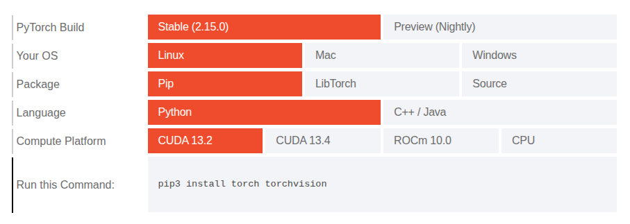

# Lesson 0: Setup Lab — Prepare Your Computer for the Course

## By the end, you will be able to

- Run the course **[site](#1-run-the-course-site-with-uv)** with `uv`.
- Install the **[vision packages](#2-install-the-vision-packages)** into that environment.
- **[Download MNIST](#3-download-mnist)** and confirm that the images are ready to use.

## In this lesson

- Create and use a project-specific Python environment.
- Install PyTorch and TorchVision without adding them to the site’s base dependencies.
- Download MNIST’s training and test splits.
- Check the downloaded data with a short script.

---

## 1. Run the course site with uv

From the course repository root, run:

```bash
uv sync
uv run mkdocs serve
```

`uv sync` creates the course `.venv/` if needed and installs the site dependencies. `uv run mkdocs serve` starts a local preview of the course site; open the address printed in the terminal. Stop the preview with `Ctrl+C`. If needed, install `uv` using its [installation guide](https://docs.astral.sh/uv/getting-started/installation/).

---

## 2. Install the vision packages

The locked dependencies set up the learning site. The image lessons also use **PyTorch**, **TorchVision**, and **Matplotlib**, installed separately so the base site remains lightweight.

Choose the CPU or GPU install command for your computer from the [official PyTorch install selector](https://pytorch.org/get-started/locally/). In a standard CPU setup, install into the course environment with:



```bash
uv pip install --python .venv/bin/python torch torchvision matplotlib
```

If your selected PyTorch instructions specify an index URL or extra package, keep those options in the `uv pip install` command so the PyTorch packages match your hardware.

Confirm the packages are available through the project environment:

```bash
uv run python -c "import matplotlib, torch, torchvision; print('PyTorch:', torch.__version__); print('TorchVision:', torchvision.__version__); print('Matplotlib:', matplotlib.__version__)"

# output

PyTorch: 2.15.0+cu132
TorchVision: 0.29.2+cu132
Matplotlib: 3.11.2
```

<div class="quiz" data-answer="b" data-explanation="A project virtual environment keeps its Python packages separate from other projects on the same computer.">
  <p><strong>Checkpoint 1:</strong> Why create a virtual environment for this course?</p>
  <label><input type="radio" name="lesson0-venv" value="a"> It makes the neural network train without data</label><br>
  <label><input type="radio" name="lesson0-venv" value="b"> It keeps this project's Python packages separate</label><br>
  <label><input type="radio" name="lesson0-venv" value="c"> It permanently changes the system Python</label><br>
  <button class="quiz-check" type="button">Check answer</button>
  <p class="quiz-result" aria-live="polite"></p>
</div>

---

## 3. Download MNIST

MNIST contains 70,000 small grayscale images of handwritten digits: 60,000 training examples and 10,000 test examples. Each image is 28 × 28 pixels and has a label from 0 through 9.

The course downloads MNIST with TorchVision. The first run needs an internet connection; later runs reuse the local copy under `data/mnist/`. The dataset files are ignored by Git, so they will not appear in commits.

The runnable downloader loads both splits, converts images to tensors, and prints their sizes and the shape of one image:

```python
--8<-- "examples/00-setup/download_mnist.py"
```

Run it from the repository root:

```bash
uv run python examples/00-setup/download_mnist.py
```

Expect output similar to:

```text
Training images: 60000
Test images: 10000
One image tensor: (1, 28, 28)
First image label: 5
MNIST files: .../data/mnist
```

The first label can differ only if the dataset ordering changes; the count and tensor shape are the main checks. The leading `1` is the grayscale channel. The `data/mnist/` folder is on disk, while the image and label tensors are loaded into memory when the script runs.

To use an example in your own code, index the dataset. TorchVision reads the extracted files and returns an image and its label together; you do not need to open the `.gz` or IDX files yourself. The complete runnable example is `examples/00-setup/load_mnist_sample.py`:

```python
--8<-- "examples/00-setup/load_mnist_sample.py"
```

Here, `0` is the example's position in the training split. `label` is its digit class, and `image` is a tensor shaped `[1, 28, 28]`. The script removes the single channel dimension for plotting, displays the grayscale image, and puts the label in the plot title. Run it from the repository root with `uv run python examples/00-setup/load_mnist_sample.py`.

<div class="quiz" data-answer="a" data-explanation="The training and test splits serve different purposes. Keep test images separate until you are ready for a final evaluation.">
  <p><strong>Checkpoint 2:</strong> Which MNIST split is used to update a model's weights?</p>
  <label><input type="radio" name="lesson0-splits" value="a"> The training split</label><br>
  <label><input type="radio" name="lesson0-splits" value="b"> The test split</label><br>
  <label><input type="radio" name="lesson0-splits" value="c"> Neither split contains labels</label><br>
  <button class="quiz-check" type="button">Check answer</button>
  <p class="quiz-result" aria-live="polite"></p>
</div>

---

## 4. Hands-on: prepare and check the dataset

1. From the repository root, run the downloader command above.
2. Confirm that it reports 60,000 training images and 10,000 test images.
3. Check that one image has shape `(1, 28, 28)` and a label from 0 to 9.
4. Run the command a second time. It should reuse the local dataset rather than download it again.

<details>
<summary>Show the solution</summary>

The downloader constructs two `torchvision.datasets.MNIST` objects with `download=True`, one with `train=True` and one with `train=False`. TorchVision downloads both splits if they are missing. `transforms.ToTensor()` converts a grayscale image into a `[1, 28, 28]` tensor. On a successful run, the sizes print as `60000` and `10000`, and the label is one integer between `0` and `9`.

</details>

---

## Ready for Lesson 1

Your setup is ready when `uv run` uses the course environment and the MNIST downloader prints the expected split sizes. Continue to [Lesson 1: How Does a Neural Network Recognize an Image?](../modules/01-cnn-fundamentals/lesson-01-how-neural-networks-see-images/index.md) to see how a digit image becomes numerical input.
