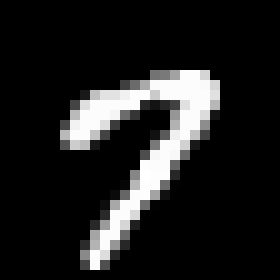
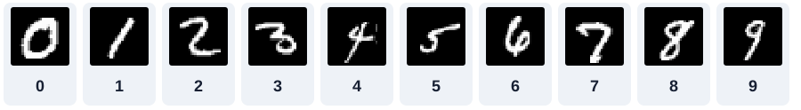
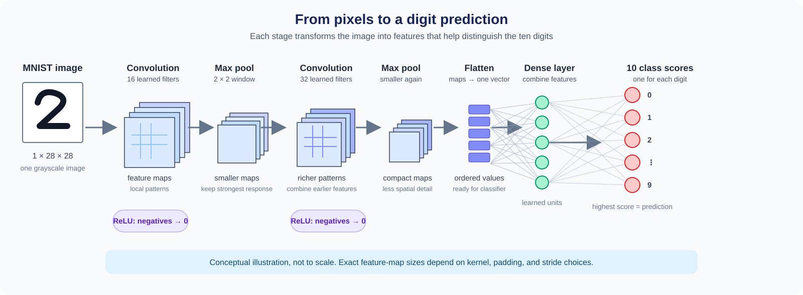
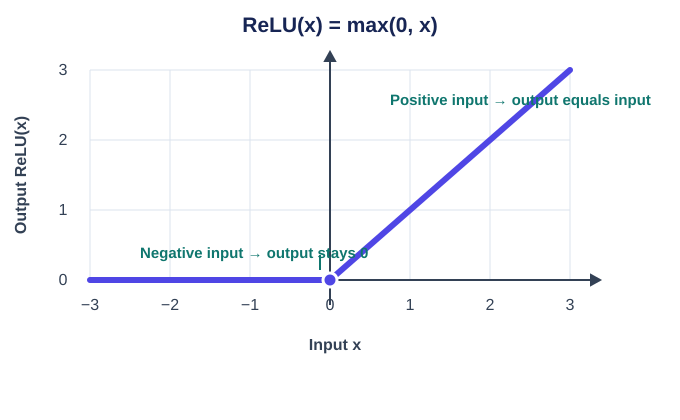
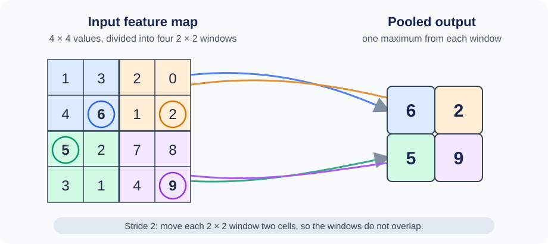

# Lesson 1: How Does a Neural Network Recognize an Image?

## By the end, you will be able to

- Explain how an image becomes **[pixel values](#what-does-a-neural-network-see)** the network can process.
- Describe how a **[convolutional neural network (CNN)](#how-do-filters-find-patterns)** uses filters to find patterns.
- Trace how **[layers](#how-do-layers-build-on-each-other)** combine simple features into useful representations.
- Outline how **[training](#how-do-filters-learn)** adjusts a network using examples and errors.

## In this lesson

- Turn an MNIST digit into numbers.
- See how a small filter responds to local image patterns.
- Follow image information through a simple CNN.
- Connect predictions to training and parameter updates.

---

## What is MNIST?

**MNIST** is a collection of handwritten digit images used to teach and benchmark image-classification models. It contains 70,000 grayscale images of digits 0–9: 60,000 for training and 10,000 for testing. Each image is 28 × 28 pixels and comes with its correct digit label.

Here is one real image from the MNIST training split. It is enlarged from its original 28 × 28 pixels so the individual pixels are visible:



Each image also has a digit label. This row shows one real training example from each of the ten classes:



You can download the files from the [MNIST database homepage](http://yann.lecun.com/exdb/mnist/). In this course, TorchVision can download the dataset automatically when `download=True`, as shown in the [PyTorch MNIST documentation](https://docs.pytorch.org/vision/stable/generated/torchvision.datasets.MNIST.html):

```python
from torchvision import datasets

train_data = datasets.MNIST("data/mnist", train=True, download=True)
```

This downloads the training split into `data/mnist/`. Lesson 4 shows how to load both training and test splits and convert the images into tensors.

---

## What does a neural network see?

You can look at a handwritten digit and recognize a 7. A neural network receives no built-in concept of “seven”: it receives numbers arranged like an image.

MNIST pictures are 28 pixels wide and 28 pixels high. Each pixel records brightness. In the original image format, 0 is black and 255 is white, with gray shades between them. In many PyTorch workflows, those values are scaled to the range 0 to 1 before the model uses them.

A tiny sketch of a diagonal stroke might be represented like this:

```text
0   0 255 255 255
0   0   0   0 255
0   0   0 255   0
0   0 255   0   0
0 255   0   0   0
```

The full 28 × 28 image contains 784 pixel values. A model processes those values and produces a score for each digit class. A common classifier converts the scores to probabilities with softmax:

```text
Image of a handwritten digit
              ↓
       Neural network
              ↓
Digit       Probability
  0             0.01
  1             0.02
  2             0.03
  3             0.01
  4             0.01
  5             0.01
  6             0.01
  7             0.88  ← highest
  8             0.01
  9             0.01
```

The predicted class is the one with the highest score or probability. These numbers are an illustration, not the output of a trained model.

---

## How do filters find patterns?

People recognize digits by their shapes. A 1 often has a long stroke, a 0 has a loop, and an 8 often has two loops. A CNN can learn numerical patterns that help distinguish those shapes.

A **filter**, also called a **kernel**, is a small grid of learned numbers. The network applies it to small neighborhoods across the image. At each position, it combines the local pixel values with the filter values to produce a response. Collecting those responses makes a **feature map**.

For example, this hand-picked filter responds strongly to a bright vertical stroke on a dark background:

```text
-1   2  -1
-1   2  -1
-1   2  -1
```

Watch the kernel move over a small image. This toy input is 4 × 4, so a 3 × 3 kernel has exactly four valid positions. At each position, the demo multiplies the nine image values by the matching kernel weights, adds them, and writes the result into the output feature map.

<div class="convolution-demo" data-convolution-demo>
  <div class="conv-visuals">
    <div class="conv-panel">
      <h4>Input image · 4 × 4</h4>
      <div class="conv-input-stage">
        <div class="conv-grid conv-input-grid" data-rows="4" data-cols="4" role="img" aria-label="Input image matrix: 0 1 0 0, 0 1 1 0, 0 1 0 0, 0 1 0 0">
          <span class="conv-cell" data-value="0">0</span><span class="conv-cell" data-value="1">1</span><span class="conv-cell" data-value="0">0</span><span class="conv-cell" data-value="0">0</span>
          <span class="conv-cell" data-value="0">0</span><span class="conv-cell" data-value="1">1</span><span class="conv-cell" data-value="1">1</span><span class="conv-cell" data-value="0">0</span>
          <span class="conv-cell" data-value="0">0</span><span class="conv-cell" data-value="1">1</span><span class="conv-cell" data-value="0">0</span><span class="conv-cell" data-value="0">0</span>
          <span class="conv-cell" data-value="0">0</span><span class="conv-cell" data-value="1">1</span><span class="conv-cell" data-value="0">0</span><span class="conv-cell" data-value="0">0</span>
        </div>
        <div class="conv-kernel-outline" aria-hidden="true" hidden></div>
      </div>
    </div>
    <div class="conv-panel">
      <h4>3 × 3 kernel</h4>
      <div class="conv-grid conv-kernel-grid" data-rows="3" data-cols="3" role="img" aria-label="Vertical-line filter weights: minus one, two, minus one in each row">
        <span class="conv-cell" data-value="-1">−1</span><span class="conv-cell" data-value="2">2</span><span class="conv-cell" data-value="-1">−1</span>
        <span class="conv-cell" data-value="-1">−1</span><span class="conv-cell" data-value="2">2</span><span class="conv-cell" data-value="-1">−1</span>
        <span class="conv-cell" data-value="-1">−1</span><span class="conv-cell" data-value="2">2</span><span class="conv-cell" data-value="-1">−1</span>
      </div>
    </div>
    <div class="conv-panel">
      <h4>Output · 2 × 2</h4>
      <div class="conv-grid conv-output-grid" role="img" aria-label="Output feature map, filled one position at a time">
        <span class="conv-cell" data-output-cell>—</span><span class="conv-cell" data-output-cell>—</span>
        <span class="conv-cell" data-output-cell>—</span><span class="conv-cell" data-output-cell>—</span>
      </div>
    </div>
  </div>
  <div class="conv-controls">
    <button class="conv-run" type="button">Animate 4 steps</button>
    <button class="conv-reset" type="button">Reset</button>
  </div>
  <p class="conv-status" aria-live="polite">Ready. Run the four kernel positions to fill the output.</p>
</div>

The output becomes `[[5, -1], [5, -1]]`. The strong positive values appear where the patch contains a vertical stroke in the kernel's center column. In a full 5 × 5 image, this same 3 × 3 kernel would visit nine positions and produce a 3 × 3 feature map. A trained CNN uses many filters, and the useful patterns are learned from data. They are not necessarily as easy for a person to name as “vertical line” or “curve.”

> **Key idea:** The example filter above is chosen by hand to make convolution easier to picture. In a CNN, training adjusts filter values automatically.

<div class="quiz" data-answer="b" data-explanation="A feature map stores the filter's response at positions across the image.">
  <p><strong>Checkpoint 1:</strong> What does a feature map show?</p>
  <label><input type="radio" name="lesson1-feature-map" value="a"> The original image resized to fit the network</label><br>
  <label><input type="radio" name="lesson1-feature-map" value="b"> The responses of a filter at different image locations</label><br>
  <label><input type="radio" name="lesson1-feature-map" value="c"> A list of the names of the filters</label><br>
  <button class="quiz-check" type="button">Check answer</button>
  <p class="quiz-result" aria-live="polite"></p>
</div>

---

## How do layers build on each other?

A CNN applies several transformations in sequence. Early layers can respond to small local patterns. Later layers combine those responses into broader patterns. This is a useful mental model, though the filters in a real trained model do not always correspond neatly to human labels.

```text
Image pixels          Early layers         Later layers          Classifier
28 × 28 values   →   edges and strokes  →  curves and shapes  →  scores for 0–9
```

A layer does not receive a new drawing of the digit. It receives numerical feature maps from the previous layer and transforms them. Stacking layers lets the network build representations from earlier ones.

<div class="quiz" data-answer="a" data-explanation="Later layers operate on features produced by earlier layers and can combine them into richer patterns.">
  <p><strong>Checkpoint 2:</strong> Why stack multiple CNN layers?</p>
  <label><input type="radio" name="lesson1-layers" value="a"> Later layers can combine earlier features into more complex representations</label><br>
  <label><input type="radio" name="lesson1-layers" value="b"> Each layer stores a human-written rule for one digit</label><br>
  <label><input type="radio" name="lesson1-layers" value="c"> More layers turn the image into a larger number of pixels</label><br>
  <button class="quiz-check" type="button">Check answer</button>
  <p class="quiz-result" aria-live="polite"></p>
</div>

---

## How do filters learn?

At the beginning, the filter values are usually initialized without useful digit knowledge. Training repeatedly compares a model's predictions with the correct labels and adjusts its parameters.

1. **Forward pass:** An image passes through the network and produces class scores.
2. **Loss:** A loss function measures how far the prediction is from the correct label.
3. **Backpropagation:** The network calculates how its parameters contributed to the loss.
4. **Optimizer update:** An optimizer adjusts parameters, including convolution filter values.
5. **Repeat:** The process uses many labeled examples, helping the network make better predictions on new images.

```text
image → prediction → loss → parameter update
  image → prediction → loss → parameter update
    image → prediction → loss → parameter update
                         …
```

Backpropagation calculates information used to update parameters; the optimizer performs the update. Across training, the network learns patterns that help classification rather than receiving a list of drawing instructions.

<div class="quiz" data-answer="c" data-explanation="Backpropagation estimates how parameters affect the loss, and the optimizer uses that information to update them.">
  <p><strong>Checkpoint 3:</strong> Which statement best describes backpropagation and the optimizer?</p>
  <label><input type="radio" name="lesson1-training" value="a"> Backpropagation chooses the digit label, and the optimizer loads more images</label><br>
  <label><input type="radio" name="lesson1-training" value="b"> Backpropagation writes human-readable rules into the filters</label><br>
  <label><input type="radio" name="lesson1-training" value="c"> Backpropagation determines how parameters affect loss, and the optimizer updates them</label><br>
  <button class="quiz-check" type="button">Check answer</button>
  <p class="quiz-result" aria-live="polite"></p>
</div>

---

## A simple CNN from image to prediction

Here is one possible high-level path for an MNIST image. Exact tensor shapes depend on choices such as padding, stride, and pooling. This diagram focuses on each component's role.



**ReLU** (Rectified Linear Unit) replaces negative values with zero and leaves positive values unchanged. In short, `ReLU(x) = max(0, x)`. This simple operation helps the network learn more than a single linear transformation.



For example, ReLU maps `-2 → 0`, `0 → 0`, and `2 → 2`.

**Max pooling** summarizes each small region by keeping its largest value. A 2 × 2 max-pooling operation, for example, reduces the height and width of a feature map when applied with a 2 × 2 stride.

Here, divide the input into four non-overlapping 2 × 2 regions. The colors show the four windows. In each window, keep the largest value, then place it in the matching position in the smaller output:



Each output cell comes from the window in the same position:

| Window | Values examined | Largest value | Output position |
| --- | --- | ---: | --- |
| Upper left | 1, 3, 4, 6 | **6** | Top left |
| Upper right | 2, 0, 1, 2 | **2** | Top right |
| Lower left | 5, 2, 3, 1 | **5** | Bottom left |
| Lower right | 7, 8, 4, 9 | **9** | Bottom right |

So the 4 × 4 input becomes this 2 × 2 output:

```text
6  2
5  9
```

The **2 × 2 window** says how many input cells are compared at a time. The **stride of 2** moves each window two cells, so these windows do not overlap. Pooling reduces width and height while retaining the strongest response from each region.

The classifier turns the extracted features into one score per class. A model may use softmax to convert those scores into probabilities for display or interpretation.

---

## Try a tiny example

This standard-library example represents a small image as rows of brightness values and reports how many pixels it contains. It illustrates image data; it is not a trained neural network.

```python
--8<-- "examples/01-cnn-fundamentals/lesson-01/image_pixels.py"
```

Run it from the repository root:

```bash
uv run python examples/01-cnn-fundamentals/lesson-01/image_pixels.py
```

Expected output:

```text
Image size: 5 x 5
Pixel values: 25
Bright pixels: 7
```

---

## Exercise

Change one `0` in the example image to `255`. Run the script again and predict how the bright-pixel count changes. Then describe why a pixel count alone is not enough to recognize every handwritten digit.

---

## The idea to remember

A CNN is not a collection of explicit rules such as “if there are two loops, predict 8.” It is a set of numerical parameters learned from examples. Filters help transform pixels into features, and later layers use those features to produce class scores.

The next lesson follows **one 3 × 3 filter learning to detect a vertical line**, step by step. See the [course overview](../../../index.md) for context and the [Stage 1 syllabus](../../../syllabus.md#stage-1-cnn-fundamentals-lessons-16) for the course sequence.
