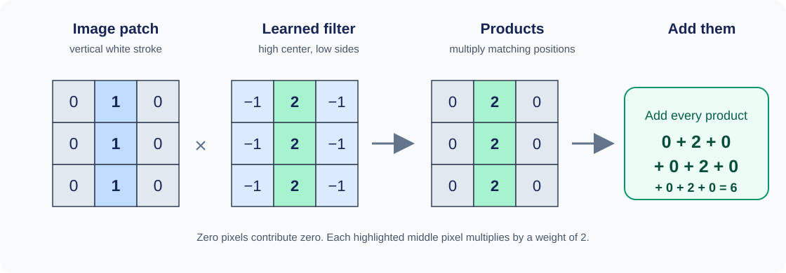
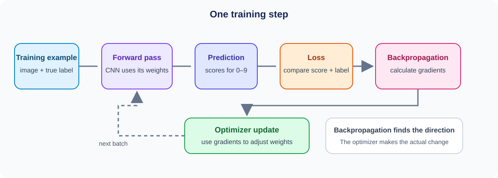
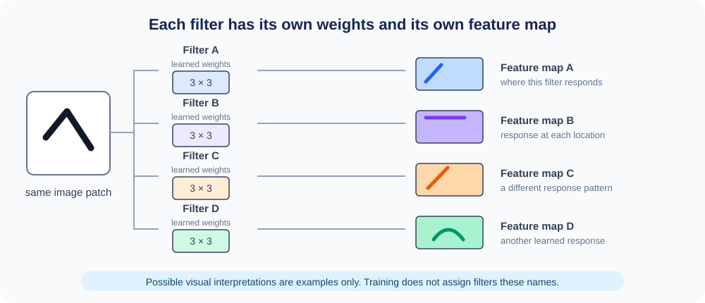
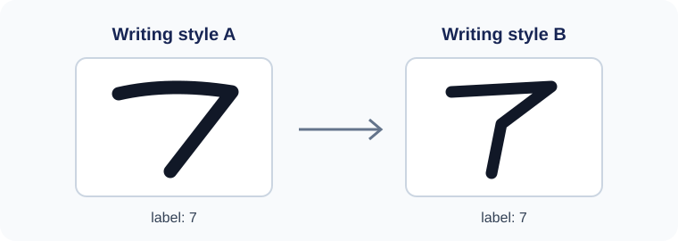

# Lesson 2: How Does a CNN Learn to Detect Patterns?

## By the end, you will be able to

- Calculate a filter's **[response](#how-does-a-filter-respond-to-a-pattern)** for a small image patch.
- Explain how **[loss, gradients, and an optimizer](#how-does-training-adjust-the-filters)** work together to adjust filter weights.
- Describe why filters learn useful patterns from labels through **[end-to-end learning](#does-anyone-tell-the-filter-to-detect-lines)**.
- Explain how training on varied examples supports **[generalization](#why-train-on-many-examples)**.

## In this lesson

- Compare an initially random filter with a filter that responds to a vertical line.
- Follow the multiplication and addition that produce one filter response.
- Visualize the training loop from prediction to weight update.
- See how multiple filters produce different feature maps.

---

## Start with an image and an untrained filter

Consider this tiny image patch. It contains a vertical white line, represented by 1s, on a dark background represented by 0s:

```text
0  1  0
0  1  0
0  1  0
```

A CNN doesn't begin with the idea “this is a vertical line.” Its filter is a small grid of **weights**, also called **parameters**. At the start of training, those weights are usually initialized to small random values. For example:

```text
 0.2  -0.3   0.1
-0.1   0.4   0.2
 0.3  -0.2   0.1
```

Those initial numbers are not expected to detect a meaningful pattern yet. Training changes them based on how well the whole network classifies its examples.

---

## How does a filter respond to a pattern?

At one image location, the filter and image patch have the same shape. Multiply matching positions and add the products. That single sum is the filter's **response** at that location.



For the initialized filter above, only the middle column contributes because the other image values are zero:

```text
(1 × -0.3) + (1 × 0.4) + (1 × -0.2) = -0.1
```

The filter responds weakly to this patch. After training, imagine its weights have changed to:

```text
-1   2  -1
-1   2  -1
-1   2  -1
```

Now the response to the vertical line is `2 + 2 + 2 = 6`, a strong positive response. A uniformly bright patch produces zero because each row's weights add to `-1 + 2 - 1 = 0`:

```text
Vertical line response:  6
Uniform bright response:  0
```

This example shows one possible useful filter. Real learned filters can be harder to interpret, and their responses depend on the surrounding pixels and the other learned weights.

<div class="quiz" data-answer="b" data-explanation="The patch is zero outside its middle column, so only the filter's three middle-column weights contribute.">
  <p><strong>Checkpoint 1:</strong> In the vertical-line patch, why do only three weights contribute to the response?</p>
  <label><input type="radio" name="lesson2-response" value="a"> The filter only uses the center weight</label><br>
  <label><input type="radio" name="lesson2-response" value="b"> Every image value outside the middle column is zero</label><br>
  <label><input type="radio" name="lesson2-response" value="c"> Pooling removes the other six weights</label><br>
  <button class="quiz-check" type="button">Check answer</button>
  <p class="quiz-result" aria-live="polite"></p>
</div>

---

## Try the filter calculation

This small Python program calculates the response for the random filter, the vertical-line filter, and a uniformly bright patch. It uses only the standard library.

```python
--8<-- "examples/01-cnn-fundamentals/lesson-02/filter_response.py"
```

Run it from the repository root:

```bash
uv run python examples/01-cnn-fundamentals/lesson-02/filter_response.py
```

Expected output:

```text
Random filter response: -0.1
Vertical-line filter response: 6
Uniform-bright patch response: 0
```

The script demonstrates one filter response. It does not train a neural network; the next sections explain how training determines weight updates.

---

## How does training adjust the filters?

A filter is part of a larger network. The network uses its filters and other layers to predict a digit. Training compares that prediction with the correct label and then adjusts many weights throughout the model.



1. **Forward pass:** Send an image through the CNN to get scores for digits 0–9.
2. **Loss:** Compare those scores with the correct label. For classification, cross-entropy is a common loss function. Lower loss generally means the model assigned more confidence to the correct class.
3. **Backpropagation:** Calculate gradients, which describe how each weight affects the loss near its current value.
4. **Optimizer update:** Use the gradients to nudge the weights in a direction expected to reduce the loss.
5. **Repeat:** Process more examples and update again.

For example, a weight might change from `0.20` to `0.18` after an update. This is a tiny adjustment, and the same training step can increase some weights while decreasing others. Backpropagation calculates gradient information; the optimizer uses it to update the parameters.

<div class="quiz" data-answer="c" data-explanation="Backpropagation calculates how weights affect the loss. The optimizer uses those gradients to change the weights.">
  <p><strong>Checkpoint 2:</strong> What happens after the network calculates the loss?</p>
  <label><input type="radio" name="lesson2-loss" value="a"> The loss function directly writes line-detection rules into the filters</label><br>
  <label><input type="radio" name="lesson2-loss" value="b"> The classifier discards the image and chooses a random label</label><br>
  <label><input type="radio" name="lesson2-loss" value="c"> Backpropagation calculates gradients, then the optimizer updates weights</label><br>
  <button class="quiz-check" type="button">Check answer</button>
  <p class="quiz-result" aria-live="polite"></p>
</div>

---

## Does anyone tell the filter to detect lines?

In ordinary supervised MNIST training, we give the model images and their digit labels. We do not assign a hand-written job to every filter:

```text
Image: handwritten 8
Label: 8
```

If line-like or curve-like responses help the network predict labels correctly, training can shape some filters to respond to those patterns. No single filter has to mean “vertical line,” and detecting a vertical stroke alone cannot determine the digit: 1, 4, and 7 can all contain vertical strokes.

This is called **end-to-end learning**: training adjusts the model's parameters to improve its final task, using the labels and loss, rather than requiring people to specify every intermediate visual feature.

---

## How can a layer learn many patterns?

A convolutional layer contains multiple filters. Each filter has its own weights and produces its own feature map. The diagram shows four filters for clarity; a layer with 16 filters produces 16 feature maps.



A later convolutional layer can combine information across the input channels to respond to richer patterns. Filter names such as “edge” or “curve” are only human interpretations after training, not instructions built into the network.

---

## Why train on many examples?

One training image may have an unusual writing style. If the model only sees that example, it may learn details that do not help with other handwriting. MNIST provides 60,000 training images and 10,000 test images, giving the model many variations to learn from and a separate set for evaluation.



A model **generalizes** when it performs well on examples it did not train on. Many varied examples help the model learn patterns that are useful beyond the exact training images.

<div class="quiz" data-answer="a" data-explanation="Training on varied examples helps the model learn features that remain useful for new handwriting styles.">
  <p><strong>Checkpoint 3:</strong> Why does the model need many different handwritten examples?</p>
  <label><input type="radio" name="lesson2-generalization" value="a"> To learn patterns that work across handwriting styles, including unseen examples</label><br>
  <label><input type="radio" name="lesson2-generalization" value="b"> To store every image as a separate digit rule</label><br>
  <label><input type="radio" name="lesson2-generalization" value="c"> To ensure every filter detects the same pattern</label><br>
  <button class="quiz-check" type="button">Check answer</button>
  <p class="quiz-result" aria-live="polite"></p>
</div>

---

## Put the learning cycle together

The **forward pass** moves from image to prediction. The learning signal then moves from the loss back through the network as gradients, and the optimizer uses them to adjust weights. After training, inference runs the forward pass to predict new images without updating the weights.

```text
TRAINING
Image + correct label
        ↓
CNN filters and layers
        ↓
Digit scores → compare with label → loss
                                  ↓
                         backpropagation
                                  ↓
                         weight gradients
                                  ↓
                          optimizer update
                                  └──────→ next training image

INFERENCE
New image → trained CNN → digit scores → predicted digit
           (weights stay fixed)
```

A strong response from one filter is only one clue. Other filters and layers combine many clues before the classifier predicts a digit.

---

## Exercise

In `filter_response.py`, change one weight in the vertical-line filter. Predict how its response to the vertical-line patch will change, then run the program. Explain why changing a filter response does not necessarily change the final digit prediction by the same amount.

---

## What's next? Lesson 3

[Lesson 3: How CNN Layers Transform Images](../../../syllabus.md#stage-1-cnn-fundamentals-lessons-16) follows an MNIST image through feature maps, ReLU, max pooling, and classification. You can revisit [Lesson 1: How Neural Networks See Images](../lesson-01-how-neural-networks-see-images/index.md) for the image and CNN basics.
