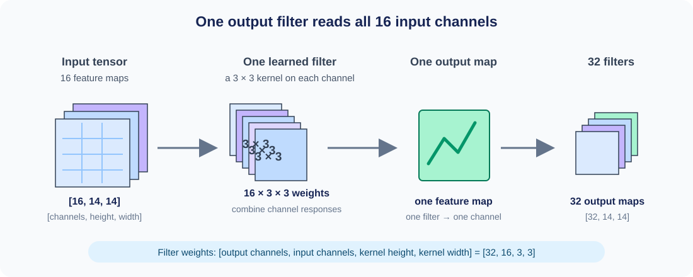
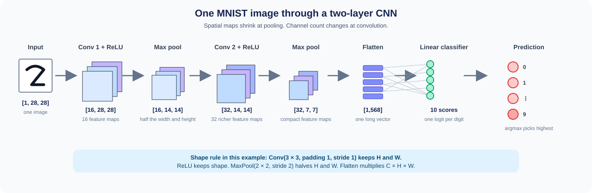

# Lesson 3: How CNN Layers Transform an MNIST Image

## By the end, you will be able to

- Read an image **[tensor shape](#1-follow-the-image-shape)** in channel, height, and width order.
- Explain how **[padding and stride](#padding-and-stride-control-edges-and-movement)** affect convolution, and how **[ReLU and max pooling](#2-convolution-relu-and-pooling)** change values and dimensions.
- Explain how **[channels and filters](#3-the-second-convolution-combines-channels)** relate to the number of feature maps.
- Describe what **[flattening and logits](#4-from-feature-maps-to-digit-scores)** do before classification.
- Calculate a CNN's **[learnable parameters](#5-where-are-the-learnable-parameters)** at a high level.

## In this lesson

- Track one MNIST image from pixels to ten class scores.
- See how channels and spatial size change at each layer.
- Distinguish learned layers from shape-changing operations with no weights.
- Practice tracing a second architecture and check the solution.

---

## 1. Follow the image shape

An MNIST image is grayscale, so it has one channel. In PyTorch, one image commonly has shape `[channels, height, width]`, or `[1, 28, 28]`. A batch adds a first dimension: 32 images have shape `[32, 1, 28, 28]`, written `[batch, channels, height, width]`.

The shape describes how values are organized. It does not tell us the pixel values themselves.

---

## 2. Convolution, ReLU, and pooling

Our example CNN uses 3 × 3 convolution kernels, padding of 1, and stride of 1. This padding keeps height and width at 28. Sixteen filters produce sixteen output channels, or feature maps:

### Padding and stride control edges and movement

**Padding** adds pixels around the image before convolution. With `padding=1`, one zero-valued pixel is added along every edge. This gives the kernel room to cover the original border pixels:

```text
Original 3 × 3 image       After padding=1
A  B  C                    0  0  0  0  0
D  E  F                    0  A  B  C  0
G  H  I                    0  D  E  F  0
                           0  G  H  I  0
                           0  0  0  0  0
```

So for a 28 × 28 image and a 3 × 3 kernel, padding 1 makes a 30 × 30 padded image. The filter can still produce an output aligned to every original pixel, including pixels at the edges.

**Stride** is how far the kernel moves between positions. With `stride=1`, it moves one pixel at a time, so neighboring patches overlap. With the 3 × 3 kernel, the first two horizontal positions are:

```text
Position 1: columns 1–3
Position 2: columns 2–4   ← moved one column
```

For the course model, combining a 3 × 3 kernel, padding 1, and stride 1 preserves the spatial dimensions: `[1, 28, 28] → [16, 28, 28]`. The 16 filters change the channel count; padding and stride determine the height and width.

Try the same operation on a tiny grid. The original 3 × 3 image is surrounded by one row and column of zeros (`padding=1`). The kernel moves one cell at a time (`stride=1`), filling each cell of the 3 × 3 output. The blue cells mark the added padding:

<div class="convolution-demo" data-convolution-demo>
  <div class="conv-visuals">
    <div class="conv-panel">
      <h4>Padded input · 5 × 5</h4>
      <div class="conv-input-stage">
        <div class="conv-grid conv-input-grid" data-rows="5" data-cols="5" role="img" aria-label="A 3 by 3 input image surrounded by one border of zero padding: rows are 0 0 0 0 0, 0 1 0 0 0, 0 1 1 0 0, 0 1 0 0 0, 0 0 0 0 0">
          <span class="conv-cell conv-pad-cell" data-value="0">0</span><span class="conv-cell conv-pad-cell" data-value="0">0</span><span class="conv-cell conv-pad-cell" data-value="0">0</span><span class="conv-cell conv-pad-cell" data-value="0">0</span><span class="conv-cell conv-pad-cell" data-value="0">0</span>
          <span class="conv-cell conv-pad-cell" data-value="0">0</span><span class="conv-cell" data-value="1">1</span><span class="conv-cell" data-value="0">0</span><span class="conv-cell" data-value="0">0</span><span class="conv-cell conv-pad-cell" data-value="0">0</span>
          <span class="conv-cell conv-pad-cell" data-value="0">0</span><span class="conv-cell" data-value="1">1</span><span class="conv-cell" data-value="1">1</span><span class="conv-cell" data-value="0">0</span><span class="conv-cell conv-pad-cell" data-value="0">0</span>
          <span class="conv-cell conv-pad-cell" data-value="0">0</span><span class="conv-cell" data-value="1">1</span><span class="conv-cell" data-value="0">0</span><span class="conv-cell" data-value="0">0</span><span class="conv-cell conv-pad-cell" data-value="0">0</span>
          <span class="conv-cell conv-pad-cell" data-value="0">0</span><span class="conv-cell conv-pad-cell" data-value="0">0</span><span class="conv-cell conv-pad-cell" data-value="0">0</span><span class="conv-cell conv-pad-cell" data-value="0">0</span><span class="conv-cell conv-pad-cell" data-value="0">0</span>
        </div>
        <div class="conv-kernel-outline" aria-hidden="true" hidden></div>
      </div>
      <p class="conv-note">Blue border cells are the padding.</p>
    </div>
    <div class="conv-panel">
      <h4>3 × 3 kernel</h4>
      <div class="conv-grid conv-kernel-grid" data-rows="3" data-cols="3" role="img" aria-label="Vertical-line filter weights: minus one, two, minus one in each row">
        <span class="conv-cell" data-value="-1">−1</span><span class="conv-cell" data-value="2">2</span><span class="conv-cell" data-value="-1">−1</span>
        <span class="conv-cell" data-value="-1">−1</span><span class="conv-cell" data-value="2">2</span><span class="conv-cell" data-value="-1">−1</span>
        <span class="conv-cell" data-value="-1">−1</span><span class="conv-cell" data-value="2">2</span><span class="conv-cell" data-value="-1">−1</span>
      </div>
    </div>
    <div class="conv-panel">
      <h4>Output · 3 × 3</h4>
      <div class="conv-grid conv-output-grid" role="img" aria-label="Output feature map, filled one position at a time">
        <span class="conv-cell" data-output-cell>—</span><span class="conv-cell" data-output-cell>—</span><span class="conv-cell" data-output-cell>—</span>
        <span class="conv-cell" data-output-cell>—</span><span class="conv-cell" data-output-cell>—</span><span class="conv-cell" data-output-cell>—</span>
        <span class="conv-cell" data-output-cell>—</span><span class="conv-cell" data-output-cell>—</span><span class="conv-cell" data-output-cell>—</span>
      </div>
    </div>
  </div>
  <div class="conv-controls">
    <button class="conv-run" type="button">Animate 9 steps</button>
    <button class="conv-reset" type="button">Reset</button>
  </div>
  <p class="conv-status" aria-live="polite">Ready. Run the nine kernel positions to fill the output.</p>
</div>

```text
Input image: [1, 28, 28]
      │
      ├─ Conv2D: 1 input channel → 16 output channels
      │           kernel 3 × 3, padding 1, stride 1
      ▼
Feature maps: [16, 28, 28]
```

Each channel is a learned representation. The maps may emphasize different useful visual patterns, but we do not assign a fixed meaning to each one.

### ReLU keeps the shape

ReLU replaces negative values with zero and leaves positive values as they are. It changes values, but not the tensor shape. Animate the nine cells to see the element-by-element change:

<div class="convolution-demo grid-transform-demo" data-grid-transform="relu">
  <div class="conv-visuals">
    <div class="conv-panel">
      <h4>Before ReLU · 3 × 3</h4>
      <div class="conv-input-stage">
        <div class="conv-grid conv-input-grid" data-rows="3" data-cols="3" data-window-rows="1" data-window-cols="1" data-stride="1" role="img" aria-label="Values before ReLU: minus two, three, minus one, four, minus five, two, minus one, six, minus three">
          <span class="conv-cell" data-value="-2">−2</span><span class="conv-cell" data-value="3">3</span><span class="conv-cell" data-value="-1">−1</span>
          <span class="conv-cell" data-value="4">4</span><span class="conv-cell" data-value="-5">−5</span><span class="conv-cell" data-value="2">2</span>
          <span class="conv-cell" data-value="-1">−1</span><span class="conv-cell" data-value="6">6</span><span class="conv-cell" data-value="-3">−3</span>
        </div>
        <div class="conv-kernel-outline" aria-hidden="true" hidden></div>
      </div>
    </div>
    <div class="conv-panel">
      <h4>After ReLU · 3 × 3</h4>
      <div class="conv-grid conv-output-grid" role="img" aria-label="ReLU output, filled one value at a time">
        <span class="conv-cell" data-output-cell>—</span><span class="conv-cell" data-output-cell>—</span><span class="conv-cell" data-output-cell>—</span>
        <span class="conv-cell" data-output-cell>—</span><span class="conv-cell" data-output-cell>—</span><span class="conv-cell" data-output-cell>—</span>
        <span class="conv-cell" data-output-cell>—</span><span class="conv-cell" data-output-cell>—</span><span class="conv-cell" data-output-cell>—</span>
      </div>
    </div>
  </div>
  <div class="conv-controls">
    <button class="conv-run" type="button">Animate 9 values</button>
    <button class="conv-reset" type="button">Reset</button>
  </div>
  <p class="conv-status" aria-live="polite">Ready. Run ReLU on all nine values.</p>
</div>

The completed output is `[[0, 3, 0], [4, 0, 2], [0, 6, 0]]`. Its shape stays 3 × 3. In the CNN, the same operation is applied to every value in every channel, so `[16, 28, 28]` remains `[16, 28, 28]`.

ReLU adds nonlinearity, which lets multiple layers learn relationships more complex than a single linear transformation.

### Max pooling reduces spatial size

A 2 × 2 max-pooling window with stride 2 keeps the largest value from each non-overlapping region. Watch the four windows visit the input and fill the smaller output:

<div class="convolution-demo grid-transform-demo" data-grid-transform="maxpool">
  <div class="conv-visuals">
    <div class="conv-panel">
      <h4>Input feature map · 4 × 4</h4>
      <div class="conv-input-stage">
        <div class="conv-grid conv-input-grid" data-rows="4" data-cols="4" data-window-rows="2" data-window-cols="2" data-stride="2" role="img" aria-label="Input feature map values: 1 3 2 4, 5 6 1 2, 2 1 8 3, 4 2 5 7">
          <span class="conv-cell" data-value="1">1</span><span class="conv-cell" data-value="3">3</span><span class="conv-cell" data-value="2">2</span><span class="conv-cell" data-value="4">4</span>
          <span class="conv-cell" data-value="5">5</span><span class="conv-cell" data-value="6">6</span><span class="conv-cell" data-value="1">1</span><span class="conv-cell" data-value="2">2</span>
          <span class="conv-cell" data-value="2">2</span><span class="conv-cell" data-value="1">1</span><span class="conv-cell" data-value="8">8</span><span class="conv-cell" data-value="3">3</span>
          <span class="conv-cell" data-value="4">4</span><span class="conv-cell" data-value="2">2</span><span class="conv-cell" data-value="5">5</span><span class="conv-cell" data-value="7">7</span>
        </div>
        <div class="conv-kernel-outline" aria-hidden="true" hidden></div>
      </div>
    </div>
    <div class="conv-panel">
      <h4>After max pooling · 2 × 2</h4>
      <div class="conv-grid conv-output-grid" role="img" aria-label="Max pooling output, filled one value at a time">
        <span class="conv-cell" data-output-cell>—</span><span class="conv-cell" data-output-cell>—</span>
        <span class="conv-cell" data-output-cell>—</span><span class="conv-cell" data-output-cell>—</span>
      </div>
    </div>
  </div>
  <div class="conv-controls">
    <button class="conv-run" type="button">Animate 4 windows</button>
    <button class="conv-reset" type="button">Reset</button>
  </div>
  <p class="conv-status" aria-live="polite">Ready. Run the four non-overlapping windows.</p>
</div>

The result is `[[6, 4], [4, 8]]`. Since the window moves two cells at a time, each 2 × 2 patch is used once and the height and width are halved.

For every channel, pooling halves the height and width:

```text
[16, 28, 28]  →  [16, 14, 14]
```

Pooling reduces later computation and can make the representation less sensitive to small shifts. It also discards some spatial detail.

<div class="quiz" data-answer="a" data-explanation="ReLU changes negative values to zero, but it does not change the tensor's dimensions.">
  <p><strong>Checkpoint 1:</strong> What shape comes out of ReLU when its input is `[16, 28, 28]`?</p>
  <label><input type="radio" name="lesson3-relu-shape" value="a"> `[16, 28, 28]`</label><br>
  <label><input type="radio" name="lesson3-relu-shape" value="b"> `[16, 14, 14]`</label><br>
  <label><input type="radio" name="lesson3-relu-shape" value="c"> `[28, 28]`</label><br>
  <button class="quiz-check" type="button">Check answer</button>
  <p class="quiz-result" aria-live="polite"></p>
</div>

---

## 3. The second convolution combines channels

After the first pooling layer, the tensor has 16 channels of size 14 × 14. The next convolution uses 32 filters. Each filter looks across all 16 input channels, using a 3 × 3 patch in each channel, and contributes to one output feature map.



The layer's weight tensor has shape `[32, 16, 3, 3]`:

- `32` filters, which become 32 output channels.
- `16` input channels read by every filter.
- `3 × 3` spatial weights per input channel.

With padding 1 and stride 1, this convolution keeps the spatial dimensions. ReLU keeps them too. The next 2 × 2 max-pooling layer halves height and width:

```text
Conv2D:  [16, 14, 14] → [32, 14, 14]
ReLU:    [32, 14, 14] → [32, 14, 14]
MaxPool: [32, 14, 14] → [32,  7,  7]
```

---

## 4. From feature maps to digit scores

**Flatten** lays all values out in one long vector. It changes their arrangement, but does not learn weights or alter the values:

```text
32 channels × 7 high × 7 wide = 1,568 values
[32, 7, 7] → [1,568]
```

For a batch of 32 images, the shape is `[32, 1568]`. A fully connected linear layer maps each vector to ten **logits**, or raw class scores:

```text
[1,568] → Linear(1,568, 10) → [10 logits]
```

For example, if the score for digit 8 is the largest, the predicted class is 8. **Softmax** can turn logits into probabilities that sum to 1, without changing which score is largest. PyTorch's `CrossEntropyLoss` expects raw logits and applies the needed log-softmax internally.

<div class="quiz" data-answer="c" data-explanation="Flattening multiplies channels, height, and width: 32 × 7 × 7 = 1,568 values per image.">
  <p><strong>Checkpoint 2:</strong> How many values are in a `[32, 7, 7]` tensor after flattening?</p>
  <label><input type="radio" name="lesson3-flatten" value="a"> 224</label><br>
  <label><input type="radio" name="lesson3-flatten" value="b"> 1,024</label><br>
  <label><input type="radio" name="lesson3-flatten" value="c"> 1,568</label><br>
  <button class="quiz-check" type="button">Check answer</button>
  <p class="quiz-result" aria-live="polite"></p>
</div>

---

## 5. Where are the learnable parameters?

Convolutions and linear layers learn weights and biases. ReLU, max pooling, and flattening do not have learnable parameters.

| Layer | Output shape `[C, H, W]` or vector | Learnable parameters |
|---|---|---:|
| Input | `[1, 28, 28]` | 0 |
| Conv2D (1 → 16, 3 × 3) | `[16, 28, 28]` | 160 |
| ReLU | `[16, 28, 28]` | 0 |
| MaxPool2D (2 × 2) | `[16, 14, 14]` | 0 |
| Conv2D (16 → 32, 3 × 3) | `[32, 14, 14]` | 4,640 |
| ReLU | `[32, 14, 14]` | 0 |
| MaxPool2D (2 × 2) | `[32, 7, 7]` | 0 |
| Flatten | `[1,568]` | 0 |
| Linear (1,568 → 10) | `[10]` | 15,690 |
| **Total** | | **20,490** |

For a convolution with one bias per output channel, the parameter count is:

\[
P=\text{Output Channels}\times(\text{Input Channels}\times\text{Kernel Height}\times\text{Kernel Width}+\text{Bias per output channel})
\]

**First convolution:** \(16\times(1\times3\times3+1)=160\) parameters.

| Count | Source |
|---:|---|
| 16 output channels | The first convolution has 16 filters. |
| 1 input channel | MNIST images are grayscale. |
| 3 × 3 weights per input channel | Each filter covers a 3 × 3 patch. |
| 1 bias per filter | Each output channel has one learned bias. |
| 160 total parameters | 16 filters × (9 weights + 1 bias). |

**Linear layer:** \(1{,}568\times10+10=15{,}690\) parameters. The \(+10\) accounts for one learned bias for each of its 10 output scores.

| Count | Source |
|---:|---|
| 1,568 inputs | Flattening produces \(32\times7\times7=1{,}568\) values. |
| 10 outputs | The classifier produces one score for each digit class, 0–9. |
| 15,680 weights | Every input connects to every output: \(1{,}568\times10\). |
| 10 biases | One learned bias per output score. |
| 15,690 total parameters | 15,680 weights + 10 biases. |

In this small model, the linear layer contains most of the parameters. Later, global average pooling offers one way to reduce its parameter count.

---

## 6. The whole CNN at a glance

The visual shows one image moving through the model. The exact tensor shapes depend on choices such as kernel size, padding, and stride; the shapes shown here match the layers described above.



```text
[1, 28, 28] → Conv 16 → ReLU → Pool → [16, 14, 14]
             → Conv 32 → ReLU → Pool → [32, 7, 7]
             → Flatten [1,568] → Linear [10 logits] → Argmax [predicted digit]
```

Argmax selects the index of the largest logit. It gives the predicted digit from 0 to 9.

---

## Try it: trace the shapes with Python

This runnable example calculates the shape and parameter count at each stage using plain Python. It is a shape calculator, not a PyTorch implementation.

```python
--8<-- "examples/01-cnn-fundamentals/lesson-03/shape_trace.py"
```

Run it from the repository root:

```bash
uv run python examples/01-cnn-fundamentals/lesson-03/shape_trace.py
```

The output should end with `Final output: (10,)` and `Total learnable parameters: 20490`.

---

## Hands-on: trace a smaller model

A batch of 32 MNIST images goes through this network:

```text
Input: [32, 1, 28, 28]
Conv2D(1 → 8, kernel=3, padding=1, stride=1)
ReLU
MaxPool2D(2 × 2, stride=2)
Conv2D(8 → 16, kernel=3, padding=1, stride=1)
ReLU
MaxPool2D(2 × 2, stride=2)
Flatten
Linear(?, 10)
```

Write the shape after each operation. Remember that the batch dimension stays at the front, convolution with padding 1 keeps the spatial size, ReLU does not change shape, and each pooling layer halves height and width.

<details>
<summary>Show the solution</summary>

```text
Input:      [32, 1, 28, 28]
Conv2D:     [32, 8, 28, 28]
ReLU:       [32, 8, 28, 28]
MaxPool2D:  [32, 8, 14, 14]
Conv2D:     [32, 16, 14, 14]
ReLU:       [32, 16, 14, 14]
MaxPool2D:  [32, 16, 7, 7]
Flatten:    [32, 784]
Linear:     [32, 10]
```

The flattened size per image is `16 × 7 × 7 = 784`, so the linear layer is `Linear(784, 10)`.

</details>

---

## Three ideas to remember

- **Channels** count learned feature maps: in this example, `1 → 16 → 32`.
- **Spatial resolution** shrinks through pooling: `28 × 28 → 14 × 14 → 7 × 7`.
- **Joint learning:** training adjusts convolution and classifier weights together, while ReLU, pooling, and flattening have no learned parameters.

---

## What's next? Lesson 4

[Lesson 4: Build Your First CNN in PyTorch](../../../syllabus.md#cnn-basics-lessons-16) will load MNIST, implement these layers, train the model, and visualize feature maps. Revisit [Lesson 2: How CNN Filters Learn Patterns](../lesson-02-how-cnn-filters-learn-patterns/index.md) if you want to review how filters are trained.
