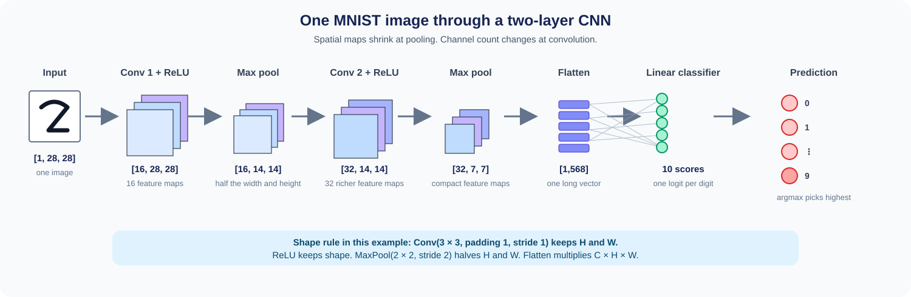
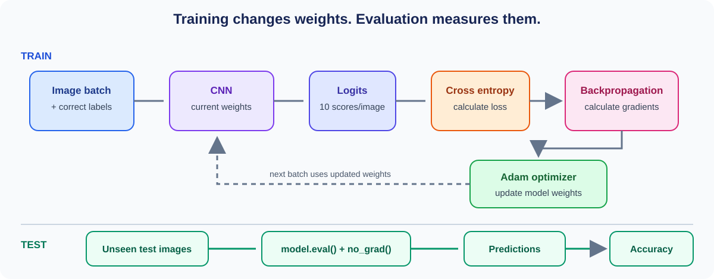

# Lesson 4: Build Your First CNN in PyTorch

## By the end, you will be able to

- Load and batch **[MNIST images](#2-load-mnist)** as PyTorch tensors.
- Implement and inspect a **[CNN model](#3-create-the-cnn)** with the layers from Lesson 3.
- Describe the roles of **[loss and optimizer](#5-choose-a-loss-and-optimizer)** during a training step.
- Train the model and measure **[test accuracy](#7-evaluate-on-validation-and-test-images)** on held-out images.
- Inspect **[feature maps and filter weights](#8-visualize-what-the-cnn-learned)** and save model weights.

## In this lesson

- Build the same two-convolution network from Lesson 3.
- Download and visualize MNIST, then check tensor shapes.
- Train for five epochs and evaluate on the test set.
- Save the model and compare filters and feature maps.

---

## 1. What are we building?

The CNN receives a 28 × 28 grayscale image and produces ten scores, one for each digit. It has the same 20,490 trainable parameters as Lesson 3.



We'll use PyTorch for the model and training, TorchVision for MNIST, and Matplotlib for visualizations. The full runnable script is `examples/01-cnn-fundamentals/lesson-04/train_mnist.py`.

### Set up the optional vision packages

The course environment keeps its documentation dependencies small. Install the libraries for this lesson into the course `.venv`. PyTorch's install command depends on your operating system and whether you want CPU or GPU support, so choose the matching build from the [official PyTorch installer](https://pytorch.org/get-started/locally/).

```bash
uv sync
uv pip install --python .venv/bin/python torch torchvision matplotlib
```

The second command installs the default packages for your platform. If you need a specific CPU or CUDA build, use the matching index option from the official installer with `uv pip install --python .venv/bin/python`.

---

## 2. Load MNIST

TorchVision downloads 60,000 training images and 10,000 test images the first time the script runs. `ToTensor()` converts each grayscale image to a tensor of shape `[1, 28, 28]` and scales pixels to values between 0 and 1. By default, the script uses 54,000 images for training and holds 6,000 from the training set for validation. It keeps all 10,000 test images separate until final evaluation. The `TRAIN_SIZE` constant can be reduced for the small-data experiment in Lesson 6. The dataset is stored under `data/mnist/` in the repository, which is ignored by Git.

The loader function used by the runnable example is:

```python
--8<-- "examples/01-cnn-fundamentals/lesson-04/train_mnist.py:loaders"
```

The data is downloaded when `download=True` and reused on later runs. Validation data helps us monitor learning and choose when to stop; reserve test data for the final evaluation so it stays unseen during model development.

---

## 3. Create the CNN

`nn.Module` is PyTorch's base class for models. `__init__` creates the layers and their trainable parameters. `forward` describes how an input passes through the layers. ReLU and max pooling have no trainable parameters, so their shared instances can be reused.

```python
import torch
from torch import nn

--8<-- "examples/01-cnn-fundamentals/lesson-04/train_mnist.py:model"
```

The final layer returns **raw logits**. We do not apply softmax in `forward`, because `CrossEntropyLoss` expects logits and handles the needed normalization internally.

---

## 4. Inspect tensor shapes

Before training, inspect a dummy image as it passes through each layer. A leading batch dimension is present even when the batch contains only one image:

```python
--8<-- "examples/01-cnn-fundamentals/lesson-04/train_mnist.py:inspect"
```

Expected shapes:

```text
Input:         [1, 1, 28, 28]
After Conv1:   [1, 16, 28, 28]
After ReLU:    [1, 16, 28, 28]
After Pool1:   [1, 16, 14, 14]
After Conv2:   [1, 32, 14, 14]
After Pool2:   [1, 32, 7, 7]
After Flatten: [1, 1568]
Output:        [1, 10]
```

---

## 5. Choose a loss and optimizer

**Cross-entropy loss** compares the ten logits with the correct digit label. A larger loss means the prediction is worse according to this loss function. **Adam** is the optimizer: it uses gradients from backpropagation to update the model's trainable weights. The learning rate `0.001` controls the scale of those updates.

A batch contains 64 images with shape `[64, 1, 28, 28]` and 64 labels with shape `[64]` (the last batch can be smaller). An **epoch** is one pass through the 54,000 training images.

---

## 6. Train the CNN



Each batch uses five steps:

1. Clear gradients from the previous batch.
2. Run the forward pass to get ten logits per image.
3. Calculate the loss against the correct labels.
4. Backpropagate the loss to calculate gradients.
5. Update the model weights with Adam.

Here is the training function from the runnable example:

```python
--8<-- "examples/01-cnn-fundamentals/lesson-04/train_mnist.py:train"
```

The script repeats this function for five epochs, recording training loss and accuracy alongside validation loss, validation accuracy, and learning rate after each epoch. It saves these values in `training_history.csv` and plots loss and accuracy in `training_curves.png`. Values depend on initialization, package versions, and hardware. Training metrics alone do not show how well the model handles unseen images.

<div class="quiz" data-answer="b" data-explanation="The model returns raw logits, and CrossEntropyLoss combines them with the correct labels to calculate classification loss.">
  <p><strong>Checkpoint 1:</strong> What does `CrossEntropyLoss` receive?</p>
  <label><input type="radio" name="lesson4-loss" value="a"> Only the input images</label><br>
  <label><input type="radio" name="lesson4-loss" value="b"> Raw logits and the correct class labels</label><br>
  <label><input type="radio" name="lesson4-loss" value="c"> Softmax probabilities and the feature maps</label><br>
  <button class="quiz-check" type="button">Check answer</button>
  <p class="quiz-result" aria-live="polite"></p>
</div>

---

## 7. Evaluate on validation and test images

Validation metrics are measured after each epoch to track how well the model handles held-out examples. After training is complete, test metrics provide one final evaluation. `model.eval()` sets evaluation behavior, and `torch.no_grad()` avoids recording gradients that are unnecessary for prediction.

```python
--8<-- "examples/01-cnn-fundamentals/lesson-04/train_mnist.py:evaluate"
```

The script calls this function for validation after each epoch and for the test set once at the end. A small CNN can often reach around 98% or higher after suitable training, but your result may vary. The test set should not be used to choose hyperparameters or decide when to stop training.

<div class="quiz" data-answer="a" data-explanation="Evaluation uses model.eval() and torch.no_grad() to predict without updating weights or tracking gradients.">
  <p><strong>Checkpoint 2:</strong> What should the model do during test evaluation?</p>
  <label><input type="radio" name="lesson4-evaluation" value="a"> Make predictions without calculating or updating gradients</label><br>
  <label><input type="radio" name="lesson4-evaluation" value="b"> Call loss.backward() for every test batch</label><br>
  <label><input type="radio" name="lesson4-evaluation" value="c"> Shuffle test images and update the optimizer</label><br>
  <button class="quiz-check" type="button">Check answer</button>
  <p class="quiz-result" aria-live="polite"></p>
</div>

---

## 8. Visualize what the CNN learned

The script saves three images under `examples/01-cnn-fundamentals/lesson-04/outputs/`:

- `mnist_sample.png` shows one test image and its label.
- `feature_maps.png` shows the 16 first-layer responses after ReLU.
- `kernels_before_after.png` compares the first convolution's 3 × 3 weights before and after training.

A feature map shows where a filter responds. The map may emphasize strokes or boundaries, but it is not necessarily a human-readable label. The kernel plot uses one shared color scale for the before/after comparison.

```python
--8<-- "examples/01-cnn-fundamentals/lesson-04/train_mnist.py:visualize"
```

Run this visualization after training. Comparing random starting weights with trained weights makes it easier to see that training changes the filters.

<div class="quiz" data-answer="b" data-explanation="Each feature map shows the first convolution filter's activations across the image after ReLU.">
  <p><strong>Checkpoint 3:</strong> What does one first-layer feature map show?</p>
  <label><input type="radio" name="lesson4-feature-map" value="a"> The 3 × 3 filter weights plotted as an image</label><br>
  <label><input type="radio" name="lesson4-feature-map" value="b"> Where one filter responds across the input image</label><br>
  <label><input type="radio" name="lesson4-feature-map" value="c"> The ten final digit scores</label><br>
  <button class="quiz-check" type="button">Check answer</button>
  <p class="quiz-result" aria-live="polite"></p>
</div>

---

## 9. Save and reload the model

The script saves the learned parameters as a `state_dict`, a mapping from layer names to tensors. To restore them, create the same model architecture first, then load the saved state:

```python
model = SimpleCNN()
state = torch.load(
    "examples/01-cnn-fundamentals/lesson-04/outputs/mnist_cnn.pth",
    map_location="cpu",
    weights_only=True,
)
model.load_state_dict(state)
model.eval()
```

The checkpoint stores weights, not the Python class definition. Keep `SimpleCNN` available when loading it.

---

## Run the complete example

From the repository root, with the lesson dependencies installed:

```bash
uv run python examples/01-cnn-fundamentals/lesson-04/train_mnist.py
```

The script chooses CUDA when PyTorch can use it and otherwise runs on CPU. The first run downloads MNIST. It trains for five epochs, reports train and validation metrics, evaluates once on the test set, saves `mnist_cnn.pth`, and writes the visualizations and learning curves. CPU training may take several minutes.

---

## Hands-on: change the model

Try one change at a time and compare test accuracy and saved feature maps:

1. Change the first convolution from 16 filters to 4. Update the next convolution's `in_channels` and compare the result.
2. Change both kernels from 3 × 3 to 5 × 5. Set `padding=2` to keep spatial sizes unchanged.
3. Remove the second convolution and update the linear layer's input size to match the remaining tensor shape.

### Solution guide

<details>
<summary>Show how to update the dimensions</summary>

1. With 4 first-layer filters, `conv1` outputs 4 channels, so `conv2` must use `in_channels=4`. The final flatten size stays `32 × 7 × 7 = 1,568` if `conv2` still outputs 32 channels.
2. With 5 × 5 kernels and padding 2, height and width remain unchanged before each pooling layer. The flatten size remains 1,568.
3. Without `conv2`, the second pooling output is `[16, 7, 7]`, so set the linear layer to `nn.Linear(16 * 7 * 7, 10)` or `nn.Linear(784, 10)`.

The exact accuracy change is empirical. Fewer filters or layers may reduce capacity, but a smaller network can still perform well on MNIST.

</details>

---

## What you've learned

- The model turns batches of images into ten logits per image.
- Training updates weights using loss, gradients, and an optimizer; evaluation measures predictions without updates.
- Feature maps and kernel plots offer two different views into the trained network.

Next, [Lesson 5: What Does a CNN Actually Learn?](../../../syllabus.md#stage-1-cnn-fundamentals-lessons-16) will compare filters and activations before and after training. Review [Lesson 3: How CNN Layers Transform Images](../lesson-03-how-cnn-layers-transform-images/index.md) for the shape-by-shape explanation.
