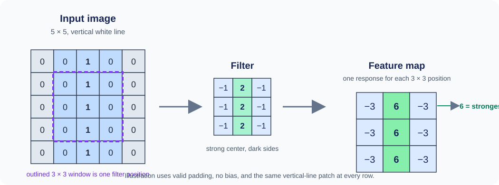
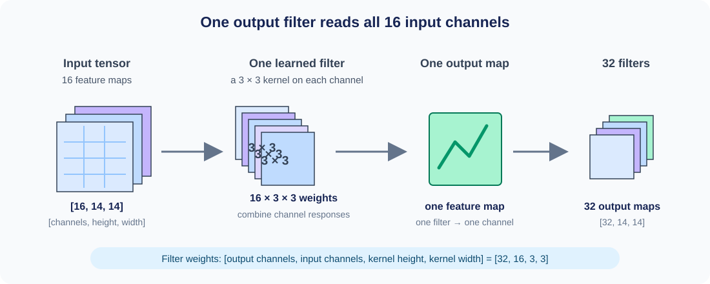

# Lesson 5: What Does a CNN Actually Learn?

**Stage:** CNN Fundamentals · **Level:** Beginner · **Dataset:** MNIST

## By the end, you will be able to

- Describe how **[weights change during training](#1-training-changes-weights)**.
- Explain what a **[feature map](#2-a-feature-map-shows-where-a-filter-responds)** shows at each image location.
- Describe how **[multiple filters and deeper layers](#3-why-use-multiple-filters)** build useful representations.
- Compare **[first- and second-layer activations](#4-deeper-layers-combine-earlier-features)** without assuming each map has one obvious meaning.
- Visualize features from a trained MNIST model with the **[runnable example](#6-visualize-your-trained-cnn)**.

## In this lesson

- Compare random and trained filter weights.
- Follow a filter response across an image into a feature map.
- See how later layers use feature maps from earlier layers.
- Load the Lesson 4 model and visualize activations for several digits.

---

## 1. Training changes weights

The CNN from Lesson 4 starts with randomly initialized weights. Training changes those numbers so the network's final digit predictions improve. The model does not store a written rule such as “if two loops, predict 8.”

The grids below are **illustrative**, not measured weights from a specific run. A filter can sometimes be interpreted as responding to an edge or stroke, but real filters are not always easy to name.

```text
Random starting weights       Possible trained weights
 0.12  -0.24   0.08            -0.82   1.24  -0.75
-0.18   0.31  -0.11            -0.91   1.53  -0.88
 0.05  -0.09   0.21            -0.71   1.18  -0.67
```

In Lesson 4, the training cycle was:

```text
Image → prediction → loss → gradients → weight update
```

The architecture stays the same during this cycle; the learned parameter values change.

---

## 2. A feature map shows where a filter responds

A convolution filter slides across an image. At each position it produces a response. The grid of responses is a **feature map**: a map of how strongly that filter responds at different locations.



This is a schematic, not the exact convolution output for an MNIST digit. Actual values depend on the image, padding, bias, and filter weights. A bright location means a stronger activation in this display, not that the filter has recognized the whole digit.

<div class="quiz" data-answer="b" data-explanation="A feature map records the response of one filter at positions across an input.">
  <p><strong>Checkpoint 1:</strong> What does one feature map represent?</p>
  <label><input type="radio" name="lesson5-feature-map" value="a"> The ten final class probabilities</label><br>
  <label><input type="radio" name="lesson5-feature-map" value="b"> One filter's responses at different image locations</label><br>
  <label><input type="radio" name="lesson5-feature-map" value="c"> A copy of the original image with no processing</label><br>
  <button class="quiz-check" type="button">Check answer</button>
  <p class="quiz-result" aria-live="polite"></p>
</div>

---

## 3. Why use multiple filters?

One filter cannot represent every useful pattern. The first convolution has 16 independent filters, each with its own weights. They all process the same input and produce separate feature maps:

```text
                       Input image
                           │
             ┌─────────────┼─────────────┐
             ▼             ▼             ▼
        Filter 1       Filter 2       Filter 3  …
             │             │             │
             ▼             ▼             ▼
        Feature map   Feature map   Feature map …
```

The layer produces 16 feature maps, giving the tensor shape `[16, 28, 28]` for one image. Different maps can respond to different image structures, but those roles are not manually assigned. Some filters respond to several patterns or are hard to interpret.

---

## 4. Deeper layers combine earlier features

After the first convolution, ReLU, and pooling, the next layer receives `[16, 14, 14]` feature values. It does not receive the original pixels again. Each second-layer filter reads all 16 input channels and combines local evidence from them.



A useful mental model is that early layers respond to local edges and strokes, while later layers can combine those responses into curves, intersections, or partial shapes. This is a conceptual guide: training optimizes digit classification, not human interpretability, so a filter may not have a single clear meaning.

<div class="quiz" data-answer="a" data-explanation="The second convolution receives the first layer's 16 feature maps and combines information across them.">
  <p><strong>Checkpoint 2:</strong> What does the second convolution use as its input?</p>
  <label><input type="radio" name="lesson5-second-layer" value="a"> The 16 feature maps produced by the earlier layer</label><br>
  <label><input type="radio" name="lesson5-second-layer" value="b"> Only the original grayscale pixels</label><br>
  <label><input type="radio" name="lesson5-second-layer" value="c"> The final ten digit labels</label><br>
  <button class="quiz-check" type="button">Check answer</button>
  <p class="quiz-result" aria-live="polite"></p>
</div>

---

## 5. Compare before and after training carefully

Lesson 4's training script saves `kernels_before_after.png`. It compares the same model's first-layer kernels before and after training, using one color scale. Use that image to see which values changed during training.

Comparing activation maps from a newly initialized model with maps from a separately trained model is also possible, but filter 1 from one model is not guaranteed to correspond to filter 1 from the other. Their initializations differ, so filter numbering does not identify the same learned feature.

A model is trained to reduce classification error. Some learned weights may look like simple edge detectors, but interpretability is not the objective.

---

## 6. Visualize your trained CNN

The runnable example loads the Lesson 4 checkpoint and displays digits 1, 5, and 8 beside selected feature maps from both convolutional layers. It also saves a grid of the trained first-layer kernels.

The model definition must match Lesson 4 so the checkpoint weights fit the same layer shapes:

```python
--8<-- "examples/01-cnn-fundamentals/lesson-05/visualize_cnn.py:model"
```

Run it from the repository root after completing Lesson 4:

```bash
uv run python examples/01-cnn-fundamentals/lesson-05/visualize_cnn.py
```

It loads the test set and saves three images under `examples/01-cnn-fundamentals/lesson-05/outputs/`:

- `first_layer_maps.png`: each input beside the first eight Conv1 maps.
- `second_layer_maps.png`: each input beside the first eight Conv2 maps.
- `trained_kernels.png`: the 16 learned 3 × 3 Conv1 filters.

The selected maps are only a sample; each layer has 16 or 32 maps. Feature map intensities are shown relative to each plotted map, so brightness should not be read as a class probability.

The script loads and evaluates the network without updating its weights:

```python
--8<-- "examples/01-cnn-fundamentals/lesson-05/visualize_cnn.py:load"
```

It chooses the first test image found for each requested digit:

```python
--8<-- "examples/01-cnn-fundamentals/lesson-05/visualize_cnn.py:examples"
```

It extracts first- and second-layer activations in a forward pass:

```python
--8<-- "examples/01-cnn-fundamentals/lesson-05/visualize_cnn.py:activations"
```

The plotting helper places each input beside eight maps from the selected layer:

```python
--8<-- "examples/01-cnn-fundamentals/lesson-05/visualize_cnn.py:plot_maps"
```

<div class="quiz" data-answer="c" data-explanation="These visualizations show intermediate activations and filter weights, not the model's final class probabilities.">
  <p><strong>Checkpoint 3:</strong> What does a feature-map visualization show?</p>
  <label><input type="radio" name="lesson5-visualization" value="a"> The model's confidence for each digit</label><br>
  <label><input type="radio" name="lesson5-visualization" value="b"> A guarantee that a filter has one human-readable purpose</label><br>
  <label><input type="radio" name="lesson5-visualization" value="c"> Intermediate filter responses at image locations</label><br>
  <button class="quiz-check" type="button">Check answer</button>
  <p class="quiz-result" aria-live="polite"></p>
</div>

---

## Hands-on: compare feature maps for digits 1, 5, and 8

Run the visualization script and open `first_layer_maps.png`. Choose one filter column and compare its response for each digit. Then compare the same inputs in `second_layer_maps.png`.

Write down:

1. Which of the three inputs gives the strongest-looking response in that map?
2. Does the same filter respond to more than one digit?
3. How does the second-layer map differ in spatial size and appearance?

<details>
<summary>Show a sample solution</summary>

There is no single correct filter or handwritten image, and each training run can learn different weights. A good observation might be: “Filter 3 is bright along part of the stroke for both 1 and 8, so its response is not a digit label. The second-layer maps are 14 × 14 because pooling reduced the first-layer maps from 28 × 28.” Use the actual saved images to support your observation.

</details>

---

## Lesson 5 summary

- Training changes the network's numerical weights.
- A feature map shows where one filter responds.
- Multiple filters create multiple representations of the same image.
- Deeper layers combine earlier feature maps, but their features are not always easy to name.
- Visualizations help us inspect the model without turning activations into human-written rules.

Next, [Lesson 6: Training, Overfitting, and Improving Accuracy](../../../syllabus.md#stage-1-cnn-fundamentals-lessons-16) will compare training and test performance, explore overfitting, and discuss ways to improve a baseline. Review [Lesson 4: Build Your First CNN in PyTorch](../lesson-04-build-first-cnn-pytorch/index.md) to train the checkpoint used here.
