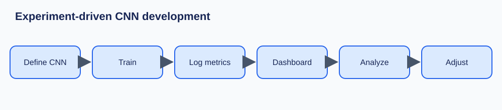
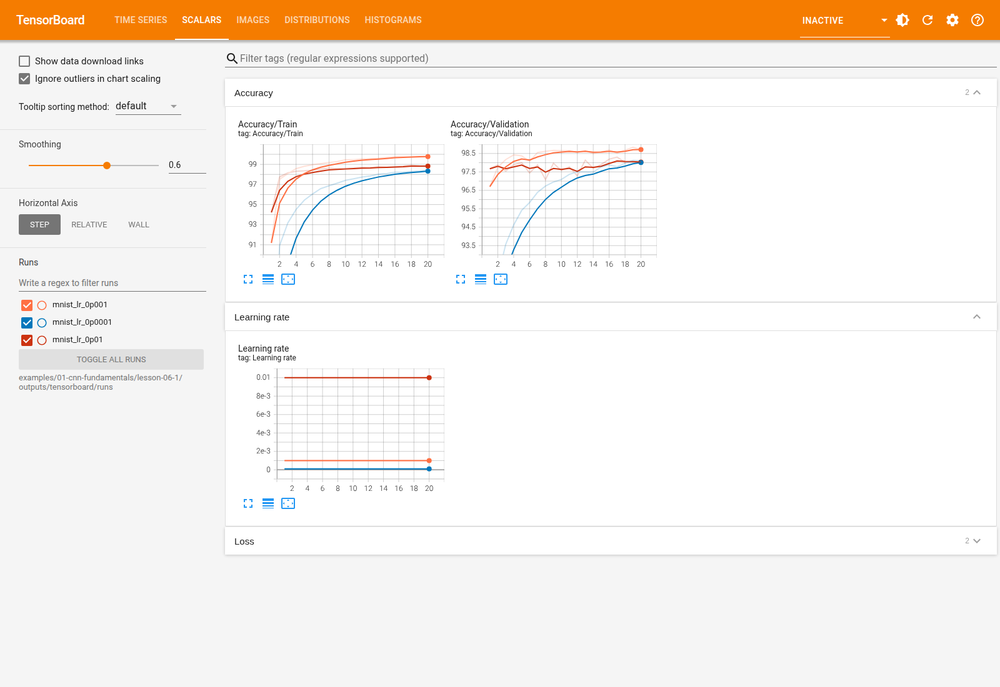
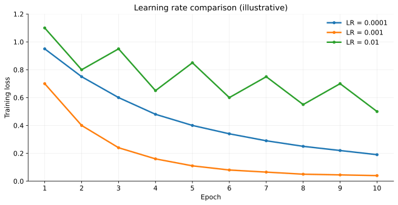
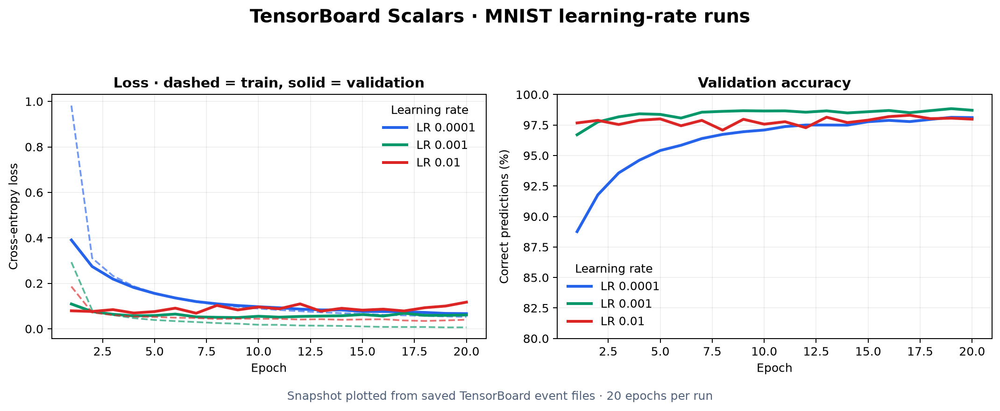

# Lesson 6.1: See CNN Training with TensorBoard

## By the end, you will be able to

- Explain **[why training dashboards help](#1-why-look-inside-a-training-run)**.
- Read **[loss and accuracy curves](#2-follow-loss-and-accuracy)** to compare learning behavior.
- Interpret **[weight histograms and image summaries](#3-look-at-images-and-weights)**.
- Compare runs with **[TensorBoard](#4-compare-independent-runs)** while keeping the test set untouched.
- Run a **[hands-on MNIST experiment](#5-hands-on-compare-learning-rates)** and evaluate one selected checkpoint.

## In this lesson

- Track training and validation metrics over time.
- Open TensorBoard during training or review saved logs afterward.
- View recorded validation images and weight histograms.
- Compare learning rates while keeping the data split and model fixed.
- Run final test evaluation only after choosing a model.

> **Optional supplement:** This dashboard lesson extends Lesson 6. It is not part of the 15 core lessons.

## Before you begin

**TensorBoard** is a dashboard for viewing training information—such as loss, accuracy, images, and weight histograms—that a script records as it runs. Install it into the course `.venv` from the repository root:

```bash
uv pip install --python .venv/bin/python tensorboard
```

This lesson assumes PyTorch and TorchVision are already installed, as in Lesson 4. If not, follow the [Lesson 4 setup](../lesson-04-build-first-cnn-pytorch/index.md#set-up-the-optional-vision-packages) first.

---

## 1. Why look inside a training run?

In Lesson 4, the CNN printed a few numbers to the terminal. A dashboard puts those measurements on a timeline. This makes it easier to notice whether training is improving, stalling, or becoming unstable.

The workflow is:



TensorBoard is a visualization tool: the training code writes event records, and TensorBoard displays them. We will track scalar values such as loss and accuracy, sample images, and weight histograms. Each record includes a **step** (here, the epoch number), so values can be compared over time.

The example uses the same small MNIST CNN as Lesson 4. It makes a fixed split of the 60,000 training images into 50,000 training and 10,000 validation examples. The official 10,000-image test set stays separate while runs are compared.

### View a run while it trains or afterward

The training script saves TensorBoard event files under a separate folder for each `--run-name`. Start the training script in one terminal. In a second terminal, run the TensorBoard command below and open `http://localhost:6006`:

```bash
uv run tensorboard --logdir examples/01-cnn-fundamentals/lesson-06-1/outputs/tensorboard/runs --host 127.0.0.1
```

**While training**, TensorBoard reads new event records as the script writes them at the end of each epoch. **After training**, start the same dashboard command to inspect the saved event files; the training process does not need to be running. This is local monitoring and review, not a cloud service, and the saved logs can be viewed without an internet connection.

The essential pattern inside the training loop is to calculate metrics, record them with the epoch as the step, then flush the writer so an open dashboard can see the latest values:

```python
--8<-- "examples/01-cnn-fundamentals/lesson-06-1/visualize_training.py:logging"
```

To record a simple run before opening TensorBoard, use one unique run name:

```bash
uv run python examples/01-cnn-fundamentals/lesson-06-1/visualize_training.py --learning-rate 0.001 --run-name mnist_lr_0p001
```

If no run has written event files yet, TensorBoard has no metrics to display. Keep the dashboard command running while you inspect it, and stop it with `Ctrl+C` when finished.

---

## 2. Follow loss and accuracy

**Loss** summarizes how far predictions are from the correct labels. **Accuracy** counts the fraction classified correctly. Training metrics describe examples used to update the weights. Validation metrics describe held-out examples measured without weight updates.


If training loss falls while validation loss flattens or rises, the model may be overfitting. A single curve does not explain the cause by itself; check the data, split, and training settings too.

Accuracy complements loss. It is possible for loss to improve while accuracy changes little, because confidence can change even when the top predicted class stays the same.


The figures on this page are **illustrative diagrams from the supplied lesson materials**, not measurements from this example. Your TensorBoard plots will be generated by your own run and will vary.

### Explore a simulated TensorBoard graph

Choose a learning rate to update the training and validation loss curves. These fixed, **simulated teaching values** illustrate common patterns; they are not measurements from a trained model or TensorBoard event files.

<div class="tb-simulator" data-tb-simulator>
  <label class="tb-simulator-control" for="lesson61-learning-rate">Learning rate</label>
  <select id="lesson61-learning-rate" data-learning-rate aria-describedby="lesson61-simulator-help">
    <option value="0.0001">0.0001 — small steps</option>
    <option value="0.001" selected>0.001 — steady steps</option>
    <option value="0.01">0.01 — large steps</option>
  </select>
  <p id="lesson61-simulator-help">Watch how the train and validation loss change over ten epochs.</p>
  <svg class="tb-simulator-chart" viewBox="0 0 680 390" role="img" aria-labelledby="lesson61-chart-title lesson61-chart-description">
    <title id="lesson61-chart-title">Simulated TensorBoard loss chart</title>
    <desc id="lesson61-chart-description" data-chart-description>Illustrative train and validation loss for learning rate 0.001 across ten epochs.</desc>
    <rect x="0" y="0" width="680" height="390" rx="12" fill="#ffffff"/>
    <text x="340" y="27" class="tb-chart-title" text-anchor="middle">Loss by epoch</text>
    <g class="tb-chart-grid">
      <line x1="78" y1="55" x2="630" y2="55"/><line x1="78" y1="107" x2="630" y2="107"/>
      <line x1="78" y1="159" x2="630" y2="159"/><line x1="78" y1="211" x2="630" y2="211"/>
      <line x1="78" y1="263" x2="630" y2="263"/><line x1="78" y1="315" x2="630" y2="315"/>
    </g>
    <g class="tb-chart-axis">
      <path d="M78 55V315H630"/>
      <text x="62" y="320" text-anchor="end">0</text><text x="62" y="268" text-anchor="end">0.5</text>
      <text x="62" y="216" text-anchor="end">1.0</text><text x="62" y="164" text-anchor="end">1.5</text>
      <text x="62" y="112" text-anchor="end">2.0</text><text x="62" y="60" text-anchor="end">2.5</text>
      <text x="78" y="338" text-anchor="middle">1</text><text x="139" y="338" text-anchor="middle">2</text>
      <text x="201" y="338" text-anchor="middle">3</text><text x="262" y="338" text-anchor="middle">4</text>
      <text x="323" y="338" text-anchor="middle">5</text><text x="385" y="338" text-anchor="middle">6</text>
      <text x="446" y="338" text-anchor="middle">7</text><text x="507" y="338" text-anchor="middle">8</text>
      <text x="569" y="338" text-anchor="middle">9</text><text x="630" y="338" text-anchor="middle">10</text>
      <text x="354" y="369" text-anchor="middle">Epoch</text>
      <text transform="translate(20 190) rotate(-90)" text-anchor="middle">Loss</text>
    </g>
    <path class="tb-series tb-series-train" data-train-line d=""/>
    <path class="tb-series tb-series-validation" data-validation-line d=""/>
    <g data-train-points></g><g data-validation-points></g>
  </svg>
  <div class="tb-chart-legend" aria-hidden="true"><span><i class="tb-series-train"></i>Train</span><span><i class="tb-series-validation"></i>Validation</span></div>
  <p class="tb-simulator-status" data-simulator-status aria-live="polite">Selected rate: 0.001. Compare the two loss curves.</p>

<div class="quiz tb-simulator-quiz" data-simulator-quiz data-answer="b" data-explanation="Both losses fall steadily and stay close in this illustration, which is the most useful of these three patterns.">
  <p><strong>Checkpoint:</strong> What does the graph for the selected learning rate suggest?</p>
  <label><input type="radio" name="lesson61-simulated-graph" value="a"> The rate may be too small, so progress is slow</label><br>
  <label><input type="radio" name="lesson61-simulated-graph" value="b"> The losses fall steadily and remain close</label><br>
  <label><input type="radio" name="lesson61-simulated-graph" value="c"> The updates may be too large and unstable</label><br>
  <button class="quiz-check" type="button">Check answer</button>
  <p class="quiz-result" aria-live="polite"></p>
</div>
</div>

<div class="quiz" data-answer="b" data-explanation="Training loss measures fit on examples used for weight updates. Validation loss measures performance on held-out examples and helps compare runs.">
  <p><strong>Checkpoint 1:</strong> Which metric should guide your choice between two learning-rate runs?</p>
  <label><input type="radio" name="lesson61-metrics" value="a"> The final training loss only</label><br>
  <label><input type="radio" name="lesson61-metrics" value="b"> Validation loss and accuracy, considered together</label><br>
  <label><input type="radio" name="lesson61-metrics" value="c"> The test accuracy after every epoch</label><br>
  <button class="quiz-check" type="button">Check answer</button>
  <p class="quiz-result" aria-live="polite"></p>
</div>

---

## 3. Look at images and weights

The example records 16 validation images so you can confirm what the model is processing. It also writes histograms of the first two convolutional layers' weights every five epochs.

A **histogram** groups numerical values into ranges and shows how many weights fall in each range. It can reveal whether a distribution is shifting or becoming unusually concentrated. A histogram does not tell us by itself whether a filter has learned a useful visual feature; pair it with feature-map visualizations from Lesson 5.

These summaries are logged in the training script under clear scalar tags such as `Loss/Train` and `Loss/Validation`.

### Read the graphs and tabs



This is a snapshot of the actual TensorBoard page for the three saved runs. The run list on the left lets you show or hide a run; its color identifies that run's line. The horizontal axis is the epoch. The **Accuracy/Train** graph shows fit on training data, while **Accuracy/Validation** shows results on held-out data. The **Learning rate** graph confirms each run's setting. The **Loss** section is collapsed in this snapshot; expand it to compare `Loss/Train` and `Loss/Validation`.

For this experiment, start with **Loss/Validation** and **Accuracy/Validation**. The training script saves a checkpoint when validation loss improves. A widening gap where training loss continues to fall but validation loss rises can indicate overfitting. Use the run checkboxes to compare learning rates, and lower the **Smoothing** setting toward zero when you want to inspect the unsmoothed values.

| Tab | What it displays | How to use it in this lesson |
|---|---|---|
| **Time Series** | A combined view of scalar graphs, images, and histograms | Scan related summaries together while training |
| **Scalars** | Numeric values recorded at each step, such as loss, accuracy, and learning rate | Compare train and validation curves across runs |
| **Images** | Images recorded by the training script | Check the MNIST examples the model receives |
| **Distributions** | How a tensor's value distribution changes over training steps | Notice whether weight values spread out or become concentrated |
| **Histograms** | Weight-value counts at the recorded steps | Inspect the distributions for `conv1` and `conv2`, logged every five epochs |

The example only records weight histograms every five epochs, so those tabs update less often than the scalar graphs. A histogram can show how weights change, but it cannot prove that a filter detects a meaningful feature. See the official [TensorBoard visualization guide](https://github.com/tensorflow/tensorboard#the-visualizations) for more on the dashboard views.

### Summarize what changed in a training session

“Parameters” can mean the model's **learned weights and biases**, or the **settings** chosen for training. During one run, the optimizer updates weights and biases after each training batch. Settings such as learning rate, batch size, and epoch count stay fixed for that run. In this lesson's comparisons, only the learning rate changes between runs.

| Item | What happens during one run? | Where to inspect it |
|---|---|---|
| Convolution and classifier weights and biases | Updated by backpropagation and Adam after each training batch | Histograms show `conv1` and `conv2` weights every five epochs; biases and classifier weights are not histogrammed |
| Learning rate | Fixed within a run; changed between comparison runs | `Scalars` → `Learning rate` and `Text` → `Run settings` |
| Batch size, epoch count, data split, random seed, and model | Fixed for fair comparisons | `Text` → `Run settings` |
| Loss and accuracy | Measured each epoch; they are not model parameters | `Scalars` |

The training script records the run settings in TensorBoard's **Text** tab, so each run has a configuration summary beside its graphs. The model has 20,490 trainable weights and biases; the histograms show only some of them. Compare the settings first, then use validation curves to see how each learning rate affected training.

---

## 4. Compare independent runs

Each run uses its own name and event directory. Keep the seed, architecture, data split, batch size, and number of epochs fixed so the learning rate is the main difference.



The curve shapes are tendencies, not promises. A learning rate that looks good on one model or dataset may not be best for another. Compare the validation metrics from the actual runs.



This snapshot is plotted from the runs' saved TensorBoard event files. The lower learning rate improves more gradually, while the highest learning rate's validation loss rises later in training. The medium learning rate performs well in these runs. Your results may differ; use your own validation curves when choosing a checkpoint.

When validation loss improves, the script saves that model as the current best checkpoint:

```python
--8<-- "examples/01-cnn-fundamentals/lesson-06-1/visualize_training.py:checkpoint"
```

This **best checkpoint** lets you use the weights from the strongest validation epoch, even if later epochs perform worse. The official test split is not involved in that selection.

<div class="quiz" data-answer="a" data-explanation="Changing one setting at a time makes the comparison easier to interpret. The fixed seed and split also reduce unrelated variation between runs.">
  <p><strong>Checkpoint 2:</strong> What is the cleanest way to compare learning rates?</p>
  <label><input type="radio" name="lesson61-runs" value="a"> Keep the setup fixed and change only the learning rate</label><br>
  <label><input type="radio" name="lesson61-runs" value="b"> Change learning rate, architecture, and data split together</label><br>
  <label><input type="radio" name="lesson61-runs" value="c"> Select the run with the highest training accuracy</label><br>
  <button class="quiz-check" type="button">Check answer</button>
  <p class="quiz-result" aria-live="polite"></p>
</div>

---

## 5. Hands-on: compare learning rates

The companion instructions are in `examples/01-cnn-fundamentals/lesson-06-1/README.md`. They install TensorBoard into the course `.venv`, explain the output files, and include the dashboard command.

From the repository root, run the baseline and two comparison runs:

```bash
uv run python examples/01-cnn-fundamentals/lesson-06-1/visualize_training.py --learning-rate 0.001 --run-name mnist_lr_0p001
uv run python examples/01-cnn-fundamentals/lesson-06-1/visualize_training.py --learning-rate 0.0001 --run-name mnist_lr_0p0001
uv run python examples/01-cnn-fundamentals/lesson-06-1/visualize_training.py --learning-rate 0.01 --run-name mnist_lr_0p01
```

Open TensorBoard using the README command. In **Scalars**, compare `Loss/Validation` and `Accuracy/Validation` for the three runs. Note which run improves steadily, which is slow, and whether any run becomes unstable. Use validation behavior to choose one run and its saved best checkpoint.

After you have chosen, evaluate that one checkpoint once on MNIST's test set:

```bash
uv run python examples/01-cnn-fundamentals/lesson-06-1/evaluate_best.py --run-name mnist_lr_0p001
```

Replace the run name if another configuration was selected. Record the test result as the final check; do not use it to go back and tune the comparison. The training downloads MNIST the first time, and runtime depends on your CPU/GPU. Run names must be unique if you want to preserve earlier runs.

<div class="quiz" data-answer="c" data-explanation="Choose the run using validation data, then use the untouched test set for a final estimate after the choice is made.">
  <p><strong>Checkpoint 3:</strong> When should the official test set be evaluated?</p>
  <label><input type="radio" name="lesson61-test" value="a"> After every epoch, to decide when training should stop</label><br>
  <label><input type="radio" name="lesson61-test" value="b"> Every time a learning rate is changed</label><br>
  <label><input type="radio" name="lesson61-test" value="c"> Once after choosing a run with validation metrics</label><br>
  <button class="quiz-check" type="button">Check answer</button>
  <p class="quiz-result" aria-live="polite"></p>
</div>

---

## Lesson summary

- TensorBoard turns per-epoch metrics and model summaries into visual timelines.
- Loss and accuracy answer related but different questions about model behavior.
- Validation results help compare runs and select a checkpoint.
- The test set stays separate until choices are complete.

You can revisit [Lesson 6: Training, Overfitting, and Improving Accuracy](../lesson-06-training-overfitting-improve-accuracy/index.md) for curve interpretation, or continue to [Lesson 7: From MNIST to CIFAR-10](../../../syllabus.md#modern-cnns-lessons-710) to move from grayscale digits to color images.
