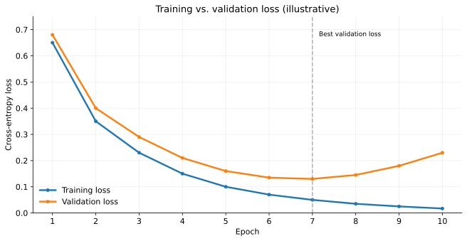
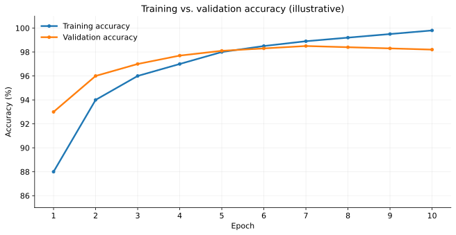

# Lesson 6.1: See CNN Training with TensorBoard

## By the end, you will be able to

- Explain **[why training dashboards help](#1-why-look-inside-a-training-run)**.
- Read **[loss and accuracy curves](#2-follow-loss-and-accuracy)** to compare learning behavior.
- Interpret **[weight histograms and image summaries](#3-look-at-images-and-weights)**.
- Compare runs with **[TensorBoard](#4-compare-independent-runs)** while keeping the test set untouched.
- Run a **[hands-on MNIST experiment](#5-hands-on-compare-learning-rates)** and evaluate one selected checkpoint.

## In this lesson

- Track training and validation metrics over time.
- View recorded validation images and weight histograms.
- Compare learning rates while keeping the data split and model fixed.
- Run final test evaluation only after choosing a model.

> **Optional supplement:** This dashboard lesson extends Lesson 6. It is not part of the 15 core lessons.

---

## 1. Why look inside a training run?

In Lesson 4, the CNN printed a few numbers to the terminal. A dashboard puts those measurements on a timeline. This makes it easier to notice whether training is improving, stalling, or becoming unstable.

The workflow is:


TensorBoard is a visualization tool: the training code writes event records, and TensorBoard displays them. We will track scalar values such as loss and accuracy, sample images, and weight histograms. Each record includes a **step** (here, the epoch number), so values can be compared over time.

The example uses the same small MNIST CNN as Lesson 4. It makes a fixed split of the 60,000 training images into 50,000 training and 10,000 validation examples. The official 10,000-image test set stays separate while runs are compared.

---

## 2. Follow loss and accuracy

**Loss** summarizes how far predictions are from the correct labels. **Accuracy** counts the fraction classified correctly. Training metrics describe examples used to update the weights. Validation metrics describe held-out examples measured without weight updates.



If training loss falls while validation loss flattens or rises, the model may be overfitting. A single curve does not explain the cause by itself; check the data, split, and training settings too.

Accuracy complements loss. It is possible for loss to improve while accuracy changes little, because confidence can change even when the top predicted class stays the same.



The figures on this page are **illustrative diagrams from the supplied lesson materials**, not measurements from this example. Your TensorBoard plots will be generated by your own run and will vary.

<div class="quiz" data-answer="b" data-explanation="Training loss measures fit on examples used for weight updates. Validation loss measures performance on held-out examples and helps compare runs.">
  <p><strong>Checkpoint 1:</strong> Which metric should guide your choice between two learning-rate runs?</p>
  <label><input type="radio" name="lesson61-metrics" value="a"> The final training loss only</label><br>
  <label><input type="radio" name="lesson61-metrics" value="b"> Validation loss and accuracy, considered together</label><br>
  <label><input type="radio" name="lesson61-metrics" value="c"> The test accuracy after every epoch</label><br>
  <button class="quiz-check" type="button">Check answer</button>
  <p class="quiz-result" aria-live="polite"></p>
</div>

---

## 3. Look at images and weights

The example records 16 validation images so you can confirm what the model is processing. It also writes histograms of the first two convolutional layers' weights every five epochs.

A **histogram** groups numerical values into ranges and shows how many weights fall in each range. It can reveal whether a distribution is shifting or becoming unusually concentrated. A histogram does not tell us by itself whether a filter has learned a useful visual feature; pair it with feature-map visualizations from Lesson 5.

These summaries are logged in the training script. The example sends scalar series under clear tags such as `Loss/Train` and `Loss/Validation`:

```python
--8<-- "examples/01-cnn-fundamentals/lesson-06-1/visualize_training.py:logging"
```

When opening TensorBoard, the **Images** tab shows the recorded MNIST examples and the **Histograms** tab shows weight distributions. The **Scalars** tab is where we will compare loss and accuracy.

---

## 4. Compare independent runs

Each run uses its own name and event directory. Keep the seed, architecture, data split, batch size, and number of epochs fixed so the learning rate is the main difference.


The curve shapes are tendencies, not promises. A learning rate that looks good on one model or dataset may not be best for another. Compare the validation metrics from the actual runs.

When validation loss improves, the script saves that model as the current best checkpoint:

```python
--8<-- "examples/01-cnn-fundamentals/lesson-06-1/visualize_training.py:checkpoint"
```

This **best checkpoint** lets you use the weights from the strongest validation epoch, even if later epochs perform worse. The official test split is not involved in that selection.

<div class="quiz" data-answer="a" data-explanation="Changing one setting at a time makes the comparison easier to interpret. The fixed seed and split also reduce unrelated variation between runs.">
  <p><strong>Checkpoint 2:</strong> What is the cleanest way to compare learning rates?</p>
  <label><input type="radio" name="lesson61-runs" value="a"> Keep the setup fixed and change only the learning rate</label><br>
  <label><input type="radio" name="lesson61-runs" value="b"> Change learning rate, architecture, and data split together</label><br>
  <label><input type="radio" name="lesson61-runs" value="c"> Select the run with the highest training accuracy</label><br>
  <button class="quiz-check" type="button">Check answer</button>
  <p class="quiz-result" aria-live="polite"></p>
</div>

---

## 5. Hands-on: compare learning rates

The companion instructions are in `examples/01-cnn-fundamentals/lesson-06-1/README.md`. They install TensorBoard into the course `.venv`, explain the output files, and include the dashboard command.

From the repository root, run the baseline and two comparison runs:

```bash
uv run python examples/01-cnn-fundamentals/lesson-06-1/visualize_training.py --learning-rate 0.001 --run-name mnist_lr_0p001
uv run python examples/01-cnn-fundamentals/lesson-06-1/visualize_training.py --learning-rate 0.0001 --run-name mnist_lr_0p0001
uv run python examples/01-cnn-fundamentals/lesson-06-1/visualize_training.py --learning-rate 0.01 --run-name mnist_lr_0p01
```

Open TensorBoard using the README command. In **Scalars**, compare `Loss/Validation` and `Accuracy/Validation` for the three runs. Note which run improves steadily, which is slow, and whether any run becomes unstable. Use validation behavior to choose one run and its saved best checkpoint.

After you have chosen, evaluate that one checkpoint once on MNIST's test set:

```bash
uv run python examples/01-cnn-fundamentals/lesson-06-1/evaluate_best.py --run-name mnist_lr_0p001
```

Replace the run name if another configuration was selected. Record the test result as the final check; do not use it to go back and tune the comparison. The training downloads MNIST the first time, and runtime depends on your CPU/GPU. Run names must be unique if you want to preserve earlier runs.

<div class="quiz" data-answer="c" data-explanation="Choose the run using validation data, then use the untouched test set for a final estimate after the choice is made.">
  <p><strong>Checkpoint 3:</strong> When should the official test set be evaluated?</p>
  <label><input type="radio" name="lesson61-test" value="a"> After every epoch, to decide when training should stop</label><br>
  <label><input type="radio" name="lesson61-test" value="b"> Every time a learning rate is changed</label><br>
  <label><input type="radio" name="lesson61-test" value="c"> Once after choosing a run with validation metrics</label><br>
  <button class="quiz-check" type="button">Check answer</button>
  <p class="quiz-result" aria-live="polite"></p>
</div>

---

## Lesson summary

- TensorBoard turns per-epoch metrics and model summaries into visual timelines.
- Loss and accuracy answer related but different questions about model behavior.
- Validation results help compare runs and select a checkpoint.
- The test set stays separate until choices are complete.

You can revisit [Lesson 6: Training, Overfitting, and Improving Accuracy](../lesson-06-training-overfitting-improve-accuracy/index.md) for curve interpretation, or continue to [Lesson 7: From MNIST to CIFAR-10](../../../syllabus.md#stage-2-understanding-modern-cnns-lessons-710) to move from grayscale digits to color images.
