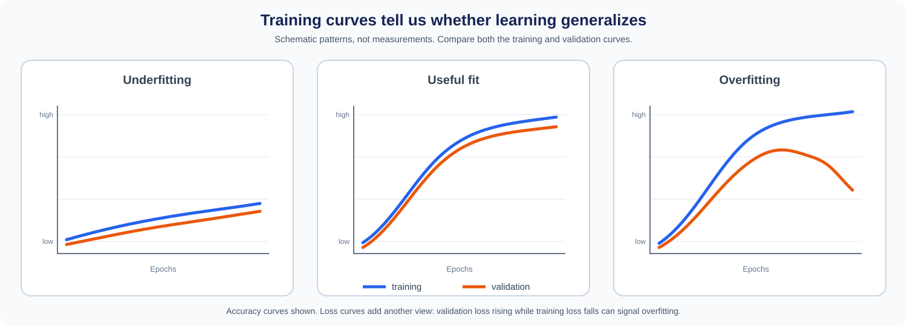
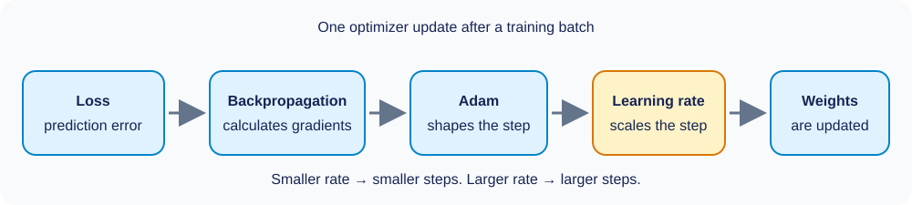
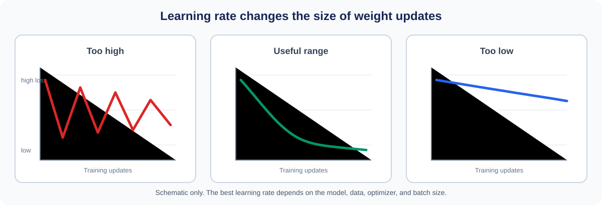

# Lesson 6: Training, Overfitting, and Improving Accuracy

## By the end, you will be able to

- Distinguish **[training, validation, and test metrics](#1-which-metrics-should-we-track)**.
- Recognize **[underfitting and overfitting](#2-read-the-learning-curves)** from learning curves.
- Explain how the **[learning rate](#3-choose-an-improvement-that-matches-the-signal)** can make learning slow or unstable.
- Use **[targeted debugging steps](#4-debug-before-changing-the-model)** to improve a baseline.
- Inspect real per-epoch metrics from the **[Lesson 4 training run](#5-inspect-your-mnist-training-history)**.

## In this lesson

- Read the training and validation curves produced by the MNIST CNN.
- Tell underfitting from a possible overfitting signal.
- Choose one improvement that matches the observed behavior.
- Practice diagnosing a small training history from the course example.

---

## 1. Which metrics should we track?

Lesson 4 now divides MNIST's 60,000 training images into 54,000 training examples and 6,000 validation examples. It keeps the 10,000 test images untouched until the final evaluation.

- **Training metrics** describe examples used to update the weights.
- **Validation metrics** describe held-out examples measured after each epoch. They help us monitor progress and choose changes.
- **Test metrics** provide a final check after choices are complete. Repeatedly changing the model based on test results turns the test set into another validation set.

Track both **loss** and **accuracy**. Loss measures the model's error on a smooth scale; accuracy counts the share of examples whose top-scoring class is correct. They can move differently. For example, a model can become more confident in its existing predictions and lower its loss without changing how many predictions are correct.

Run the updated Lesson 4 training script at `examples/01-cnn-fundamentals/lesson-04/train_mnist.py`. It saves per-epoch training and validation loss, accuracy, and learning rate to `examples/01-cnn-fundamentals/lesson-04/outputs/training_history.csv`, and plots loss and accuracy in `training_curves.png`.

---

## 2. Read the learning curves

A learning curve plots a metric over epochs. The figure shows three **schematic accuracy patterns**, not results from a particular run:



### Underfitting

Training and validation accuracy are both low and close together. The model has not learned enough from the training data. Possible causes include a model with too little capacity, too few epochs, a learning rate that prevents useful progress, or a bug in the data or training loop.

An illustrative example might be 60% training accuracy and 58% validation accuracy. Those figures are only a teaching example, not the expected MNIST result.

### A useful fit

Training and validation performance improve, and the curves remain reasonably close. The model is learning patterns that also help with held-out images.

### Overfitting

Training performance continues to improve while validation performance stops improving or gets worse. The model may be fitting details specific to the training examples instead of patterns that transfer to new images.

For example, 99% training accuracy and 72% validation accuracy would show a large gap. A gap alone is a signal to investigate, not proof of one cause. Validation loss rising while training loss falls is another common overfitting signal.

<div class="quiz" data-answer="c" data-explanation="Overfitting is a concern when the model keeps improving on training data while held-out validation performance stalls or worsens.">
  <p><strong>Checkpoint 1:</strong> Which pattern most strongly suggests overfitting?</p>
  <label><input type="radio" name="lesson6-curves" value="a"> Both training and validation accuracy stay low and similar</label><br>
  <label><input type="radio" name="lesson6-curves" value="b"> Training and validation accuracy rise together and remain close</label><br>
  <label><input type="radio" name="lesson6-curves" value="c"> Training accuracy rises while validation loss rises and validation accuracy falls</label><br>
  <button class="quiz-check" type="button">Check answer</button>
  <p class="quiz-result" aria-live="polite"></p>
</div>

---

## 3. Choose an improvement that matches the signal

A **learning rate** is a scale factor the optimizer uses when updating the model's weights. It has no standard physical unit like seconds or meters; in ordinary neural-network training, it is treated as a unitless setting. The gradient gives the optimizer information about which direction changes would increase loss. The learning rate helps set the size of the update in the direction that should reduce it.

For a simple gradient-descent update:

$$
\text{new weight} = \text{old weight} - (\text{learning rate} \times \text{gradient})
$$

For example, if a weight is `0.20`, its gradient is `0.4`, and the learning rate is `0.001`, a simple SGD update changes it by `0.0004`:

```text
0.20 − (0.001 × 0.4) = 0.1996
```

This is an illustrative **SGD** calculation. The course code uses **Adam**: after `loss.backward()` calculates gradients, `optimizer.step()` uses Adam's running gradient estimates and scales its proposed update with the learning rate. The optimizer applies an update after each training batch, not just once per epoch.



If the learning rate is too high, updates can jump past useful values and loss may oscillate or grow. If it is too low, learning may make very slow progress.



Match the adjustment to the observed curve:

| Signal | A reasonable first check |
|---|---|
| Training and validation loss are both high and still falling | Allow more training, then check model capacity and learning rate. |
| Loss barely changes | Verify that weights update; then try a different learning rate. |
| Training improves while validation worsens | Stop based on validation, then consider augmentation, weight decay, dropout, or a smaller model. |
| Curves jump up and down | Try a lower learning rate and check the data and loss values. |

Change one thing at a time and compare it with the baseline. If several settings change together, it becomes hard to tell which one helped.

<div class="quiz" data-answer="a" data-explanation="A very high learning rate can make updates overshoot, causing loss to oscillate or increase.">
  <p><strong>Checkpoint 2:</strong> What can a learning rate that is too high do?</p>
  <label><input type="radio" name="lesson6-learning-rate" value="a"> Make updates overshoot, so loss oscillates or grows</label><br>
  <label><input type="radio" name="lesson6-learning-rate" value="b"> Guarantee that validation accuracy increases</label><br>
  <label><input type="radio" name="lesson6-learning-rate" value="c"> Reduce the number of input channels</label><br>
  <button class="quiz-check" type="button">Check answer</button>
  <p class="quiz-result" aria-live="polite"></p>
</div>

---

## 4. Debug before changing the model

A useful debugging check is to train on a tiny subset, such as 10 or 100 examples. A sufficiently capable model should usually be able to memorize a tiny set. If it cannot, check the training pipeline before adding layers:

- Are the labels paired with the right images?
- Do input shapes and value ranges match the model's expectations?
- Is the loss receiving raw logits and the correct labels?
- Does `loss.backward()` run, and does `optimizer.step()` update weights?
- Is gradient tracking enabled during training?

Once the pipeline works, choose a next step based on the curves. More epochs may help an underfit model whose validation metrics are still improving. For overfitting, stop at the best validation point or try a regularization strategy. For unstable loss, investigate the learning rate before redesigning the CNN.

---

## 5. Inspect your MNIST training history

After running Lesson 4, this small script reads its CSV and reports the epoch with the lowest validation loss and the final train-validation accuracy gap. It does not choose a model automatically; use the numbers together with the curves.

```python
--8<-- "examples/01-cnn-fundamentals/lesson-06/analyze_history.py"
```

Run it from the repository root:

```bash
uv run python examples/01-cnn-fundamentals/lesson-06/analyze_history.py
```

The script uses only Python's standard library. It needs `training_history.csv`, which Lesson 4 creates when it trains.

<div class="quiz" data-answer="b" data-explanation="Validation data helps monitor and tune the model. The test set should remain untouched until the final evaluation.">
  <p><strong>Checkpoint 3:</strong> Which split should be reserved for a final evaluation after tuning?</p>
  <label><input type="radio" name="lesson6-data-splits" value="a"> Training set</label><br>
  <label><input type="radio" name="lesson6-data-splits" value="b"> Test set</label><br>
  <label><input type="radio" name="lesson6-data-splits" value="c"> Validation set</label><br>
  <button class="quiz-check" type="button">Check answer</button>
  <p class="quiz-result" aria-live="polite"></p>
</div>

---

## Hands-on: diagnose your run

1. Run the Lesson 4 CNN and open `training_curves.png`. Write down its final train-validation gap.
2. In `train_mnist.py`, change `TRAIN_SIZE` from `54000` to `600` and `EPOCHS` from `5` to `20`. Leave validation size, architecture, and learning rate unchanged.
3. Run Lesson 4 again, then run `analyze_history.py`. Compare train and validation behavior. The saved history and plots are overwritten, so keep your baseline notes.
4. Restore `TRAIN_SIZE = 54000` and `EPOCHS = 5` when finished. Do not use test results to decide which run is better.

<details>
<summary>Show a sample solution</summary>

There is no fixed diagnosis because the values depend on initialization and hardware. With only 600 training examples, the model may fit training images more quickly than validation images. A good answer names evidence, for example: “Training accuracy rose while validation loss stopped improving. That suggests a possible overfitting signal.” If the validation curves continue improving, the evidence does not show clear overfitting yet. The small-data run should be judged by training and validation curves, not by the final test score.

</details>

---

## Lesson 6 summary

- Training metrics show how the model fits examples used for updates; validation metrics show how it behaves on held-out examples.
- A widening train-validation gap or rising validation loss can signal overfitting.
- Low, similar train and validation performance can signal underfitting or a training-pipeline issue.
- Learning rate and training duration should be adjusted based on observed curves.
- Keep the test set for one final evaluation after choices are complete.

### Training-session settings and changes

In this course's baseline, the model settings stay fixed during a run, while the CNN's learned weights and biases update after each training batch. The hands-on activity changes two settings to demonstrate the effect of less training data and more epochs:

| Setting or value | Lesson 4 baseline | Lesson 6 experiment | What it means |
|---|---:|---:|---|
| Training images | 54,000 | 600 | Examples used to update the model weights |
| Validation images | 6,000 | 6,000 | Held-out examples used to track generalization |
| Epochs | 5 | 20 | Full passes over the training images |
| Batch size | 64 | 64 | Images processed before one weight update |
| Learning rate | 0.001 | 0.001 | Step size used by the optimizer |
| CNN architecture | SimpleCNN | SimpleCNN | Same layers and capacity in both runs |
| Learned weights and biases | 20,490 values | 20,490 values | Updated during training; not manually set in this experiment |

Restore the baseline values after the experiment. The exact loss and accuracy changes depend on initialization and hardware, so compare the training and validation curves rather than expecting fixed numbers.

**CNN Basics complete:** You can now trace, train, visualize, and diagnose a basic MNIST CNN. Optionally, [Lesson 6.1: See CNN Training with TensorBoard](../lesson-06-1-tensorboard-dashboard/index.md) adds a dashboard workflow. Continue to the [CNN Basics stage review](../review/index.md), then move on to [Lesson 7: From MNIST to CIFAR-10](../../02-modern-cnns/lesson-07-from-mnist-to-cifar10/index.md).
