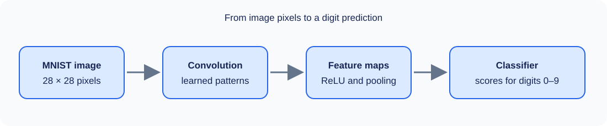

# CNN Basics: Stage Review

## By the end, you will be able to

- Trace **[an MNIST image through a CNN](#1-from-pixels-to-a-prediction)**.
- Explain **[how training changes the model](#2-learning-from-errors)**.
- Use **[training and validation behavior](#3-diagnose-a-training-run)** to describe whether a model is learning well.

This checkpoint reviews Lessons 1–6. It is not an additional lesson.

---

## 1. From pixels to a prediction



An image starts as pixel values. Convolutions produce feature maps, later layers combine those patterns, and a classifier returns scores for digits 0–9.

| You can now explain… | Revisit |
|---|---|
| How pixels become a tensor and class scores | [Lesson 1](../lesson-01-how-neural-networks-see-images/index.md) |
| How filters learn from loss and gradients | [Lesson 2](../lesson-02-how-cnn-filters-learn-patterns/index.md) |
| How convolution, ReLU, pooling, and flattening change the image representation | [Lesson 3](../lesson-03-how-cnn-layers-transform-images/index.md) |
| How to train, infer with, and inspect a PyTorch CNN | [Lesson 4](../lesson-04-build-first-cnn-pytorch/index.md) and [Lesson 5](../lesson-05-what-cnn-learns/index.md) |
| How to compare training and validation behavior | [Lesson 6](../lesson-06-training-overfitting-improve-accuracy/index.md) |

---

## 2. Learning from errors

The model's **weights and biases** are adjusted during training. The training settings, such as learning rate and batch size, guide those updates. Validation data helps us compare progress without updating the model.

```text
Image + label → prediction → loss → gradient updates → improved parameters
                                     ↓
                            validation check
```

<div class="quiz" data-answer="b" data-explanation="A CNN filter responds to a local pattern. Later layers combine many such responses to classify the digit.">
  <p><strong>Checkpoint:</strong> A filter responds strongly to a vertical stroke. What does that tell us?</p>
  <label><input type="radio" name="stage1-review-filter" value="a"> The image must be the digit 1</label><br>
  <label><input type="radio" name="stage1-review-filter" value="b"> The filter found a pattern that may help later layers classify the image</label><br>
  <label><input type="radio" name="stage1-review-filter" value="c"> The filter has changed the correct label</label><br>
  <button class="quiz-check" type="button">Check answer</button>
  <p class="quiz-result" aria-live="polite"></p>
</div>

---

## 3. Diagnose a training run

**Apply it:** Training accuracy keeps rising, but validation loss starts rising too. What would you check or try first?

<details>
<summary>Show one reasonable response</summary>

This may be overfitting. Compare the curves, keep the checkpoint with the best validation behavior, and consider a regularization or data-augmentation change. Do not use the test set to choose the change.

</details>

**Continue:** Go to [Lesson 7 — From MNIST to CIFAR-10](../../02-modern-cnns/lesson-07-from-mnist-to-cifar10/index.md) to see how these ideas scale to color images.
