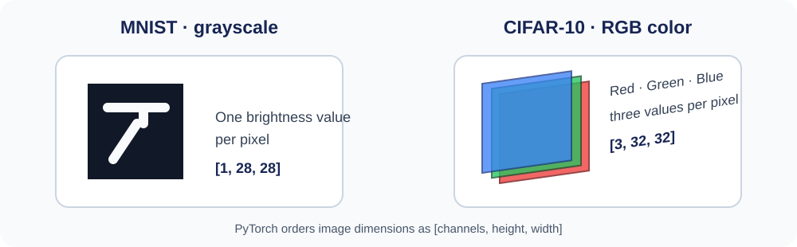
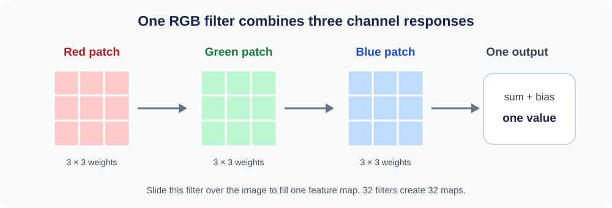
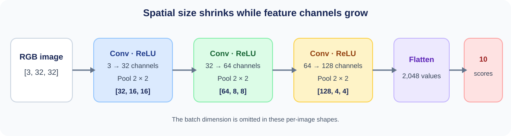
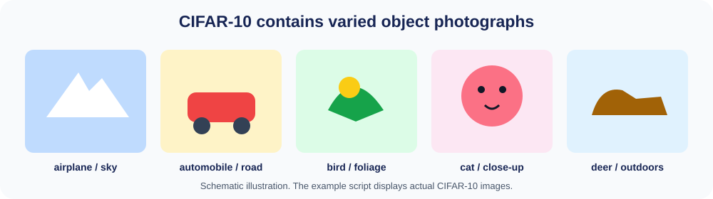
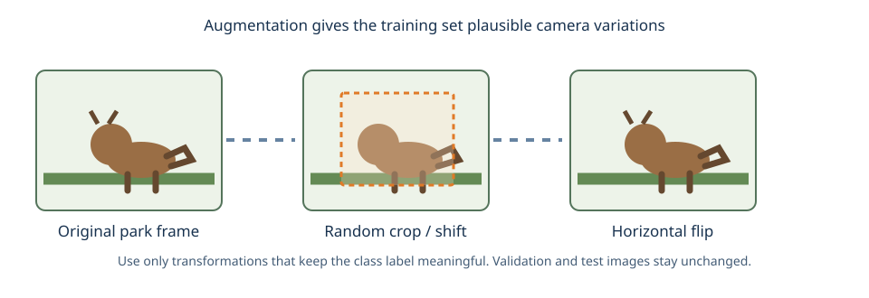
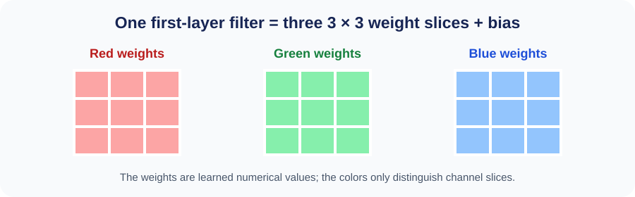

# Lesson 7: From MNIST to CIFAR-10

## By the end, you will be able to

- Compare **[MNIST and CIFAR-10](#1-why-move-beyond-mnist)** and explain why object photos are harder to classify.
- Explain **[data augmentation](#data-augmentation-practice-with-plausible-variations)** and why it belongs only in the training split.
- Describe **[RGB channels](#2-how-does-a-network-see-color)** and **[multi-channel convolution](#3-how-does-a-filter-read-color)**.
- Trace **[feature shapes through a deeper CNN](#4-follow-a-color-image-through-a-cnn)**.
- Run and inspect a **[CIFAR-10 PyTorch example](#5-load-and-visualize-cifar-10)**.

## In this lesson

- Move from centered grayscale digits to small color photographs.
- Explore how convolution combines red, green, and blue information.
- Follow image shapes through a three-block CNN.
- Load, visualize, train, and evaluate a CIFAR-10 model.
- Use label-preserving image changes to make training examples more varied.

---

## 1. Why move beyond MNIST?

MNIST images contain centered handwritten digits on a mostly plain background. CIFAR-10 contains small photographs of objects in varied poses, colors, lighting, and backgrounds. A cat may be partly hidden, viewed from the side, or surrounded by clutter. The network has to learn which visual patterns matter despite those changes.

| | MNIST | CIFAR-10 |
|---|---|---|
| Image size | 28 × 28 | 32 × 32 |
| Channels | 1 grayscale | 3 RGB |
| Labels | Digits 0–9 | Ten object categories |
| Main challenge | Recognize a simple shape | Recognize objects across varied scenes |

CIFAR-10 has **60,000 images**: 50,000 training images and 10,000 test images. Each of its ten classes has 6,000 images overall. The official training set has 5,000 images per class, and the test set has 1,000 per class.



### CIFAR-10 classes

| ID | Class | ID | Class |
|---:|---|---:|---|
| 0 | Airplane | 5 | Dog |
| 1 | Automobile | 6 | Frog |
| 2 | Bird | 7 | Horse |
| 3 | Cat | 8 | Ship |
| 4 | Deer | 9 | Truck |

<div class="quiz" data-answer="b" data-explanation="CIFAR-10 has color and varied object scenes, so the model must handle more visual variation than centered grayscale digits.">
  <p><strong>Checkpoint 1:</strong> Why is CIFAR-10 usually harder than MNIST?</p>
  <label><input type="radio" name="lesson7-datasets" value="a"> It has more pixel values per image only because it is much larger</label><br>
  <label><input type="radio" name="lesson7-datasets" value="b"> Objects vary in appearance, pose, lighting, and background</label><br>
  <label><input type="radio" name="lesson7-datasets" value="c"> It has no class labels</label><br>
  <button class="quiz-check" type="button">Check answer</button>
  <p class="quiz-result" aria-live="polite"></p>
</div>

---

## 2. How does a network see color?

PyTorch stores a single CIFAR-10 image as `[3, 32, 32]`: three channels, each 32 pixels high and wide. A batch of 64 images has shape `[64, 3, 32, 32]`, where the first number is the batch size.

```text
One color image                    Tensor shape

  Red plane      Green plane      Blue plane
  32 × 32         32 × 32          32 × 32
       \              |              /
        └─────────────┴─────────────┘
                 [3, 32, 32]
```

Each pixel has a red, green, and blue value. `ToTensor()` converts these channel values from 0–255 integers to floating-point values between 0 and 1. Matplotlib expects channels last (`[height, width, channels]`), so displaying a PyTorch image requires rearranging its dimensions with `permute(1, 2, 0)`.

---

## 3. How does a filter read color?

The first MNIST convolution accepts one input channel. CIFAR-10's first convolution accepts three:

```python
nn.Conv2d(in_channels=3, out_channels=32, kernel_size=3, padding=1)
```

Each output filter has a 3 × 3 weight slice for each input channel: one for red, one for green, and one for blue. It combines those channel responses into **one** output feature map. With 32 filters, the layer produces 32 maps.



Filters may respond to edges, texture, brightness changes, or color contrasts. Those are possibilities that emerge during training; we do not assign each filter a job in advance. A first-layer 3 × 3 filter sees only a tiny patch, so it cannot identify a whole cat by itself.

<div class="quiz" data-answer="c" data-explanation="A standard convolutional filter spans all three input channels, combines their responses, and produces one output feature map.">
  <p><strong>Checkpoint 2:</strong> What does one standard RGB convolution filter produce?</p>
  <label><input type="radio" name="lesson7-convolution" value="a"> Three output maps, one for every input color</label><br>
  <label><input type="radio" name="lesson7-convolution" value="b"> One class prediction</label><br>
  <label><input type="radio" name="lesson7-convolution" value="c"> One feature map formed from all three input channels</label><br>
  <button class="quiz-check" type="button">Check answer</button>
  <p class="quiz-result" aria-live="polite"></p>
</div>

---

## 4. Follow a color image through a CNN

The example uses three convolution and pooling blocks. Each 2 × 2 max-pooling layer halves height and width, while later convolutions create more feature channels.



The receptive field is the portion of the input image that can affect a feature at a particular location. Stacking stride-one 3 × 3 convolutions grows its theoretical size from 3 × 3 to 5 × 5 to 7 × 7. Pooling makes it grow faster. Deeper layers can therefore combine evidence spread over larger regions, although they do not necessarily use every pixel equally.

The hierarchy—edges and colors, then textures and parts, then object-level evidence—is a useful way to think about the model. Real learned features can be mixed and hard to name.

---

## 5. Load and visualize CIFAR-10

This example uses `torchvision.datasets.CIFAR10` to download the dataset the first time it runs. The complete runnable project and its run instructions are in `examples/02-modern-cnns/lesson-07/README.md`.

The loader converts images to tensors. It splits the official 50,000-image training set into 45,000 training examples and 5,000 validation examples. The 10,000 official test images remain separate for final evaluation.

```python
--8<-- "examples/02-modern-cnns/lesson-07/train_cifar10.py:dataset"
```

The script saves a grid of ten sample images. It converts each image from channel-first to channel-last order for Matplotlib. Try naming the objects before reading the titles.



### Data augmentation: practice with plausible variations

In a park-camera setting, the same animal may appear a little left or right, or face the other way. **Data augmentation** creates training variations such as small crops and horizontal flips so the model sees more than one exact framing.



The script applies these transforms to training images only. Validation and test images remain unchanged so they measure the model on unmodified examples.

```python
--8<-- "examples/02-modern-cnns/lesson-07/train_cifar10.py:augmentations"
```

Augmentation is useful only when it preserves the label. For example, a horizontal flip is reasonable for many CIFAR-10 object classes, but an application that reads text or handedness may need different transformations.

---

## 6. Build the teaching CNN

Here is the model's shape progression:

```text
[3, 32, 32]  RGB image
      │ Conv 3 → 32, ReLU, 2 × 2 pool
[32, 16, 16]
      │ Conv 32 → 64, ReLU, 2 × 2 pool
[64, 8, 8]
      │ Conv 64 → 128, ReLU, 2 × 2 pool
[128, 4, 4]
      │ Flatten: 128 × 4 × 4 = 2,048 values
      │ Linear: 2,048 → 10
[10] class scores (logits)
```

The code defines each convolution, activation, and pooling operation in sequence:

```python
--8<-- "examples/02-modern-cnns/lesson-07/train_cifar10.py:model"
```

The output is ten logits, one per class. The largest score gives the predicted class. During training, `CrossEntropyLoss` accepts these raw logits directly.

<div class="quiz" data-answer="a" data-explanation="A 2 × 2 max-pooling layer with stride 2 halves both spatial dimensions: 32 becomes 16.">
  <p><strong>Checkpoint 3:</strong> What shape follows `[32, 32, 32]` after 2 × 2 max pooling?</p>
  <label><input type="radio" name="lesson7-shapes" value="a"> `[32, 16, 16]`</label><br>
  <label><input type="radio" name="lesson7-shapes" value="b"> `[16, 32, 32]`</label><br>
  <label><input type="radio" name="lesson7-shapes" value="c"> `[32, 32, 16]`</label><br>
  <button class="quiz-check" type="button">Check answer</button>
  <p class="quiz-result" aria-live="polite"></p>
</div>

---

## 7. Train and inspect the model

Training follows the familiar cycle: make predictions, calculate loss, backpropagate, and update weights. This example reports training and validation metrics each epoch, then uses the test set once for a final measurement.

```python
--8<-- "examples/02-modern-cnns/lesson-07/train_cifar10.py:training"
```

The runnable script also saves the first convolution's RGB weights for inspection. A filter is visualized by arranging its three channel slices as a tiny RGB image. This is a display of weights, not an ordinary CIFAR photograph, so colors and patterns can look unusual.



Training time and accuracy depend on hardware, random initialization, and settings. This small model is a teaching baseline, not an accuracy guarantee or tuned CIFAR-10 solution.

---

## Hands-on: inspect color and shape

1. Run the example and open `outputs/sample_images.png`.
2. In the script, change `CONV1_CHANNELS` from 32 to 16, then inspect the printed shapes.
3. Compare the sample grid with the learned first-layer filters in `outputs/rgb_filters.png`.
4. Restore the original settings and note how the RGB planes combine into one feature map per filter.

<details>
<summary>Show a sample solution</summary>

With 16 first-layer channels, the first convolution output becomes `[batch, 16, 32, 32]`. The next convolution accepts 16 channels automatically because its input size uses `CONV1_CHANNELS`. Each first-layer output filter still combines all RGB input channels.

</details>

<div class="quiz" data-answer="b" data-explanation="CIFAR-10 labels each image with one of ten object categories, and the model produces ten corresponding logits.">
  <p><strong>Checkpoint 4:</strong> What does the model's final layer represent?</p>
  <label><input type="radio" name="lesson7-output" value="a"> One RGB image reconstruction</label><br>
  <label><input type="radio" name="lesson7-output" value="b"> Ten scores, one for each CIFAR-10 class</label><br>
  <label><input type="radio" name="lesson7-output" value="c"> A bounding box for each object</label><br>
  <button class="quiz-check" type="button">Check answer</button>
  <p class="quiz-result" aria-live="polite"></p>
</div>

---

## Lesson 7 summary

- CIFAR-10 images have three color channels and more scene variation than MNIST digits.
- A standard RGB convolution filter spans every input channel and produces one feature map.
- Pooling reduces spatial size while deeper layers build representations from earlier features.
- The training workflow still uses logits, loss, backpropagation, and optimizer updates.

**Next:** [Lesson 8 — Building Deeper CNNs](../lesson-08-building-deeper-cnns/index.md) explores depth, width, Batch Normalization, and global average pooling.
