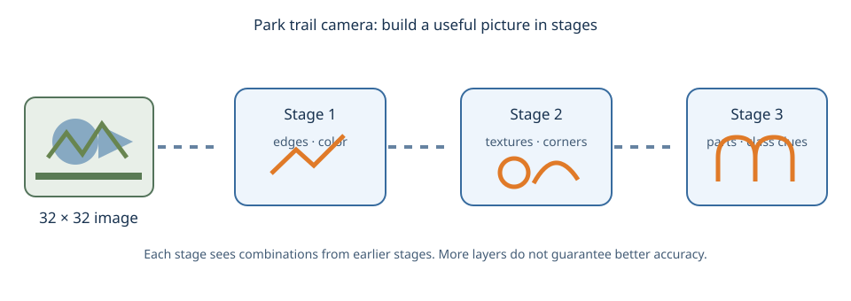
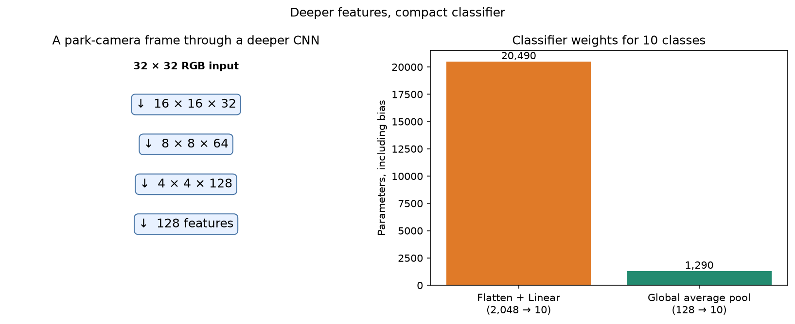

# Lesson 8: Building Deeper CNNs

## By the end, you will be able to

- Explain how **[depth and width](#2-depth-and-width-see-different-things)** change the features a CNN can represent.
- Describe how the **[receptive field](#receptive-field-grows-with-depth)** grows through stacked layers.
- Describe why **[Batch Normalization](#3-keep-deeper-networks-steady)** can help stabilize training.
- Compare **[flattening and global average pooling](#4-shrink-the-classifier-with-global-average-pooling)**.
- Read the **[shape and parameter comparison](#5-run-the-architecture-demo)** from the runnable example.

## In this lesson

- Use a park trail camera as a practical image-classification scenario.
- Trace feature maps as a CNN gets deeper.
- See how BatchNorm and global average pooling affect the model.
- Run a small architecture demo without downloading CIFAR-10.

---

## 1. Scenario: classify trail-camera snapshots

Imagine a camera at a park entrance. It records small images that a ranger later sorts into categories such as bird, deer, dog, horse, automobile, or truck. **CIFAR-10 is our teaching proxy**: its tiny color images include several of these categories, but they are not photographs from the actual park camera. A real monitoring system needs images from its own camera and environment.

In [Lesson 7](../lesson-07-from-mnist-to-cifar10/index.md), a three-block CNN turned a 32 × 32 image into a ten-class prediction. Here we improve the feature extractor and compare its classifier head.

---

## 2. Depth and width see different things

**Depth** is the number of processing layers. **Width** is the number of feature channels a layer produces. A wider layer can represent more feature maps at that point; deeper layers can combine information from earlier maps.



The animation gives a useful mental model: early layers respond to local color changes and edges, while later layers can combine those signals into larger shapes. It does not mean every trained filter has a neat human-readable job.

With 3 × 3 convolutions, pooling makes the feature maps smaller while the number of channels can grow:

```text
32 × 32 × 3 image
       ↓ Conv + Pool
16 × 16 × 32 features
       ↓ Conv + Pool
 8 × 8 × 64 features
       ↓ Conv + Pool
 4 × 4 × 128 features
```

### Receptive field grows with depth

The **receptive field** is the area of the input that can affect one activation. With stride-one 3 × 3 convolutions and no dilation, each extra convolution grows the theoretical receptive field:

| Stacked convolutions | Theoretical receptive field |
|---:|---:|
| 1 | 3 × 3 pixels |
| 2 | 5 × 5 pixels |
| 3 | 7 × 7 pixels |

Pooling makes it grow faster because later activations summarize larger regions. This helps later layers combine context from more of the park scene.

---

## 3. Keep deeper networks steady

**Batch Normalization** (`BatchNorm2d`) adjusts each channel's activation using statistics from the training mini-batch. During evaluation it uses running statistics collected during training. It can make optimization less sensitive to activation scale, though it does not guarantee better accuracy.

The block used in the demo is:

```text
Convolution → BatchNorm → ReLU → MaxPool
```

Each component has a distinct role: convolution learns filters, BatchNorm stabilizes channel values, ReLU adds nonlinearity, and max pooling reduces spatial size.

<div class="quiz" data-answer="b" data-explanation="BatchNorm normalizes channel activations using mini-batch statistics during training and running statistics during evaluation; it can help stability but does not guarantee accuracy.">
  <p><strong>Checkpoint 1:</strong> What is BatchNorm doing in this CNN block?</p>
  <label><input type="radio" name="lesson8-bn" value="a"> It creates the ten class labels from the image</label><br>
  <label><input type="radio" name="lesson8-bn" value="b"> It normalizes channel activations to help keep training stable</label><br>
  <label><input type="radio" name="lesson8-bn" value="c"> It doubles the image resolution</label><br>
  <button class="quiz-check" type="button">Check answer</button>
  <p class="quiz-result" aria-live="polite"></p>
</div>

---

## 4. Shrink the classifier with global average pooling

After the last block, the demo has 128 feature maps of size 4 × 4. Flattening keeps all `128 × 4 × 4 = 2,048` values for the classifier. **Global average pooling** averages each map into one value, giving just 128 values.

For ten classes, a linear layer with a bias uses:

| Classifier input | Parameters | Source of the count |
|---|---:|---|
| Flatten: 2,048 values | 20,490 | `2,048 × 10` weights + `10` biases |
| Global average pool: 128 values | 1,290 | `128 × 10` weights + `10` biases |

This reduces the final classifier size. It also discards the exact spatial location of each feature, so it is a design trade-off rather than an automatic improvement.

<div class="quiz" data-answer="a" data-explanation="A 4 × 4 map becomes one average, so 128 channels produce 128 values rather than 128 × 4 × 4 values.">
  <p><strong>Checkpoint 2:</strong> What happens when global average pooling receives 128 feature maps?</p>
  <label><input type="radio" name="lesson8-gap" value="a"> It produces 128 values, one average per map</label><br>
  <label><input type="radio" name="lesson8-gap" value="b"> It produces 2,048 values, one for each pixel in every map</label><br>
  <label><input type="radio" name="lesson8-gap" value="c"> It produces one value for the whole image</label><br>
  <button class="quiz-check" type="button">Check answer</button>
  <p class="quiz-result" aria-live="polite"></p>
</div>

---

## 5. Run the architecture demo

The script builds a three-block CNN, prints feature shapes, and graphs the two classifier sizes. It uses a random tensor to keep this shape demonstration quick and download-free.

```python
--8<-- "examples/02-modern-cnns/lesson-08-building-deeper-cnns/deeper_cnn_demo.py:model"
```



The graph compares only the final classifier parameters, not the full model size or its accuracy. The feature extractor is the same for both head counts.

Run it from the repository root:

```bash
uv run python examples/02-modern-cnns/lesson-08-building-deeper-cnns/deeper_cnn_demo.py
```

---

## Hands-on: change the final feature width

1. Run the script and note the printed shapes and classifier counts.
2. Change the last value in `CHANNELS` from 128 to 64.
3. Update the illustrative flatten count in `save_comparison` to use the new channel count, then rerun.
4. Compare the classifier sizes. The next convolution and final head depend on that channel width.

<div class="quiz" data-answer="c" data-explanation="Depth adds processing stages, while width changes how many channels or feature maps a stage can produce.">
  <p><strong>Checkpoint 3:</strong> In this lesson, what does making a CNN wider mean?</p>
  <label><input type="radio" name="lesson8-width" value="a"> Increasing each image from RGB to RGBA</label><br>
  <label><input type="radio" name="lesson8-width" value="b"> Adding more pooling to shrink every feature map</label><br>
  <label><input type="radio" name="lesson8-width" value="c"> Giving a layer more output channels</label><br>
  <button class="quiz-check" type="button">Check answer</button>
  <p class="quiz-result" aria-live="polite"></p>
</div>

---

## Lesson 8 summary

- Greater depth lets later stages combine earlier feature maps; greater width adds channels.
- BatchNorm normalizes channel activations and may make training easier to manage.
- Global average pooling replaces each spatial feature map with one average and can greatly reduce classifier parameters.

**Previous:** [Lesson 7 — From MNIST to CIFAR-10](../lesson-07-from-mnist-to-cifar10/index.md). **Next:** [Lesson 9 — Understanding ResNet](../lesson-09-understanding-resnet/index.md) shows how skip connections help information move through deeper networks.
