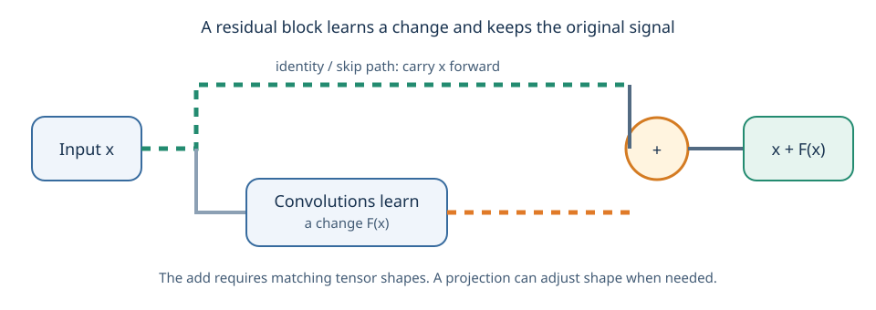
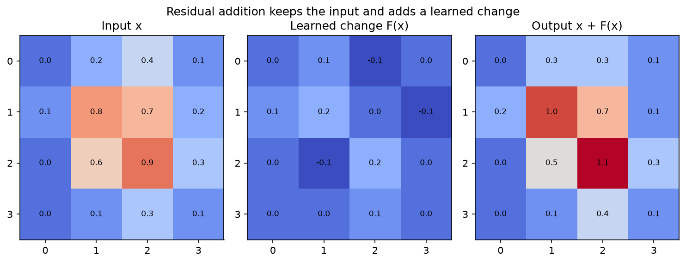

# Lesson 9: Understanding ResNet

## By the end, you will be able to

- Describe a **[residual block](#2-the-residual-block-adds-a-change)** as a learned change added to its input.
- Trace the **[skip connection](#3-why-the-skip-path-helps)** around the convolution layers.
- Explain why **[matching shapes matter](#4-when-the-two-paths-have-different-shapes)** at the addition.
- Run a **[visual residual example](#5-see-the-addition)** and inspect the three feature maps.

## In this lesson

- Use a park-camera classifier as the scenario for a deeper CNN.
- Follow the identity and learned-change paths in a residual block.
- See why ResNet adds these paths and when it must adjust tensor shapes.
- Visualize the input, change, and output using a tiny matrix example.

---

## 1. Scenario: keep useful trail-camera clues

A park camera classifier may need many layers to combine fur texture, legs, and body shape into evidence for an animal class. As networks get deeper, each layer has to pass useful information onward. **ResNet** adds a direct path that carries earlier features around a group of convolution layers.

It does not make the camera task easier by knowing the labels in advance. The training data and loss still determine which features are useful.

---

## 2. The residual block adds a change

Let `x` represent the input feature maps. A plain block learns a new result from `x`. A residual block instead learns a change, written `F(x)`, and adds it to the original input:

```text
output = x + F(x)
```



The diagram shows **two routes**:

- The skip route carries `x` forward.
- The residual route computes `F(x)` with convolution layers.
- The addition combines both routes before the next block.

If the learned change is small, the block can keep much of its input. If the change is useful, it can modify the representation.

Many ResNet blocks apply a ReLU after the addition. In this lesson's PyTorch example, the final output is `ReLU(x + F(x))`.

---

## 3. Why the skip path helps

During training, backpropagation sends learning signals from later layers toward earlier ones. A direct route through the addition gives the signal another path through the network. This can make very deep networks easier to optimize.

The skip path is not a guarantee that a deeper network will be more accurate. Data, architecture, initialization, and training still matter.

The runnable example uses a tiny feature map to make the operation visible:

```python
--8<-- "examples/02-modern-cnns/lesson-09-understanding-resnet/residual_demo.py:residual_block"
```

The block's two convolutions learn a change. The `features + self.change(features)` line adds it to the original feature tensor.

<div class="quiz" data-answer="b" data-explanation="A residual block learns a change F(x) and adds it to the original input x, giving x + F(x).">
  <p><strong>Checkpoint 1:</strong> What is the main residual-block operation?</p>
  <label><input type="radio" name="lesson9-residual" value="a"> Replace x with a new random tensor</label><br>
  <label><input type="radio" name="lesson9-residual" value="b"> Add a learned change F(x) to x</label><br>
  <label><input type="radio" name="lesson9-residual" value="c"> Convert the feature maps directly into class labels</label><br>
  <button class="quiz-check" type="button">Check answer</button>
  <p class="quiz-result" aria-live="polite"></p>
</div>

---

## 4. When the two paths have different shapes

Element-wise addition needs the two tensors to have the same shape. If a block changes channel count or spatial resolution, ResNet uses a **projection shortcut**—often a 1 × 1 convolution with an appropriate stride—to adjust the skip path before the addition.

```text
Same shape:       x ───────────────────┐
                    └─ Conv → Conv ────┴─ Add

Changed shape:    x ── 1×1 projection ─┐
                    └─ Conv → Conv ────┴─ Add
```

The projection aligns tensor shapes; it does not perform the main feature-processing job of the block.

<div class="quiz" data-answer="a" data-explanation="The skip tensor and residual result must have the same shape so their values can be added element by element.">
  <p><strong>Checkpoint 2:</strong> Why must the two paths have matching shapes before addition?</p>
  <label><input type="radio" name="lesson9-shapes" value="a"> The addition pairs values at matching channels and locations</label><br>
  <label><input type="radio" name="lesson9-shapes" value="b"> BatchNorm requires every tensor to be 1 × 1</label><br>
  <label><input type="radio" name="lesson9-shapes" value="c"> The output must have the same shape as the original photo</label><br>
  <button class="quiz-check" type="button">Check answer</button>
  <p class="quiz-result" aria-live="polite"></p>
</div>

---

## 5. See the addition

The runnable demo adds the same small feature map and a small learned-change illustration. It plots all three on one color scale so you can compare the values directly.



Run it from the repository root:

```bash
uv run python examples/02-modern-cnns/lesson-09-understanding-resnet/residual_demo.py
```

The values in the heatmap are a simple arithmetic illustration, not activations from a trained ResNet. The script also checks that a same-shape PyTorch residual block preserves its feature tensor shape.

---

## Hands-on: follow the skip path

1. Run the example and compare the `Input x` and `Output x + F(x)` panels.
2. Change one value in the `residual` matrix and rerun.
3. Check how only the corresponding output location changes.
4. In the code, change `DEMO_CHANNELS` to 32 and rerun the shape check.

<div class="quiz" data-answer="c" data-explanation="A projection shortcut can change channel or spatial dimensions so the skip signal can be added to the residual result.">
  <p><strong>Checkpoint 3:</strong> What can a projection shortcut do?</p>
  <label><input type="radio" name="lesson9-projection" value="a"> Train the model without labels</label><br>
  <label><input type="radio" name="lesson9-projection" value="b"> Remove the residual branch from every block</label><br>
  <label><input type="radio" name="lesson9-projection" value="c"> Adjust the skip tensor when its shape must change</label><br>
  <button class="quiz-check" type="button">Check answer</button>
  <p class="quiz-result" aria-live="polite"></p>
</div>

---

## Lesson 9 summary

- A residual block adds a learned change to its input.
- The skip route gives information and learning signals a direct path through the block.
- The two tensors must match in shape before addition; a projection can align them.

**Previous:** [Lesson 8 — Building Deeper CNNs](../lesson-08-building-deeper-cnns/index.md). **Next:** [Lesson 10 — Transfer Learning](../lesson-10-transfer-learning/index.md) reuses a pretrained feature extractor for a new set of classes.
