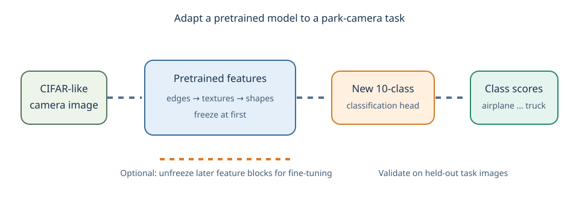
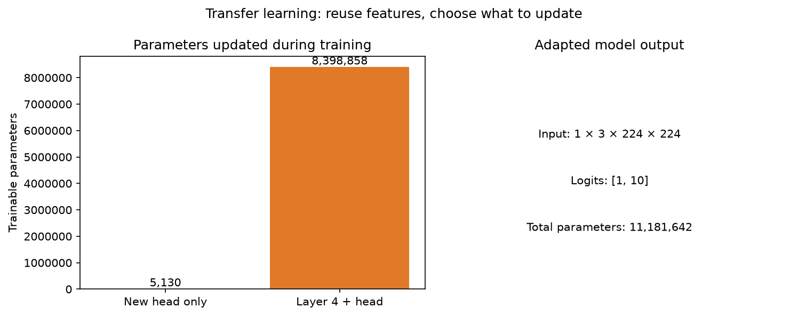

# Lesson 10: Transfer Learning

## By the end, you will be able to

- Explain **[pretraining and transfer](#2-reuse-visual-features)** with a familiar camera task.
- Distinguish **[frozen features, linear probing, and fine-tuning](#3-choose-what-the-model-learns-next)**.
- Adapt a pretrained model with a **[new classifier head](#4-adapt-a-pretrained-resnet)**.
- Interpret the **[trainable-parameter comparison](#5-run-the-transfer-demo)**.

## In this lesson

- Reuse ImageNet features for a park trail-camera classifier.
- Compare training only a new class head with fine-tuning later layers.
- Replace the old classifier with one that produces ten CIFAR-10 scores.
- Run a model-structure demo and see which parameters an optimizer updates.

---

## 1. Scenario: adapt a camera model for a park

Imagine a ranger wants a trail-camera model to distinguish birds, deer, dogs, and vehicles. Training a complete CNN from scratch requires many labeled examples. A model pretrained on ImageNet has already learned general visual features from a large image collection. We can reuse those features and adapt the final part to the new task.

CIFAR-10 is a small-image teaching dataset for this lesson, not a replacement for images from the real park camera. Its ten categories include animals and vehicles, but the resolution and image distribution differ from deployment footage.

---

## 2. Reuse visual features

**Transfer learning** starts with a model trained on one task and adapts it to another. The earlier layers often contain useful general features—edges, color changes, textures, and shapes—that can help on a new image task.



At first, keep the pretrained feature extractor fixed and train a new classifier head. If the task has enough labeled examples, you can later unfreeze some of the later feature blocks and continue training with a smaller learning rate.

---

## 3. Choose what the model learns next

| Strategy | Updated weights | When it is useful |
|---|---|---|
| **Frozen feature extractor** | New classifier head only | Quick adaptation with limited data or compute |
| **Linear probing** | A linear classifier on frozen features | A simple check of how useful the pretrained features are |
| **Fine-tuning** | Some or all pretrained layers plus the new head | More adaptation when data and compute support it |

These are choices about which parameters receive updates. A frozen layer still runs during inference; it simply does not have gradients calculated for its weights during training.

<div class="quiz" data-answer="c" data-explanation="Freezing a backbone keeps its weights fixed while a newly added classifier head learns the task labels.">
  <p><strong>Checkpoint 1:</strong> What does freezing a pretrained backbone mean?</p>
  <label><input type="radio" name="lesson10-freeze" value="a"> Remove the backbone from the model</label><br>
  <label><input type="radio" name="lesson10-freeze" value="b"> Stop passing images through its layers</label><br>
  <label><input type="radio" name="lesson10-freeze" value="c"> Keep its weights fixed while training other parameters</label><br>
  <button class="quiz-check" type="button">Check answer</button>
  <p class="quiz-result" aria-live="polite"></p>
</div>

---

## 4. Adapt a pretrained ResNet

ResNet-18's original classifier has 1,000 ImageNet outputs. We replace it with a new layer that returns ten scores for CIFAR-10. The code below freezes the pretrained weights before adding the new trainable head:

```python
--8<-- "examples/02-modern-cnns/lesson-10-transfer-learning/transfer_learning_demo.py:model_setup"
```

Then create an optimizer from trainable parameters only and make a training update:

```python
model = make_transfer_model()
model.eval()  # Keep pretrained BatchNorm running statistics fixed for head-only training.
HEAD_LEARNING_RATE = 0.001
criterion = nn.CrossEntropyLoss()
optimizer = torch.optim.Adam(
    (parameter for parameter in model.parameters() if parameter.requires_grad),
    lr=HEAD_LEARNING_RATE,
)

# `images` use the pretrained weights' resize and normalization. eval() still allows gradients.
optimizer.zero_grad()
loss = criterion(model(images), labels)
loss.backward()
optimizer.step()
```

For fine-tuning, unfreeze a later block such as `model.layer4` and use a smaller learning rate for those pretrained parameters than for the new head. The input must also use a preprocessing transform compatible with the pretrained weights. TorchVision provides that transform through `ResNet18_Weights.DEFAULT.transforms()`.

<div class="quiz" data-answer="a" data-explanation="The new final layer changes the output count to match the categories in the target task.">
  <p><strong>Checkpoint 2:</strong> Why replace the original 1,000-class head?</p>
  <label><input type="radio" name="lesson10-head" value="a"> The target CIFAR-10 task has ten categories</label><br>
  <label><input type="radio" name="lesson10-head" value="b"> ResNet cannot process color images</label><br>
  <label><input type="radio" name="lesson10-head" value="c"> Frozen layers cannot be used for inference</label><br>
  <button class="quiz-check" type="button">Check answer</button>
  <p class="quiz-result" aria-live="polite"></p>
</div>

---

## 5. Run the transfer demo

The script loads pretrained ResNet-18 weights, replaces the output head, runs a shape check, and compares the number of trainable parameters for two strategies.



The graph shows that partial fine-tuning updates more weights. It does not show accuracy or prove which strategy is better for a particular dataset.

Run from the repository root:

```bash
uv run python examples/02-modern-cnns/lesson-10-transfer-learning/transfer_learning_demo.py
```

The first run downloads the pretrained weights. The example uses a random-shaped input to verify the model output, not a real park image.

<div class="quiz" data-answer="b" data-explanation="Fine-tuning updates selected pretrained weights as well as the new head, while linear probing leaves the backbone fixed.">
  <p><strong>Checkpoint 3:</strong> What changes when you fine-tune the last ResNet block?</p>
  <label><input type="radio" name="lesson10-finetune" value="a"> The backbone is deleted and the model starts over</label><br>
  <label><input type="radio" name="lesson10-finetune" value="b"> Parameters in that pretrained block can now receive updates</label><br>
  <label><input type="radio" name="lesson10-finetune" value="c"> The output head returns the original 1,000 labels</label><br>
  <button class="quiz-check" type="button">Check answer</button>
  <p class="quiz-result" aria-live="polite"></p>
</div>

---

## Hands-on: compare frozen and fine-tuned stages

1. Run the demo and note the trainable parameter counts.
2. In `save_comparison`, also unfreeze `model.layer3` and recalculate the partial count.
3. Compare the updated count with head-only training and the original partial-unfreeze count.
4. In a real training run, validate both strategies on held-out park-camera images before choosing one.

---

## Lesson 10 summary

- Transfer learning reuses features learned on a larger source task.
- Freezing the backbone trains only the new head; fine-tuning updates selected pretrained layers too.
- Replace the final classifier to match the new class count and validate the result on task-specific images.

**Previous:** [Lesson 9 — Understanding ResNet](../lesson-09-understanding-resnet/index.md). **Next:** [Lesson 11 — Vision Transformers](../../03-modern-computer-vision/lesson-11-vision-transformers/index.md) explores a different way to process image features.
