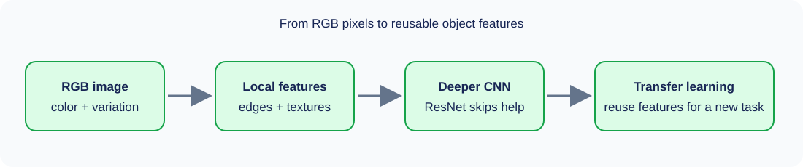

# Modern CNNs: Stage Review

## By the end, you will be able to

- Explain **[why CIFAR-10 needs richer features](#1-from-color-to-object-features)**.
- Compare **[deeper CNNs, ResNet, and transfer learning](#2-choose-a-modeling-approach)**.
- Choose a **[starting strategy for a new image task](#3-apply-the-ideas)**.

This checkpoint reviews Lessons 7–10. It is not an additional lesson.

---

## 1. From color to object features

CIFAR-10 adds color and object variation. Deeper CNNs combine local details across larger regions, ResNet adds skip connections to support deeper learning, and transfer learning reuses features from a pretrained model.

| Approach | Main idea | When it helps |
|---|---|---|
| Deeper CNN | Stack feature-learning layers | Learn richer patterns from more varied images |
| ResNet | Add skip connections around layers | Train deeper networks while preserving an information path |
| Transfer learning | Reuse pretrained weights | Adapt a model when a new task has limited labeled data |

Revisit [Lesson 7](../lesson-07-from-mnist-to-cifar10/index.md), [Lesson 8](../lesson-08-building-deeper-cnns/index.md), [Lesson 9](../lesson-09-understanding-resnet/index.md), or [Lesson 10](../lesson-10-transfer-learning/index.md) for details.

---

## 2. Choose a modeling approach

For a small labeled dataset, a pretrained model can provide useful visual features. You can first freeze its backbone and train a new classifier, then fine-tune selected layers if validation results justify it.

  
<strong>Checkpoint:</strong> You have few labels for a new image task. What is a sensible first experiment?

  <label><input type="radio" name="stage2-review-transfer" value="a"> Train a large CNN from scratch and tune on the test set</label> 
  <label><input type="radio" name="stage2-review-transfer" value="b"> Replace every pretrained layer before measuring performance</label> 
  <label><input type="radio" name="stage2-review-transfer" value="c"> Freeze a pretrained backbone, train a new head, and evaluate on validation data</label> 
  <button class="quiz-check" type="button">Check answer</button>
  

---

## 3. Apply the ideas

**Scenario:** You have a few hundred labeled photos from a new camera. Would you start with a CNN trained from scratch or transfer learning? What would you keep fixed while comparing approaches?

Show one reasonable response

Start with transfer learning because the labeled dataset is small. Compare a frozen backbone with selective fine-tuning, using the same data split and validation metric. Keep the test set for a final evaluation.

**Continue:** Go to [Lesson 11 — Vision Transformers](../../03-modern-computer-vision/lesson-11-vision-transformers/index.md) to compare CNNs with another way to process images.
