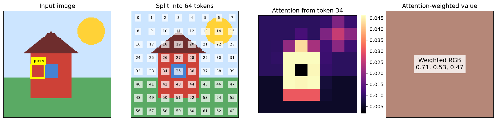

# Lesson 11: Vision Transformers

## By the end, you will be able to

- Describe how **[image patches](#2-turn-the-image-into-patches)** become a sequence of tokens.
- Explain **[self-attention](#3-how-do-tokens-share-information)** as a way for image regions to exchange information.
- Compare the **[CNN and ViT views of an image](#4-how-this-differs-from-a-cnn)**.
- Run the **[patch-attention demo](#5-visualize-patches-and-attention)** and interpret its output.

## In this lesson

- Break a small image into patches.
- Treat each patch as a token in a sequence.
- Follow one token's attention weights across the other patches.
- Compare the global token view of a ViT with a CNN's local filters.

---

## 1. From image grids to token sequences

A CNN starts with small filters that scan nearby pixels. A **Vision Transformer (ViT)** takes a different route: it breaks an image into patches, turns each patch into a vector, and processes the vectors as a sequence called **tokens**.

Think of the image as a page cut into small tiles. Each tile becomes one item the Transformer can compare with every other tile.

---

## 2. Turn the image into patches

For a 128 × 128 image divided into 16 × 16 patches, there are `8 × 8 = 64` patches. Flattening or projecting each patch gives a **patch embedding**, a vector that represents that patch. A position signal is also added so the model can tell top-left from bottom-right.

```text
128 × 128 image
       ↓ split into 16 × 16 tiles
8 × 8 grid = 64 patches
       ↓ convert each tile to a vector
64 tokens + position information
```

This demo uses each patch's average RGB color as a deliberately simple embedding. A real ViT learns a projection from the patch's pixel values, rather than reducing it to three color averages.

---

## 3. How do tokens share information?

With **self-attention**, each token compares its query with the keys of other tokens. A softmax turns those comparison scores into attention weights that sum to 1. The token then forms a weighted combination of the other tokens' values.

```text
query token ── compare with every key ──► attention weights
                                             │
all value tokens ────────────────────────────┴─► weighted mix
```

In a full ViT, query, key, and value vectors are learned projections. The demo uses normalized patch colors for its toy comparison, so it illustrates the attention operation without pretending to train a ViT.

<div class="quiz" data-answer="b" data-explanation="Patch embeddings convert image regions into vectors, so a Transformer can process them as tokens.">
  <p><strong>Checkpoint 1:</strong> Why does a ViT turn image patches into tokens?</p>
  <label><input type="radio" name="lesson11-patches" value="a"> To remove all spatial information from the image</label><br>
  <label><input type="radio" name="lesson11-patches" value="b"> To represent image regions as vectors that a Transformer can process</label><br>
  <label><input type="radio" name="lesson11-patches" value="c"> To convert every patch directly into a class label</label><br>
  <button class="quiz-check" type="button">Check answer</button>
  <p class="quiz-result" aria-live="polite"></p>
</div>

---

## 4. How this differs from a CNN

| CNN | Vision Transformer |
|---|---|
| Small filters look at local neighborhoods | Tokens can compare with other image patches through attention |
| Nearby features are combined as layers deepen | Attention mixes information across tokens, often across the whole image |
| Convolution encodes a strong local-image bias | Patch and position embeddings provide the starting representation |
| Often effective with less training data | Often benefits from large-scale pretraining |

Both model families can learn useful visual representations. This is a high-level comparison; modern systems can combine convolution and Transformer ideas.

<div class="quiz" data-answer="a" data-explanation="Self-attention lets each token assign weights to information from other tokens, including distant image patches.">
  <p><strong>Checkpoint 2:</strong> What does self-attention add to patch tokens?</p>
  <label><input type="radio" name="lesson11-attention" value="a"> A weighted way to gather information from other tokens</label><br>
  <label><input type="radio" name="lesson11-attention" value="b"> A rule that only adjacent patches can communicate</label><br>
  <label><input type="radio" name="lesson11-attention" value="c"> The final human-readable object name</label><br>
  <button class="quiz-check" type="button">Check answer</button>
  <p class="quiz-result" aria-live="polite"></p>
</div>

---

## 5. Visualize patches and attention

Run the example from the repository root:

```bash
uv run python examples/03-modern-computer-vision/lesson-11-vision-transformers/patch_attention.py
```

The script draws a small synthetic scene, splits it into 64 tokens, and computes a toy attention distribution for one selected token. Its central operation is:

```python
--8<-- "examples/03-modern-computer-vision/lesson-11-vision-transformers/patch_attention.py:attention_step"
```

The patch extraction is visible in the runnable script:

```python
--8<-- "examples/03-modern-computer-vision/lesson-11-vision-transformers/patch_attention.py:patchify"
```

### Example output



The yellow outline marks the query patch. The heatmap shows where this patch directs attention in this toy example: brighter cells receive larger weights. Those weights sum to 1. The final panel shows a weighted mix of patch color values. Real ViT attention works on learned feature vectors, not just average colors.

<div class="quiz" data-answer="c" data-explanation="The attention heatmap shows the weights assigned by the selected query token to the keys from all image patches.">
  <p><strong>Checkpoint 3:</strong> What does the attention heatmap represent?</p>
  <label><input type="radio" name="lesson11-heatmap" value="a"> The image's class probabilities</label><br>
  <label><input type="radio" name="lesson11-heatmap" value="b"> Pixel brightness in the original image</label><br>
  <label><input type="radio" name="lesson11-heatmap" value="c"> How strongly one patch token weights information from each patch</label><br>
  <button class="quiz-check" type="button">Check answer</button>
  <p class="quiz-result" aria-live="polite"></p>
</div>

---

## Hands-on: change the patch size

1. Run the patch-attention example and note the 64 tokens.
2. Change `PATCH_SIZE` from 16 to 32. The image now produces a 4 × 4 grid, or 16 tokens.
3. Run it again and compare the coarser attention map with the original.
4. Restore 16 and choose a different `QUERY_ROW` and `QUERY_COLUMN`.

The demo's square image size is divisible by both patch sizes. This keeps the patch grid simple.

## Lesson 11 summary

- A ViT turns image patches into a sequence of vector tokens.
- Self-attention lets tokens combine information from other patches.
- The example uses color averages to make attention visible; a trained ViT learns richer embeddings and projections.

**Next:** [Lesson 12 — Self-Supervised Learning](../lesson-12-self-supervised-learning/index.md) explores how a model can learn visual representations without human-provided class labels. Review [Modern CNNs](../../../syllabus.md#modern-cnns-lessons-710) for the preceding lessons.
