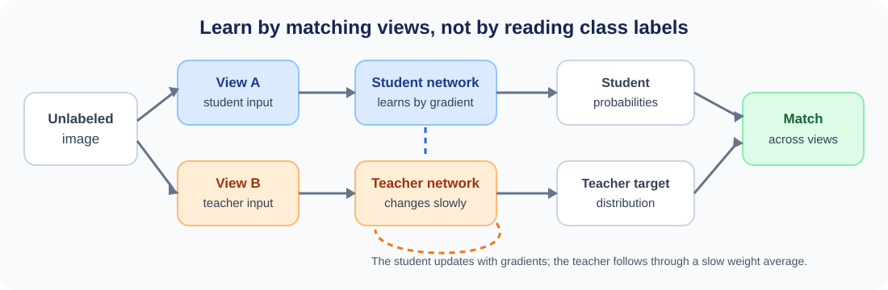
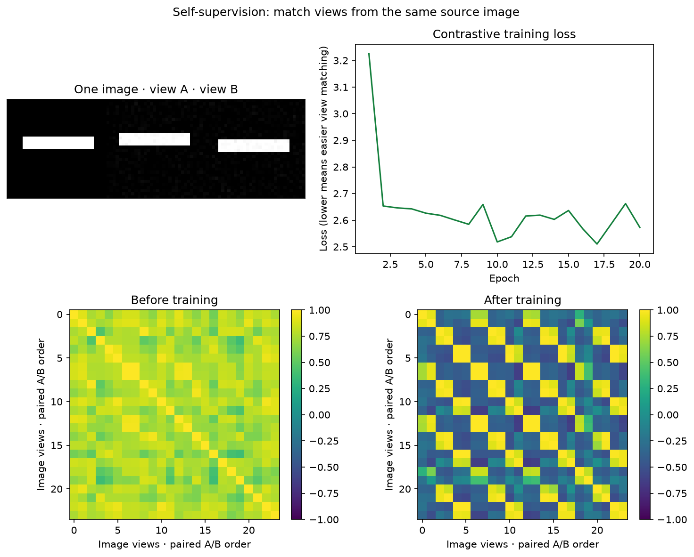

# Lesson 12: Self-Supervised Learning

## By the end, you will be able to

- Explain how **[self-supervised learning](#1-learn-from-the-image-itself)** creates a training signal without manual class labels.
- Describe **[augmented views](#2-two-views-of-one-image)** and why they can represent the same image.
- Explain the **[teacher–student idea](#3-a-teacher-guides-a-student)** used by DINO at a high level.
- Interpret the **[toy training visualization](#4-run-the-view-matching-demo)** without treating similarity as a class label.

## In this lesson

- Create two slightly changed views of an unlabeled image.
- Match the two views of an image without class labels.
- Compare the contrastive example with DINO's student–teacher approach.
- Inspect a training-loss graph and view-similarity matrices.

---

## 1. Learn from the image itself

Most classification examples use an image and a human label such as “cat.” **Self-supervised learning** builds a learning signal from the data itself, so a large collection of images can be used without first assigning each one a class label.

One common idea is to create two different views of the same image. The model is trained to make the views' representations agree. The supervision comes from knowing that both views came from the same source image, not from a human-provided category.

---

## 2. Two views of one image

A view can be changed with a small shift, a flip, a crop, or a brightness adjustment. The object may look a little different in each view, but it is still the same source image.

```text
Unlabeled image
    ├── small shift + brightness change ──► View A
    └── flip + different shift ───────────► View B
```

The model should learn visual features that remain useful across these changes. A view that changes the image's identity too much would make a poor training pair.

---

## 3. A teacher guides a student

**DINO** is a self-supervised method with a student and a slowly updated teacher. The teacher's output distribution guides the student across different image views; it is not a human class label. A moving average keeps the teacher changing more slowly than the student.

The runnable example uses a different, simpler self-supervised recipe called **contrastive learning**. It matches two views of the same image and treats other images in the batch as negatives. This makes the learning signal easy to see; DINO uses teacher–student predictions instead of this explicit negative-pair objective.



The contrastive loss in the runnable example is:

```python
--8<-- "examples/03-modern-computer-vision/lesson-12-self-supervised-learning/contrastive_views.py:contrastive_loss"
```

<div class="quiz" data-answer="b" data-explanation="The two views share an unlabeled source image, giving the learner a way to create a training signal without a human class label.">
  <p><strong>Checkpoint 1:</strong> Where does the training signal come from in the contrastive example?</p>
  <label><input type="radio" name="lesson12-signal" value="a"> A manually assigned digit label</label><br>
  <label><input type="radio" name="lesson12-signal" value="b"> Matching two views of the same image and separating other images</label><br>
  <label><input type="radio" name="lesson12-signal" value="c"> The image's file name</label><br>
  <button class="quiz-check" type="button">Check answer</button>
  <p class="quiz-result" aria-live="polite"></p>
</div>

---

## 4. Run the view-matching demo

From the repository root, run:

```bash
uv run python examples/03-modern-computer-vision/lesson-12-self-supervised-learning/contrastive_views.py
```

The script creates a small set of line and loop images in memory, with no labels used for training and no download. It prints contrastive loss by epoch, then saves and displays `outputs/contrastive_views.png`.

### Example output



The top row shows an unlabeled source and two transformed views. The loss curve tracks how the model learns to match views. In each similarity matrix, the upper-left and lower-right blocks compare views within the same group, while the upper-right and lower-left blocks compare view A with view B. Brighter paired positions after training show that views from the same source image have become more similar. No class names are used by the training objective.

<div class="quiz" data-answer="a" data-explanation="In DINO, the teacher is updated as a slow moving average of student weights, so its predictions change more gradually.">
  <p><strong>Checkpoint 2:</strong> How does the DINO teacher change?</p>
  <label><input type="radio" name="lesson12-teacher" value="a"> It follows the student's weights gradually through a moving average</label><br>
  <label><input type="radio" name="lesson12-teacher" value="b"> It receives the human labels while the student does not</label><br>
  <label><input type="radio" name="lesson12-teacher" value="c"> It is replaced with a new random network after every batch</label><br>
  <button class="quiz-check" type="button">Check answer</button>
  <p class="quiz-result" aria-live="polite"></p>
</div>

---

## 5. What the examples do not show

The contrastive demo is not DINO and does not use a teacher network. The teacher–student diagram explains DINO's central idea, while the code uses a SimCLR-style contrastive loss to keep the example small. Both approaches learn from image views without class labels, but their training objectives differ. These toy examples do not produce a production-ready vision model.

---

## Hands-on: change the view

1. Run the demo and inspect the source image and its two views.
2. In `contrastive_views.py`, increase `MAX_VIEW_SHIFT` from 1 to 3 and run it again.
3. Compare the loss curve and similarity matrices. A harder view change can make positive pairs less consistent.
4. Restore the default shift and try changing `VIEW_NOISE` slightly.

The example is intentionally small, so loss and prototype values are only illustrative.

## Lesson 12 summary

- Self-supervised learning can build targets from image views rather than human class labels.
- DINO uses a slowly changing teacher to guide a student across augmentations.
- The runnable contrastive demo and DINO share a label-free view-learning idea but use different objectives.

**Next:** [Lesson 13 — Object Detection](../lesson-13-object-detection/index.md) adds object locations and boxes to image predictions. Revisit [Lesson 11 — Vision Transformers](../lesson-11-vision-transformers/index.md) for the patch-token view of images.
