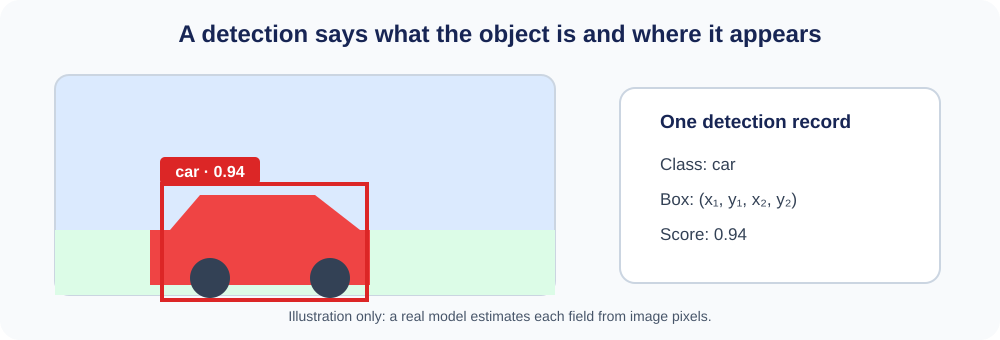
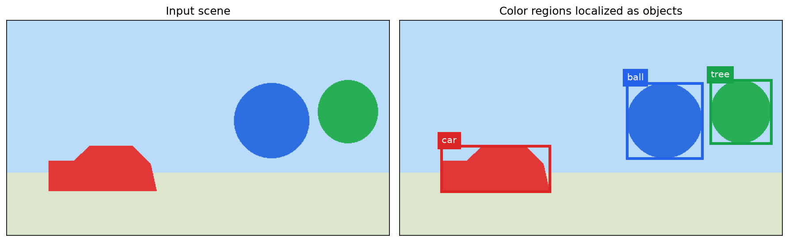

# Lesson 13: Object Detection

## By the end, you will be able to

- Distinguish **[image classification and object detection](#1-classification-or-detection)**.
- Read **[bounding boxes](#2-describe-an-object-location)** and class labels in an image.
- Describe **[YOLO at a high level](#3-how-yolo-makes-detections)** as a model that predicts object locations and classes.
- Run the **[toy localization example](#4-run-the-toy-detector)** and explain its limits.

## In this lesson

- Compare assigning one label to an image with finding multiple objects.
- Represent each detection with a class and a box.
- See how a detector's output can be overlaid on the image.
- Connect the basic output to the high-level YOLO idea.

---

## 1. Classification or detection?

An image classifier answers: **“What is the main thing in this image?”** It may return one label such as “car.” An **object detector** answers: **“What objects are here, and where is each one?”** It can return several objects with separate locations.

```text
Classification: image → one or more class scores
Detection:      image → [box, class, score] for each object
```

A detector has to recognize an object and locate it. If the image contains a car, a ball, and a tree, it should produce three detections rather than one image-level label.

---

## 2. Describe an object location

A **bounding box** is a rectangle around an object. This lesson uses pixel coordinates `(x_min, y_min, x_max, y_max)`, measured from the top-left of the image. A detection also includes a class label and, in learned detectors, a confidence score.



The box can be slightly too large or too small and still be useful. In real object-detection evaluation, overlap between a predicted box and a reference box is measured with **intersection over union (IoU)**.

<div class="quiz" data-answer="c" data-explanation="A bounding box describes where an object is located; the class identifies what it is.">
  <p><strong>Checkpoint 1:</strong> What does a bounding box tell us?</p>
  <label><input type="radio" name="lesson13-box" value="a"> The image's training loss</label><br>
  <label><input type="radio" name="lesson13-box" value="b"> Which pixels are red, green, and blue channels</label><br>
  <label><input type="radio" name="lesson13-box" value="c"> The approximate location and extent of an object</label><br>
  <button class="quiz-check" type="button">Check answer</button>
  <p class="quiz-result" aria-live="polite"></p>
</div>

---

## 3. How YOLO makes detections

YOLO is a family of object-detection models. At a high level, a YOLO model processes an image and predicts candidate boxes, class scores, and confidence scores in one model pass. A post-processing step such as **non-maximum suppression** removes many duplicate boxes around the same object, keeping the strongest candidates.

The toy example below does not implement YOLO. It uses exact color masks to locate simple shapes, making the link between pixels and boxes easy to see. A learned detector must handle textures, lighting changes, overlapping objects, and many appearances of the same class.

<div class="quiz" data-answer="a" data-explanation="A learned detector predicts candidate locations and classes; post-processing can remove duplicate boxes for the same object.">
  <p><strong>Checkpoint 2:</strong> What does an object detector add beyond image classification?</p>
  <label><input type="radio" name="lesson13-task" value="a"> A location for each detected object</label><br>
  <label><input type="radio" name="lesson13-task" value="b"> A conversion from RGB to grayscale only</label><br>
  <label><input type="radio" name="lesson13-task" value="c"> A single label for the entire dataset</label><br>
  <button class="quiz-check" type="button">Check answer</button>
  <p class="quiz-result" aria-live="polite"></p>
</div>

---

## 4. Run the toy detector

From the repository root:

```bash
uv run python examples/03-modern-computer-vision/lesson-13-object-detection/toy_detector.py
```

The script draws a simple scene, finds pixels with each toy object's exact color, wraps them in boxes, and saves and displays `outputs/toy_detections.png`. Its core color-region step is:

```python
--8<-- "examples/03-modern-computer-vision/lesson-13-object-detection/toy_detector.py:find_boxes"
```

### Example output



The left panel is the input scene. The right panel shows the detected color regions with class labels and boxes. This illustrates the shape of detection output, but it is not learned object recognition: changing an object's color would make this detector miss it.

<div class="quiz" data-answer="b" data-explanation="This lesson's demo uses hand-written color matching, so it cannot handle an object whose appearance changes outside the selected color.">
  <p><strong>Checkpoint 3:</strong> What is a limitation of the color-mask demo?</p>
  <label><input type="radio" name="lesson13-toy" value="a"> It cannot calculate pixel coordinates</label><br>
  <label><input type="radio" name="lesson13-toy" value="b"> It only finds the exact colors used to draw the toy objects</label><br>
  <label><input type="radio" name="lesson13-toy" value="c"> It always predicts a confidence score of zero</label><br>
  <button class="quiz-check" type="button">Check answer</button>
  <p class="quiz-result" aria-live="polite"></p>
</div>

---

## Hands-on: change the scene

1. Run the demo and compare the original scene with the boxed result.
2. Change the ball's fill color in `toy_detector.py` but leave `OBJECT_COLORS` unchanged. Run it again and observe which detection disappears.
3. Update the matching entry in `OBJECT_COLORS` and confirm the ball is detected again.
4. Add a second separated red shape and observe that this simple color mask combines same-color pixels into one large box. A real detector reasons about separate object instances.

## Lesson 13 summary

- Classification labels an image; detection returns an object label and location for each object.
- Bounding boxes make localization visible, and learned detectors also estimate confidence.
- YOLO predicts candidate boxes and classes in one model pass, then filters duplicate candidates.
- The runnable color-mask example explains box output but does not replace a trained detector.

**Stage 3 complete.** Continue to [Stage 4 — Practical Computer Vision](../../../syllabus.md#stage-4-practical-computer-vision-lessons-1415) to explore efficient inference and deployment. Revisit [Lesson 12 — Self-Supervised Learning](../lesson-12-self-supervised-learning/index.md) for the label-free representation example.
