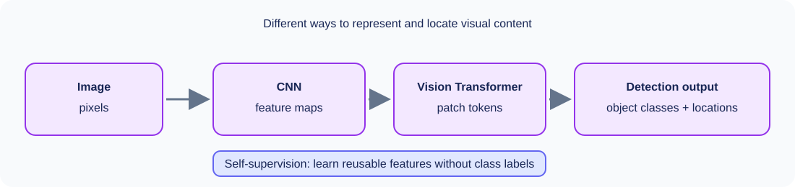

# Beyond CNNs: Stage Review

## By the end, you will be able to

- Compare **[CNNs, Vision Transformers, and self-supervised features](#1-compare-vision-approaches)**.
- Distinguish **[classification from object detection](#2-match-the-method-to-the-task)**.
- Select an approach based on **[the task output and available labels](#3-apply-the-ideas)**.

This checkpoint reviews Lessons 11–13. It is not an additional lesson.

---

## 1. Compare vision approaches

| Approach | What it learns or predicts | Labels needed for the main task? |
|---|---|---|
| CNN | Spatial features and usually image-level classes | Usually yes for classification |
| Vision Transformer | Relationships among image-patch tokens | Usually yes for classification |
| Self-supervised learning | Reusable image representations from unlabeled views | No manual class labels for pretraining |
| Object detection | Class labels and locations for multiple objects | Yes for supervised detection training |

Revisit [Vision Transformers](../lesson-11-vision-transformers/index.md), [Self-Supervised Learning](../lesson-12-self-supervised-learning/index.md), and [Object Detection](../lesson-13-object-detection/index.md).

---

## 2. Match the method to the task

The task determines the output. If the question is “what is in this image?”, classification may be enough. If the system must find multiple objects, it needs locations as well as classes. A ViT changes how image information is combined; self-supervision changes how representations can be learned.

  
<strong>Checkpoint:</strong> A camera must find several vehicles and mark each one's location. Which task fits?

  <label><input type="radio" name="stage3-review-task" value="a"> Object detection</label> 
  <label><input type="radio" name="stage3-review-task" value="b"> Image classification</label> 
  <label><input type="radio" name="stage3-review-task" value="c"> Image normalization</label> 
  <button class="quiz-check" type="button">Check answer</button>
  

---

## 3. Apply the ideas

**Scenario:** You have many unlabeled photos and later need to find several objects in each image. Which course ideas could help, and what extra information would supervised detection training need?

Show one reasonable response

Self-supervised learning could help learn representations from the unlabeled photos. To train a supervised detector, you would also need labeled examples that identify object classes and locations, such as bounding boxes.

**Continue:** Go to [Lesson 14 — Model Optimization](../../04-practical-computer-vision/lesson-14-model-optimization/index.md) to consider how a selected model can run efficiently.
