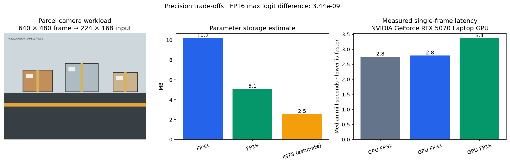

# Lesson 14: Model Optimization

## By the end, you will be able to

- Compare **[FP32, FP16, and INT8 precision](#2-what-changes-with-fp16-and-int8)** for model storage and inference.
- Explain the trade-off between **[latency and numeric agreement](#3-measure-the-inference-trade-off)**.
- Describe **[TensorRT](#4-where-tensorrt-fits)** as an inference optimization runtime.
- Interpret a **[camera-workload benchmark](#5-run-the-optimization-example)** without treating speed as model accuracy.

## In this lesson

- Use a parcel-inspection camera as the practical scenario.
- Compare model storage at different numeric precisions.
- Measure CPU/GPU inference latency and FP16 output differences.
- Connect precision and graph optimization to TensorRT deployment.

---

## 1. Scenario: inspect parcels on a conveyor

Imagine a camera above a conveyor belt sending frames to a nearby edge computer. A vision model checks each frame for a package condition. The model must fit the device's memory and finish quickly enough for the line.


The benchmark uses MobileNetV3-Small with randomly initialized weights. This keeps the example download-free and gives us a real CNN workload, but its predictions are meaningless. We are measuring compute and storage only; a deployed inspection model must be trained and evaluated on the actual package task.

---

## 2. What changes with FP16 and INT8?

Floating-point values use different amounts of storage:

| Format | Bytes per value | What to watch |
|---|---:|---|
| **FP32** | 4 | Baseline precision; commonly supported. |
| **FP16** | 2 | Smaller values and faster math on supported accelerators; outputs can shift slightly. |
| **INT8** | 1 | Compact integer values; quantization needs scales and calibration, and may change accuracy. |

If a model has `N` parameters, its raw parameter storage is approximately `N × bytes per value`. Real checkpoint size also includes buffers and metadata. The graph below estimates parameter storage; its INT8 bar is a size estimate, not a measured INT8 engine.

Quantization maps floating-point values into a smaller integer range. **Calibration** estimates the activation ranges the model uses so those values can be represented. After quantization, validate the model on task data: lower storage does not guarantee acceptable accuracy or faster inference on every device.

---

## 3. Measure the inference trade-off

The example benchmarks one 224-pixel input on CPU FP32 and, when CUDA is available, GPU FP32 and FP16. It warms up the model, runs repeated inferences, synchronizes GPU work, and reports the median latency.

```python
--8<-- "examples/04-practical-computer-vision/lesson-14-model-optimization/optimization_benchmark.py:measure_latency"
```

The embedded graph is the output from this benchmark on the development GPU. Your measurements will vary with hardware, drivers, power settings, and background load. The FP16 logit difference shows numerical change for this input; it is not a measure of task accuracy.



In this run, FP16 used the same estimated parameter storage as half of FP32, but was slower than GPU FP32. This is a useful result: lower precision is a possible optimization, not a guarantee. The INT8 bar estimates storage only; it does not report INT8 inference speed.

<div class="quiz" data-answer="b" data-explanation="INT8 stores each value in one byte, but quantization scales, calibration, and accuracy validation still matter.">
  <p><strong>Checkpoint 1:</strong> What is a practical benefit and trade-off of INT8 quantization?</p>
  <label><input type="radio" name="lesson14-int8" value="a"> It guarantees identical predictions and removes the need for calibration</label><br>
  <label><input type="radio" name="lesson14-int8" value="b"> It can reduce storage, but numerical and accuracy effects must be checked</label><br>
  <label><input type="radio" name="lesson14-int8" value="c"> It only changes the image resolution</label><br>
  <button class="quiz-check" type="button">Check answer</button>
  <p class="quiz-result" aria-live="polite"></p>
</div>

---

## 4. Where TensorRT fits

**[TensorRT](https://docs.nvidia.com/deeplearning/tensorrt/latest/index.html)** is NVIDIA's SDK for optimizing trained models for inference on NVIDIA GPUs. It compiles supported models into engines for a target deployment configuration and supports lower-precision options such as FP16 and INT8. For INT8, quantization information must be supplied through a supported workflow, then validated against the real task.

The benchmark script does not install or run TensorRT. Its results establish a PyTorch baseline; a production TensorRT engine must be benchmarked on the target device with the real model, inputs, and accuracy checks.

<div class="quiz" data-answer="a" data-explanation="A runtime such as TensorRT can optimize graph execution and choose kernels suited to the target NVIDIA device; the result still needs validation.">
  <p><strong>Checkpoint 2:</strong> What role does TensorRT play?</p>
  <label><input type="radio" name="lesson14-tensorrt" value="a"> It optimizes inference execution for supported NVIDIA hardware</label><br>
  <label><input type="radio" name="lesson14-tensorrt" value="b"> It automatically collects labels for training</label><br>
  <label><input type="radio" name="lesson14-tensorrt" value="c"> It guarantees the model's predictions are correct</label><br>
  <button class="quiz-check" type="button">Check answer</button>
  <p class="quiz-result" aria-live="polite"></p>
</div>

---

## 5. Run the optimization example

From the repository root:

```bash
uv run python examples/04-practical-computer-vision/lesson-14-model-optimization/optimization_benchmark.py
```

The script saves and displays `outputs/optimization_tradeoffs.png`. It needs no pretrained checkpoint or downloaded data. CUDA systems compare CPU FP32, GPU FP32, and GPU FP16; CPU-only systems still produce a storage chart and CPU timing.

<div class="quiz" data-answer="c" data-explanation="The example's random weights let us compare execution and storage, but they do not represent a trained package-inspection model.">
  <p><strong>Checkpoint 3:</strong> What can we conclude from this benchmark's randomly initialized model?</p>
  <label><input type="radio" name="lesson14-benchmark" value="a"> Its package-classification accuracy</label><br>
  <label><input type="radio" name="lesson14-benchmark" value="b"> That FP16 is always faster on every device</label><br>
  <label><input type="radio" name="lesson14-benchmark" value="c"> The measured compute latency on this hardware for this workload</label><br>
  <button class="quiz-check" type="button">Check answer</button>
  <p class="quiz-result" aria-live="polite"></p>
</div>

---

## Hands-on: compare precision on your device

1. Run the benchmark and note the storage estimate and median latency for each available mode.
2. Change `MODEL_INPUT_SHORT_EDGE` from 224 to 320 and rerun. The parameter storage stays the same, while input compute and latency may increase.
3. Compare FP16 logit drift with its measured latency on CUDA. Keep both values in your notes.
4. Restore 224 and compare with a trained model before making any deployment decision.

## Lesson 14 summary

- Lower precision can reduce storage and accelerate supported hardware, but its output must be validated.
- INT8 storage and actual INT8 inference are separate claims; this example estimates only storage.
- TensorRT can optimize supported inference graphs for NVIDIA devices, but target hardware and task accuracy matter.

**Next:** [Lesson 15 — Real-Time Computer Vision](../lesson-15-real-time-computer-vision/index.md) adds preprocessing, batching, and a camera frame-rate budget. Review [Lesson 13 — Object Detection](../../03-modern-computer-vision/lesson-13-object-detection/index.md) for object locations and classes.
