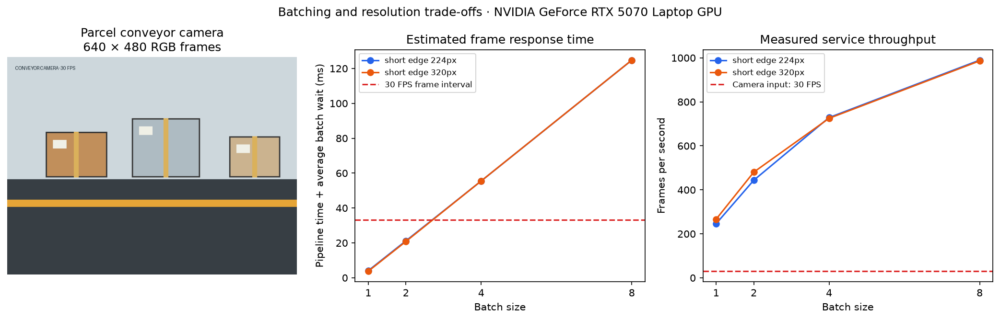

# Lesson 15: Real-Time Computer Vision

## By the end, you will be able to

- Calculate the **[frame-time budget](#1-start-with-the-camera-rate)** for a target camera FPS.
- Trace **[preprocessing and inference latency](#2-follow-a-frame-through-the-pipeline)** through a live pipeline.
- Explain how **[resolution and batch size](#3-compare-resolution-batching-and-wait-time)** affect response time and throughput.
- Interpret the **[stream benchmark graph](#4-run-the-real-time-example)** for an edge-camera scenario.

## In this lesson

- Follow a parcel-inspection camera stream through a vision model.
- Compare measured pipeline performance at two input resolutions and several batch sizes.
- Separate throughput from the time one frame waits for an answer.
- Identify where an edge device, GPU, and preprocessing fit in a deployed system.

---

## 1. Start with the camera rate

Imagine a conveyor camera sending **30 frames per second** to an edge computer. One new frame arrives every `1000 ÷ 30 ≈ 33.3 milliseconds`. This is the frame interval and gives the pipeline a useful response-time target.

```text
640 × 480 camera frame → resize and normalize → transfer → model → class score

30 FPS input means one frame arrives every 33.3 ms
```

If the system must react to each frame before the next one arrives, a slow average is not enough: sustained throughput must keep up, and response latency must fit the application's deadline. Some tasks can drop old frames or process in batches; safety-sensitive control may need a prompt result for each frame.

---

## 2. Follow a frame through the pipeline

**Latency** is the time from receiving a frame to producing its result. In the example, the measured pipeline includes host-to-device transfer, resize with the camera aspect ratio preserved, normalization, model inference, and selecting the top-scoring class.

```text
Camera frame → host-to-device transfer → resize and normalize → inference → class score
```

The script's frame-processing path is:

```python
--8<-- "examples/04-practical-computer-vision/lesson-15-real-time-computer-vision/streaming_benchmark.py:run_pipeline"
```

Physical camera capture and display are outside this benchmark. A deployed system would include those stages too, plus any detection postprocessing or application logic.

---

## 3. Compare resolution, batching, and wait time

The benchmark compares 224- and 320-pixel short edges. With the 4:3 camera image, those correspond to about 224 × 168 and 320 × 240 pixels. The larger input has about twice as many pixels, so it can preserve more detail at a compute cost.

**Throughput** is how many frames the system can process per second. Batching can raise throughput by sharing model work across frames. But a live system must wait for a batch to fill. At 30 FPS, the average batch-fill wait is approximately:

| Batch size | Average fill wait |
|---:|---:|
| 1 | 0 ms |
| 2 | 16.7 ms |
| 4 | 50.0 ms |
| 8 | 116.7 ms |

The graph adds this average wait to measured pipeline time to estimate response time, and plots measured service throughput separately. A batch can process more frames per second while making each frame wait longer for its result.

<div class="quiz" data-answer="b" data-explanation="Batching can improve throughput, but a live stream waits for more frames to arrive before the batch can run.">
  <p><strong>Checkpoint 1:</strong> What is a batching trade-off in a live camera stream?</p>
  <label><input type="radio" name="lesson15-batching" value="a"> Larger batches always reduce the wait for the first frame</label><br>
  <label><input type="radio" name="lesson15-batching" value="b"> Throughput may improve while individual frames wait longer</label><br>
  <label><input type="radio" name="lesson15-batching" value="c"> Batching removes preprocessing from the pipeline</label><br>
  <button class="quiz-check" type="button">Check answer</button>
  <p class="quiz-result" aria-live="polite"></p>
</div>

---

## 4. Run the real-time example

From the repository root:

```bash
uv run python examples/04-practical-computer-vision/lesson-15-real-time-computer-vision/streaming_benchmark.py
```

The script saves and displays `outputs/streaming_tradeoffs.png`. It runs a small MobileNetV3-Small workload on the local CPU or GPU. Random weights are used because this lesson compares system performance, not package-recognition accuracy.



The two plots answer different questions. The response-time plot includes the estimated average wait while a batch fills; the throughput plot counts completed frames per second. In this hardware run, larger batches raise throughput, but the added camera wait makes a single frame's response much slower.

The dashed lines mark the incoming 30 FPS rate and its 33.3 ms frame interval. A measured result below these targets is a useful first check, not a complete deployment guarantee. Camera capture, OS scheduling, thermal limits, and downstream actions can add time.

<div class="quiz" data-answer="a" data-explanation="At 30 FPS, the camera delivers one frame about every 33.3 milliseconds.">
  <p><strong>Checkpoint 2:</strong> What is the approximate interval between frames at 30 FPS?</p>
  <label><input type="radio" name="lesson15-budget" value="a"> 33.3 ms</label><br>
  <label><input type="radio" name="lesson15-budget" value="b"> 3 ms</label><br>
  <label><input type="radio" name="lesson15-budget" value="c"> 300 ms</label><br>
  <button class="quiz-check" type="button">Check answer</button>
  <p class="quiz-result" aria-live="polite"></p>
</div>

---

## 5. Choose the right performance measure

- **Latency** answers how long one frame waits for a result.
- **Throughput** answers how many frames can be processed over time.
- **FPS** reports throughput in frames per second.
- **Batch size** controls how many frames share one model call.

For a live camera, compare both measures with the system's actual deadline and input rate. A GPU can increase throughput, but transferring data to it and resizing the frame also take time. An edge device may reduce transfer and network delays, but its compute and thermal limits differ from a workstation.

<div class="quiz" data-answer="c" data-explanation="FPS is a throughput measure; response latency is a separate measure and can rise when frames wait for a batch.">
  <p><strong>Checkpoint 3:</strong> What does FPS describe?</p>
  <label><input type="radio" name="lesson15-fps" value="a"> The storage required for model weights</label><br>
  <label><input type="radio" name="lesson15-fps" value="b"> The image's pixel resolution</label><br>
  <label><input type="radio" name="lesson15-fps" value="c"> How many frames are processed per second</label><br>
  <button class="quiz-check" type="button">Check answer</button>
  <p class="quiz-result" aria-live="polite"></p>
</div>

---

## Hands-on: set a different camera target

1. Run the benchmark and find which resolution/batch combinations clear the 30 FPS throughput line.
2. Change `CAMERA_FPS` from 30 to 15 and compare the frame interval and average batch-fill waits.
3. Try batch sizes `(1, 2, 4)` and note how smaller batches change throughput and response time.
4. Restore the defaults and choose a configuration that fits the response-time needs of the scenario.

The model uses random weights. Do not treat its outputs as package inspection results.

## Lesson 15 summary

- A 30 FPS camera delivers a frame about every 33 ms.
- Higher throughput does not necessarily mean lower response latency.
- Resolution, preprocessing, transfers, batching, hardware, and application stages all affect real-time behavior.

**Vision in Practice complete.** You have now seen the path from image tensors through trained models to optimized, real-time inference. Revisit [Lesson 14 — Model Optimization](../lesson-14-model-optimization/index.md), then complete the [Vision in Practice stage review](../review/index.md) before choosing a [capstone project](../../../roadmap.md#capstone-project).
