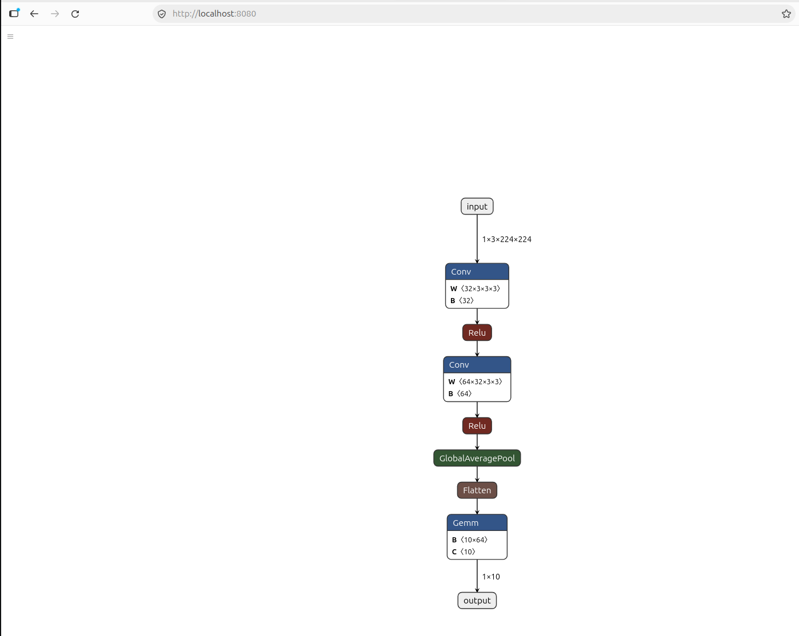
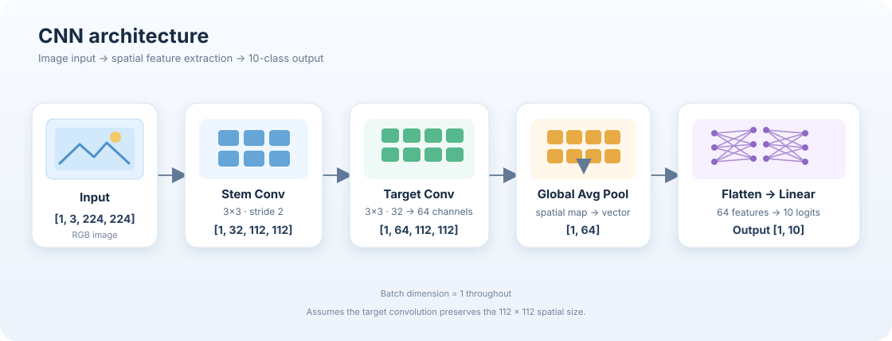
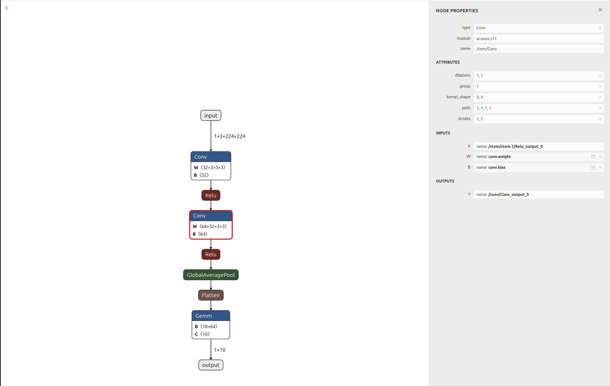
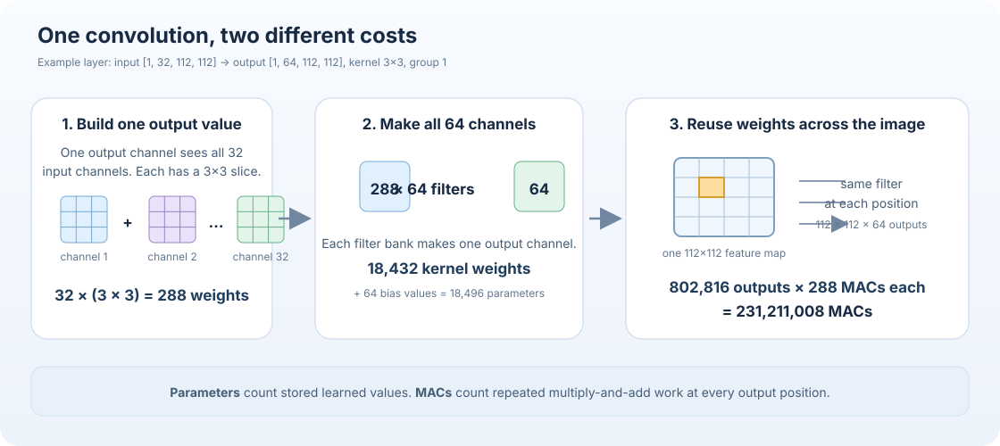
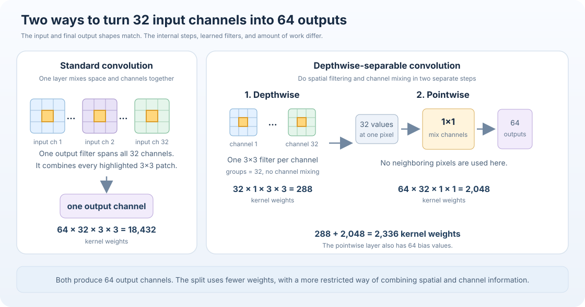

# Inspect and Optimize a Network with Netron

## By the end, you will be able to

- Inspect an **[ONNX computation graph](#1-what-netron-shows)** in Netron.
- Trace **[tensor shapes and convolution weights](#2-find-the-expensive-layer)** through a model.
- Compare **[standard and depthwise-separable convolutions](#3-change-the-convolution)** by parameters and MACs.
- Measure **[ONNX Runtime latency](#5-benchmark-the-two-graphs)** and explain why MAC reduction does not guarantee a speedup.

## In this lab

- Export two small CNNs with the same input and output shapes.
- Inspect the original graph in Netron and identify its expensive convolution.
- Replace that convolution with depthwise and pointwise operations, then compare the exported graph.
- Benchmark both ONNX models and interpret the result.


---

## 1. What Netron shows

[Netron](https://netron.app/) opens a model file and visualizes its computation graph: operators, tensor connections, shapes, and some weight metadata. It helps answer “what operations does this model contain?” It does not measure how long an operator takes on a CPU, GPU, or NPU. Use a runtime benchmark or device profiler for timing.

This lab exports a tiny CNN twice. Both versions receive `[1, 3, 224, 224]` RGB input and produce `[1, 10]` scores. The weights start random, so the scores are only there to make a complete graph; they do not indicate classification accuracy.

### Install

```bash
python3 -m pip install netron
netron model.onnx

```




!!! info "Desktop release"
    check [github repository](https://github.com/lutzroeder/netron/releases)

---

## 2. Find the expensive layer




The layer to investigate is the second `Conv` in the graph. The first convolution shrinks the image from 224×224 to 112×112; the second still has a large 112×112 feature map and expands it from 32 channels to 64. That combination means its filters are applied many times.

In Netron, click the second `Conv` node and look at its input shape, output shape, kernel, `group`, and weight shape. For this example, the key values are:



Read the selected node from the right-hand **Node Properties** panel:

- **`W <64×32×3×3>`** is the learned weight tensor. ONNX stores Conv weights in `[output channels, input channels per group, kernel height, kernel width]` order. Here that means 64 output filters; every filter reads 32 input channels and has a 3×3 kernel.
- **`B <64>`** is one learned bias for each of the 64 output channels. Bias adds 64 parameters to the layer.
- **`group 1`** means the convolution is not split into independent channel groups. Each output channel can combine all 32 input channels.
- **`kernel_shape 3, 3`** confirms each spatial filter is 3×3. `strides 1, 1` means the filter moves one pixel each step, and the padding keeps the output at 112×112.
- The red outline marks the node you selected. Its input comes from the preceding ReLU. Select other `Conv` nodes and compare their weight shape and output size to decide which deserve inspection.

The node panel tells you the weight dimensions, but it does not label a layer “expensive.” Use the output shape too: this layer produces 64 channels at 112×112 positions, so its filters do a lot of repeated work. The visual below separates the weights stored once from the operations repeated across those positions.

| Netron field | Value | What it tells you |
|---|---|---|
| Input | `[1, 32, 112, 112]` | 32 feature maps enter the layer |
| Output | `[1, 64, 112, 112]` | 64 output feature maps are computed at every image position |
| Kernel | `3 × 3` | Each filter looks at a 3-by-3 patch |
| Group | `1` | Every output channel reads all 32 input channels |
| Weight tensor | `[64, 32, 3, 3]` | 64 filters, each with 32 small 3-by-3 channel slices |



### Count the learned weights once

Think of one output channel as one filter bank. To make one output value, this bank needs a 3×3 slice from **each** of the 32 input channels:

```text
one output filter bank = 32 input channels × 3 × 3 = 288 weights
all 64 output channels = 64 × 288 = 18,432 weights
```

For a convolution with `G` groups, the general weight-count equation is:

\[
N_{\text{weights}} = C_{\text{out}} \times \frac{C_{\text{in}}}{G} \times K_h \times K_w
\]

Here `group = 1`, so every output filter uses all 32 input channels:

\[
N_{\text{weights}} = 64 \times \frac{32}{1} \times 3 \times 3 = 18{,}432
\]

**18,432 is the kernel-weight count. It is not the bias count.** Netron shows the separate bias tensor as `B <64>`, which means there is one bias value for each of the 64 output channels:

\[
N_{\text{bias}} = C_{\text{out}} = 64
\]

So this layer has 18,432 kernel weights plus 64 bias values:

\[
N_{\text{parameters}} = N_{\text{weights}} + N_{\text{bias}} = 18{,}432 + 64 = 18{,}496
\]

At every image position, the convolution combines the 288 input-weight products for an output channel, then adds that channel's bias. The kernel weights and biases are learned and stored once; the same values are reused at every position in the 112×112 feature map.

### Count the work at every output position

The output has `112 × 112 × 64 = 802,816` values. Each value is made from 288 input-weight pairs, so the layer performs:

```text
MACs = output height × output width × output channels × input channels × kernel height × kernel width
     = 112 × 112 × 64 × 32 × 3 × 3
     = 231,211,008 MACs
```

A **multiply-accumulate (MAC)** multiplies one input by one weight and adds that product to a running sum. This count is an estimate of arithmetic work; it is not a latency measurement.

This example shows why “expensive” needs context: parameters tell you how many learned values the layer stores, while MACs estimate how much arithmetic it performs. The 3×3 filter has only 18,432 weights, but it is reused at 112×112 locations for 64 channels, producing about 231 million MACs. When searching a real graph, compare the layers' output sizes and weight shapes, then use a profiler or benchmark to find actual runtime bottlenecks.

Netron may show initializers and dimensions in framework-specific order. For ONNX Conv, the weight shape is conventionally `[C_out, C_in / G, K_h, K_w]`; check the `group` attribute before interpreting the second dimension.

<div class="quiz" data-answer="a" data-explanation="With one group, each output channel has a kernel spanning all 32 input channels, so the weight count is 64 × 32 × 3 × 3.">
  <p><strong>Checkpoint 1:</strong> What determines the standard convolution's weight count?</p>
  <label><input type="radio" name="netron-weight-count" value="a"> Output channels × input channels × kernel height × kernel width</label><br>
  <label><input type="radio" name="netron-weight-count" value="b"> Input image width × image height</label><br>
  <label><input type="radio" name="netron-weight-count" value="c"> Number of output classes only</label><br>
  <button class="quiz-check" type="button">Check answer</button>
  <p class="quiz-result" aria-live="polite"></p>
</div>

---

## 3. Change the convolution

A **depthwise-separable convolution** factors the target layer into two operations:

- **Depthwise convolution** applies a spatial filter independently to each input channel. Here `groups=32`, so each of the 32 channels has its own 3×3 filter and cannot mix information from the other channels in this step.
- **Pointwise convolution** uses a 1×1 kernel to combine the 32 filtered values at each location into 64 output channels. Since the kernel is 1×1, this step mixes channels without looking at neighboring pixels.



Follow one image position to see the split: the depthwise stage looks at a 3×3 neighborhood in each of the 32 input channels, producing 32 filtered values. The pointwise stage takes those 32 values at that same position and combines them into 64 output values. It does not use a 3×3 neighborhood.

The weight shapes in Netron make those two jobs visible:

| Operation | ONNX weight shape | Weight calculation | Kernel weights |
|---|---|---|---:|
| Depthwise | `[32, 1, 3, 3]` | `32 × 1 × 3 × 3` | 288 |
| Pointwise | `[64, 32, 1, 1]` | `64 × 32 × 1 × 1` | 2,048 |
| **Combined** | — | `288 + 2,048` | **2,336** |

The baseline target layer has 18,432 kernel weights. The split version has 2,336 kernel weights, about 87.3% fewer. At 112×112 resolution, its estimated work is:

\[
N_{\text{MACs}} = 112 \times 112 \times (32 \times 3 \times 3 + 64 \times 32 \times 1 \times 1) = 29{,}302{,}784
\]

These are kernel weights; the pointwise layer also has 64 bias values, so its target block has 2,400 learned parameters in total. The baseline and split models both produce `[1, 64, 112, 112]` here, so following layers can keep the same input shape.

The designs are **not mathematically equivalent**: one full convolution can learn filters that combine spatial patterns across channels together, while the split version first filters channels independently and only then mixes them. That restriction can affect accuracy. Fewer estimated operations also do not guarantee faster execution on every processor.

<div class="quiz" data-answer="c" data-explanation="The depthwise operation filters each channel spatially; the 1×1 pointwise operation then mixes information across channels.">
  <p><strong>Checkpoint 2:</strong> What does the pointwise convolution do after depthwise filtering?</p>
  <label><input type="radio" name="netron-pointwise" value="a"> It downsamples the image to 56×56</label><br>
  <label><input type="radio" name="netron-pointwise" value="b"> It applies one spatial filter to each channel independently</label><br>
  <label><input type="radio" name="netron-pointwise" value="c"> It mixes information across channels with 1×1 filters</label><br>
  <button class="quiz-check" type="button">Check answer</button>
  <p class="quiz-result" aria-live="polite"></p>
</div>

---

## 4. Export and inspect both graphs

From the repository root, install the demo packages and export both graphs:

```bash
uv pip install --python .venv/bin/python onnx onnxruntime netron
uv run python examples/04-practical-computer-vision/netron_optimization_lab/kab1-netron-network-optimization/export_models.py
```

Open each exported graph in Netron:

```bash
uv run netron examples/04-practical-computer-vision/netron_optimization_lab/kab1-netron-network-optimization/outputs/original.onnx
uv run netron examples/04-practical-computer-vision/netron_optimization_lab/kab1-netron-network-optimization/outputs/optimized.onnx
```

Netron starts a local viewer. Keep the process running while you inspect the graph. If you want both graphs open at once, start each command in a separate terminal. Compare the original target `Conv` with the optimized graph's depthwise and pointwise `Conv` nodes.

| Inspect | Original target | Optimized target |
|---|---|---|
| Operator structure | One `Conv` | Depthwise `Conv` followed by pointwise `Conv` |
| Input/output shapes | `[1,32,112,112]` → `[1,64,112,112]` | Same overall input and output |
| Kernel and groups | 3×3, `group=1` | 3×3, `group=32`; then 1×1, `group=1` |
| Weight shapes | `[64,32,3,3]` | `[32,1,3,3]`; then `[64,32,1,1]` |

The export script checks the ONNX graphs, output shapes, and expected target-layer MAC counts. It also prints total model parameters, target-layer weights, and ONNX file sizes.

---

## 5. Benchmark the two graphs

Run the CPU benchmark:

```bash
uv run python examples/04-practical-computer-vision/netron_optimization_lab/kab1-netron-network-optimization/benchmark_onnx.py
```

| Model | Session load (ms) | Median inference (ms) | Model (MiB) |
|---|---:|---:|---:|
| original | 38.36 | 3.464 | 0.078 |
| optimized | 1.50 | 1.392 | 0.016 |

!!! tip "MiB means mebibyte"
    One MiB is 1,048,576 bytes (1024 × 1024). It is slightly larger than one decimal megabyte (MB), which is 1,000,000 bytes.

It uses the same generated input for each model, performs warm-up runs, then reports median latency and ONNX Runtime session startup time. It uses random input and random weights, so it measures graph execution only, not classification quality. Compare the measured latency with target-layer MACs; runtime kernels, memory traffic, launch overhead, and graph optimizations can change the result.

<div class="quiz" data-answer="b" data-explanation="MAC counts describe theoretical arithmetic. Actual latency also depends on runtime kernels, memory movement, and target hardware.">
  <p><strong>Checkpoint 3:</strong> Why might a model with fewer MACs run slower?</p>
  <label><input type="radio" name="netron-latency" value="a"> MACs directly measure measured wall-clock time</label><br>
  <label><input type="radio" name="netron-latency" value="b"> The new operations may use less efficient kernels or add memory overhead</label><br>
  <label><input type="radio" name="netron-latency" value="c"> ONNX graphs cannot be benchmarked</label><br>
  <button class="quiz-check" type="button">Check answer</button>
  <p class="quiz-result" aria-live="polite"></p>
</div>

---


## Hands-on challenge

1. Inspect both graphs and record the target operator's input shape, output shape, groups, and weight shape.
2. Compare the theoretical MAC and weight counts with measured CPU latency.
3. Choose another change—channel width, kernel size, or stride—and predict its shape and compute effects before editing.
4. For a meaningful accuracy comparison, train both architectures with the same dataset, split, and training schedule. Keep the test set for final evaluation.
5. For a real MobileNetV2 graph, continue with the [MobileNetV2 Paper-to-Deployment capstone](../../../capstone-mobilenetv2-gtsrb/index.md), then apply the inspect → hypothesize → modify → export → compare → benchmark → validate loop.

**Next:** Return to [Lesson 14](../lesson-14-model-optimization/index.md), continue to [Lesson 15](../lesson-15-real-time-computer-vision/index.md), or try the [MobileNetV2 capstone](../../../capstone-mobilenetv2-gtsrb/index.md).
