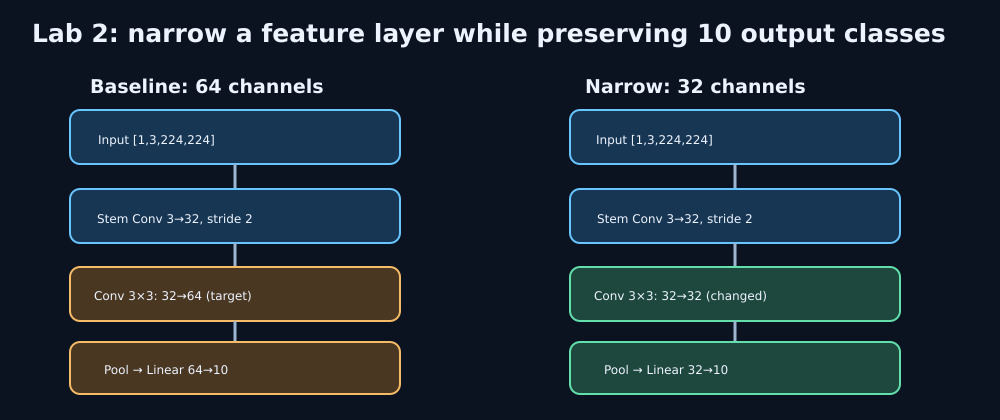
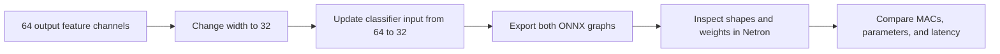
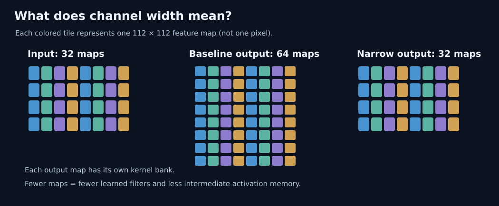
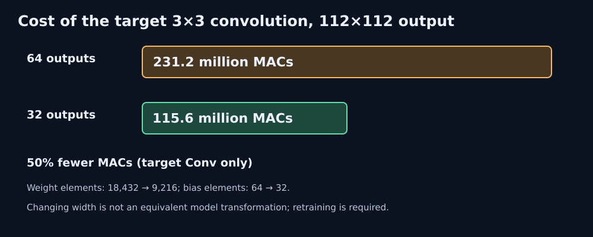

# Optional Lab 2: Reduce CNN Channel Width with Netron

## By the end, you will be able to

- Explain how **[channel width](#1-start-with-the-baseline)** changes a CNN's internal feature shapes.
- Inspect **[convolution weights in Netron](#2-inspect-the-baseline-graph)** and relate them to input/output channels.
- Calculate **[parameter and MAC changes](#4-predict-the-compute-change)** after reducing output channels.
- Compare **[measured CPU latency](#5-measure-the-change)** without treating MACs as a speed guarantee.

## In this lab

- Start from the small CNN in [Netron Lab 1](../index.md).
- Reduce the target convolution's output width from 64 channels to 32.
- Update the classifier input to match the narrower feature vector.
- Inspect both ONNX graphs and compare costs and CPU latency.

This optional extension follows [Lab 1](../index.md) and [Lesson 14 — Model Optimization](../../lesson-14-model-optimization/index.md). It is not an additional numbered course lesson.





---

## 1. Start with the baseline

The example image enters as `[1, 3, 224, 224]`. A shared stem convolution with stride 2 reduces it to `[1, 32, 112, 112]`. The target layer then maps 32 feature channels to 64 while keeping the spatial size at 112×112.

```text
Input            [1, 3, 224, 224]
Stem Conv        [1, 32, 112, 112]
Target Conv      [1, 64, 112, 112]
Global average   [1, 64, 1, 1]
Flatten          [1, 64]
Classifier       [1, 10]
```

**Channel width** is the number of feature maps a layer produces. Reducing output channels changes the number of features, not their height and width. The model graph and its final class-score shape remain valid only if downstream layers accept the new feature width.

The example implementation is `examples/04-practical-computer-vision/netron-channel-width-lab/export_models.py`:

```python
--8<-- "examples/04-practical-computer-vision/netron-channel-width-lab/export_models.py:model"
```

The classifier uses `nn.Linear(feature_channels, CLASS_COUNT)`. This is the important dependency: after global pooling and flattening, the 64-channel baseline has 64 values, while the narrow model has 32. Keeping `Linear(64, 10)` after the change would produce a shape error.

---

## 2. Inspect the baseline graph

Export both widths with the exact commands in the `examples/04-practical-computer-vision/netron-channel-width-lab/README.md`, then open `baseline.onnx` in Netron. Select the second `Conv`, the target layer after the stem.

| Netron property | Baseline value | Meaning |
|---|---|---|
| Input | `[1, 32, 112, 112]` | 32 incoming feature maps |
| Output | `[1, 64, 112, 112]` | 64 produced feature maps |
| Kernel | 3×3 | Each filter sees a local 3×3 neighborhood |
| Stride / padding | 1 / 1 | Preserve the 112×112 spatial size |
| Groups | 1 | Each output channel combines all input channels |
| Weight shape | `[64, 32, 3, 3]` | One bank of 32 spatial filters for each output channel |

The ONNX weight shape follows `[C_out, C_in / groups, K_h, K_w]`. It lets you verify the channel and kernel settings shown in the operator attributes.



---

## 3. Reduce 64 channels to 32

The target convolution changes from `32 → 64` channels to `32 → 32`. The next layers must follow the output width: global pooling now returns 32 values, and the classifier becomes `Linear(32, 10)`. The model still returns `[1, 10]` logits.

The code creates both variants from the same class, so the width is the only architecture setting changed:

```python
baseline = ChannelCNN(feature_channels=BASELINE_WIDTH)
narrow = ChannelCNN(feature_channels=NARROW_WIDTH)
```

The export script asserts both output shapes and checks the expected parameter and MAC counts before writing each ONNX graph. The networks use random weights, so their predictions cannot be compared for accuracy.

<div class="quiz" data-answer="b" data-explanation="After pooling, the narrower model has a 32-value feature vector, so the classifier must accept 32 inputs even though it still returns ten class scores.">
  <p><strong>Checkpoint 1:</strong> Why must the classifier input change when the target width goes from 64 to 32?</p>
  <label><input type="radio" name="netron-width-classifier" value="a"> The number of classes changes to 32</label><br>
  <label><input type="radio" name="netron-width-classifier" value="b"> Pooling and flattening now produce 32 features instead of 64</label><br>
  <label><input type="radio" name="netron-width-classifier" value="c"> Input images become grayscale</label><br>
  <button class="quiz-check" type="button">Check answer</button>
  <p class="quiz-result" aria-live="polite"></p>
</div>

---

## 4. Predict the compute change

For a standard convolution, the target weight count (excluding bias) is:

```text
weights = output_channels × input_channels × kernel_height × kernel_width
```

The baseline target has `64 × 32 × 3 × 3 = 18,432` weights. The narrow target has `32 × 32 × 3 × 3 = 9,216`. Since both have the same output height and width, halving the output channels also halves this layer's MACs.



| Metric | Baseline | Narrow | Change |
|---|---:|---:|---:|
| Target weights, excluding bias | 18,432 | 9,216 | −50% |
| Target parameters, including bias | 18,496 | 9,248 | −50% |
| Target-layer MACs | 231.2M | 115.6M | −50% |
| Whole-model parameters | 20,042 | 10,474 | −47.7% |
| Whole-model Conv/Linear MACs | 242.05M | 126.44M | −47.8% |
| Target output elements | 802,816 | 401,408 | −50% |

These are arithmetic and storage estimates. They do not include memory movement or predict wall-clock time.

---

## 5. Measure the change

Open `narrow.onnx` in Netron and compare its target Conv and classifier input with the baseline. The input/output image shapes remain unchanged, but the target Conv weights change to `[32, 32, 3, 3]`, and the classifier input changes from 64 to 32.

Then run the ONNX Runtime CPU benchmark. It uses the same deterministic input, warms each session, and reports session startup, median inference time, and model size:

```bash
uv run python examples/04-practical-computer-vision/netron-channel-width-lab/inspect_onnx.py
uv run python examples/04-practical-computer-vision/netron-channel-width-lab/benchmark_onnx.py
```

A 50% target-layer MAC reduction does not imply a two-times end-to-end speedup. The stem and classifier are unchanged, and kernel implementations, cache behavior, memory bandwidth, and thread scheduling affect measured time.

<div class="quiz" data-answer="a" data-explanation="MACs estimate arithmetic work. They do not include all runtime effects such as memory traffic, kernel efficiency, and the unchanged layers.">
  <p><strong>Checkpoint 2:</strong> What conclusion is justified if target-layer MACs are halved?</p>
  <label><input type="radio" name="netron-width-macs" value="a"> The target convolution has half as much estimated arithmetic, but end-to-end speed must be measured</label><br>
  <label><input type="radio" name="netron-width-macs" value="b"> The whole model is guaranteed to run twice as fast</label><br>
  <label><input type="radio" name="netron-width-macs" value="c"> Classification accuracy is unchanged</label><br>
  <button class="quiz-check" type="button">Check answer</button>
  <p class="quiz-result" aria-live="polite"></p>
</div>

<div class="quiz" data-answer="c" data-explanation="For a standard convolution with groups=1, each output channel has weights spanning all input channels.">
  <p><strong>Checkpoint 3:</strong> What does <code>groups=1</code> mean for this target convolution?</p>
  <label><input type="radio" name="netron-width-groups" value="a"> Each channel is convolved independently with no channel mixing</label><br>
  <label><input type="radio" name="netron-width-groups" value="b"> The convolution has one output channel</label><br>
  <label><input type="radio" name="netron-width-groups" value="c"> Every output channel can combine information from all input channels</label><br>
  <button class="quiz-check" type="button">Check answer</button>
  <p class="quiz-result" aria-live="polite"></p>
</div>

---

## 6. Optional RK3566 extension

The example README describes optional RKNN conversion when you have a compatible RK3566 device and vendor toolkit. Compare both models on the actual device with identical conversion settings. Host CPU timing does not predict NPU latency.

For meaningful accuracy evidence, train both widths with the same dataset, train/validation split, and schedule. Use validation data to select settings and keep a held-out test set for final comparison.

**Next:** Try [Lab 3 — Kernel Size and Receptive Field](../lab-3-kernel-receptive-field/index.md), or inspect a trained [MobileNetV2](../../../../capstone-mobilenetv2-gtsrb/index.md).
