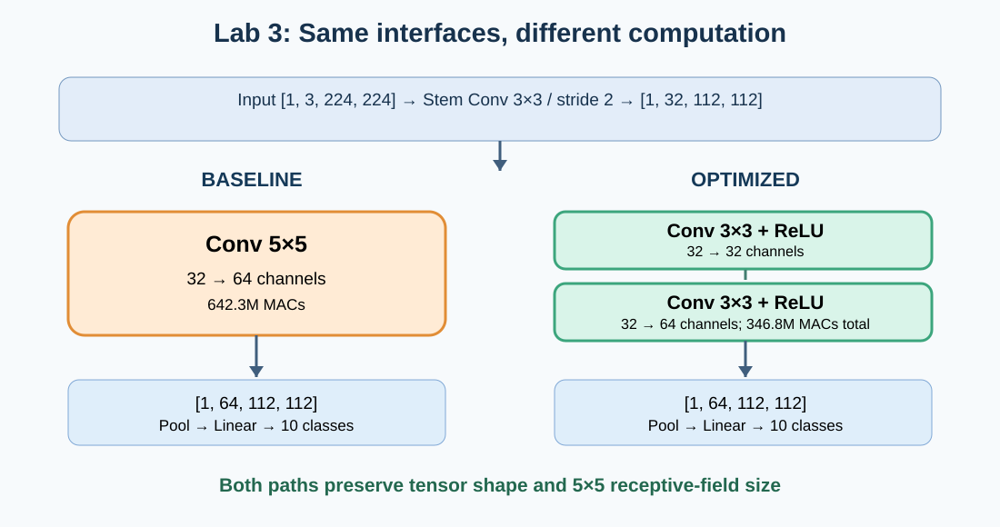
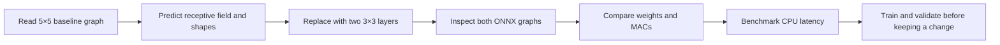
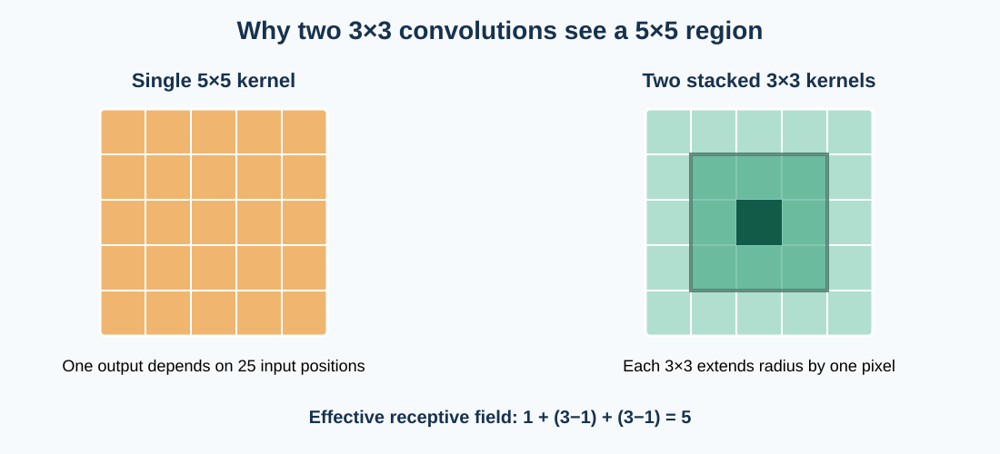
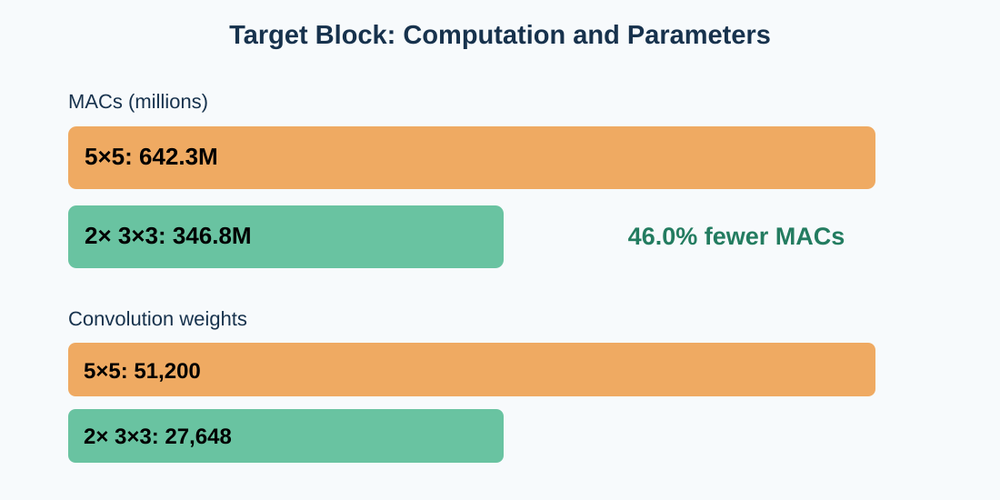

# Optional Lab 3: Kernel Size and Receptive Field with Netron

## By the end, you will be able to

- Distinguish a **[kernel size from its receptive field](#2-predict-the-receptive-field)**.
- Trace **[shape-preserving padding and stride](#1-read-the-baseline-shapes)** through an ONNX graph.
- Compare **[one 5×5 convolution with two 3×3 convolutions](#3-build-the-two-variants)** by weights and MACs.
- Explain why **[theoretical savings need runtime and accuracy checks](#5-benchmark-and-interpret)**.

## In this lab

- Inspect a baseline network with one 5×5 target convolution.
- Replace it with two 3×3 convolutions while keeping the external tensor shapes fixed.
- Calculate the target block's weights, parameters, and MACs.
- Compare the ONNX graphs and measure CPU inference latency.

This optional extension follows [Netron Lab 1](../index.md), [Lab 2 — Channel Width](../lab-2-channel-width/index.md), and [Lesson 14 — Model Optimization](../../lesson-14-model-optimization/index.md). It is not an additional numbered course lesson.





---

## 1. Read the baseline shapes

The input image is `[1, 3, 224, 224]`. The shared stem uses a 3×3 convolution with stride 2, producing `[1, 32, 112, 112]`. The target block uses a 5×5 convolution with stride 1 and padding 2, so it returns `[1, 64, 112, 112]`.

For one spatial dimension, the convolution output size is:

```text
output = floor((input + 2 × padding − kernel) / stride) + 1
```

For the target, `floor((112 + 2×2 − 5)/1) + 1 = 112`. Padding preserves height and width; it does not preserve the same pixel values or model function.

| Stage | Shape |
|---|---|
| Input | `[1, 3, 224, 224]` |
| Stem | `[1, 32, 112, 112]` |
| Target 5×5 Conv | `[1, 64, 112, 112]` |
| Global average pool and flatten | `[1, 64]` |
| Classifier output | `[1, 10]` |

---

## 2. Predict the receptive field

A **kernel** is the learned spatial window used at one layer. The **receptive field** is the region of the original input that can influence one output value after following a path through layers.

One 5×5 convolution sees a 5×5 input region. Two 3×3 convolutions, each with stride 1 and dilation 1, also have a 5×5 theoretical receptive field: the second layer combines neighboring outputs of the first, and those first-layer outputs each saw their own 3×3 patches.

```text
receptive_field = 1 + (3 − 1) + (3 − 1) = 5
```



The two blocks are not equivalent computations. The two-layer version adds an intermediate ReLU and constrains how its filters combine. Similar receptive-field size does not guarantee identical outputs or accuracy.

<div class="quiz" data-answer="b" data-explanation="With stride 1 and dilation 1, each added 3×3 layer grows the receptive field by two pixels: 1 + 2 + 2 = 5.">
  <p><strong>Checkpoint 1:</strong> What theoretical receptive field do two consecutive 3×3 convolutions have?</p>
  <label><input type="radio" name="netron-kernel-rf" value="a"> 3×3</label><br>
  <label><input type="radio" name="netron-kernel-rf" value="b"> 5×5</label><br>
  <label><input type="radio" name="netron-kernel-rf" value="c"> 6×6</label><br>
  <button class="quiz-check" type="button">Check answer</button>
  <p class="quiz-result" aria-live="polite"></p>
</div>

---

## 3. Build the two variants

The example keeps the stem, global pooling, classifier, input size, and final class count fixed. It changes only the target block:

```python
--8<-- "examples/04-practical-computer-vision/netron-kernel-receptive-field-lab/models.py:model"
```

In the baseline, the target layer maps 32 input channels to 64 with one 5×5 operation. The optimized version maps 32 to 32 with the first 3×3 convolution, applies ReLU, then maps 32 to 64 with another 3×3 convolution and ReLU. Both return `[1, 64, 112, 112]`, so the classifier remains unchanged.

Run the model script from the repository root to export both ONNX graphs:

```bash
uv run python examples/04-practical-computer-vision/netron-kernel-receptive-field-lab/models.py
```

The script checks the ONNX graphs, output shapes, total parameter counts, and target MAC estimates. The output values have no classification meaning because the weights are random.

---

## 4. Inspect the graphs and calculate cost

Open `baseline.onnx` in Netron. Find the target Conv after the stem ReLU. Its weight shape is `[64, 32, 5, 5]`: 64 output filter banks, each spanning 32 input channels with a 5×5 kernel.

```text
target weights = output_channels × input_channels × kernel_height × kernel_width
target MACs = output_height × output_width × target weights
```

The baseline target has `64 × 32 × 5 × 5 = 51,200` weights and 64 biases, for 51,264 target parameters. At 112×112 output positions, it uses 642,252,800 MACs.

In `optimized.onnx`, inspect the two consecutive 3×3 Conv nodes:

| Metric | One 5×5 | Two 3×3 |
|---|---:|---:|
| Target weight shapes | `[64,32,5,5]` | `[32,32,3,3]`, `[64,32,3,3]` |
| Target weights | 51,200 | 27,648 |
| Target parameters with biases | 51,264 | 27,744 |
| Target MACs | 642.3M | 346.8M |
| Final target output | `[1,64,112,112]` | `[1,64,112,112]` |
| Total model parameters | 52,810 | 29,290 |



The inspector script provides an independent calculation from the exported ONNX weights and shapes:

```bash
uv run python examples/04-practical-computer-vision/netron-kernel-receptive-field-lab/inspect_onnx.py
```

The lower target MAC count is an estimate of arithmetic work. It does not include memory movement, activation cost, or the efficiency of the runtime's kernels.

<div class="quiz" data-answer="a" data-explanation="Weights describe the learned kernels and do not depend on how many spatial positions reuse them. MACs include one operation per output position, so they scale with output height and width.">
  <p><strong>Checkpoint 2:</strong> Why are MACs much larger than the weight count for these convolutions?</p>
  <label><input type="radio" name="netron-kernel-cost" value="a"> The same weights are reused at every output position</label><br>
  <label><input type="radio" name="netron-kernel-cost" value="b"> Each weight is stored once per image pixel</label><br>
  <label><input type="radio" name="netron-kernel-cost" value="c"> MACs count only the model's class labels</label><br>
  <button class="quiz-check" type="button">Check answer</button>
  <p class="quiz-result" aria-live="polite"></p>
</div>

---

## 5. Benchmark and interpret

Run the CPU benchmark:

```bash
uv run python examples/04-practical-computer-vision/netron-kernel-receptive-field-lab/benchmark_onnx.py
```

It warms each ONNX Runtime session and reports median single-image latency, session startup, and model size. Record measurements from your device; the result depends on the CPU, runtime, and thread settings.

One 5×5 operator may run faster than two 3×3 operators even when the latter use fewer MACs. The extra operator and ReLU add execution overhead. Conversely, a target backend may have efficient 3×3 kernels. Benchmark rather than infer speed from graph size.

<div class="quiz" data-answer="c" data-explanation="Two 3×3 layers have fewer estimated target MACs here, but an extra operator and hardware-specific kernels can change measured latency.">
  <p><strong>Checkpoint 3:</strong> What is the right way to decide whether the optimized graph is faster?</p>
  <label><input type="radio" name="netron-kernel-benchmark" value="a"> Compare the receptive-field sizes only</label><br>
  <label><input type="radio" name="netron-kernel-benchmark" value="b"> Assume fewer MACs means proportionally lower latency</label><br>
  <label><input type="radio" name="netron-kernel-benchmark" value="c"> Measure both graphs on the target runtime and device</label><br>
  <button class="quiz-check" type="button">Check answer</button>
  <p class="quiz-result" aria-live="polite"></p>
</div>

---

## 6. Optional RK3566 extension

If you have an RK3566 device and a compatible RKNN-Toolkit2 installation, convert both ONNX models without quantization first, then benchmark and profile them on the physical device. The `examples/04-practical-computer-vision/netron-kernel-receptive-field-lab/README.md` describes the optional command. Host-side ONNX Runtime timing and Netron do not provide NPU scheduling or operator latency.

For an accuracy decision, train both variants on the same dataset and split, select using validation data, and evaluate once on a held-out test set. Since the optimized graph includes an additional nonlinear layer, matching tensor shapes and receptive-field sizes do not establish matching accuracy.

### Hands-on report

1. Record the target Conv shapes and weight dimensions from each Netron graph.
2. Calculate the receptive field and compare it with the target block's theoretical MACs.
3. Measure CPU latency and note why it differs from the MAC ratio.
4. If you train both networks, report test accuracy alongside latency and model size.

**Next:** Return to [Lesson 14 — Model Optimization](../../lesson-14-model-optimization/index.md), continue to [Lesson 15](../../lesson-15-real-time-computer-vision/index.md), or inspect a trained model in the [MobileNetV2 capstone](../../../../capstone-mobilenetv2-gtsrb/index.md).
