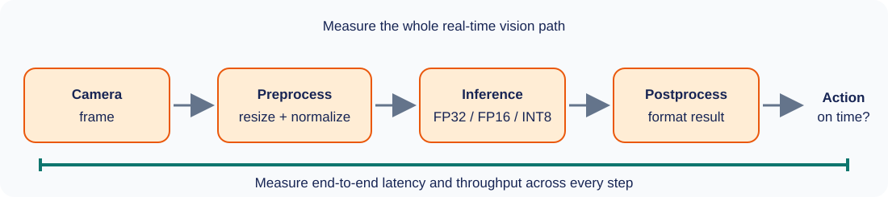

# Vision in Practice: Stage Review

## By the end, you will be able to

- Trace **[the path from a camera frame to an inference result](#1-follow-a-frame-through-inference)**.
- Compare **[latency, throughput, and model size](#2-balance-real-time-trade-offs)**.
- Choose **[a measurement that fits an application's deadline](#3-apply-the-ideas)**.

This checkpoint reviews Lessons 14–15. It is not an additional lesson.

---

## 1. Follow a frame through inference

The complete path includes more than the neural network. Resizing, transfers, model execution, and postprocessing all add time. FP16 or INT8 may improve speed or reduce memory use, but you must check accuracy and hardware support.

| Measure | What it tells you | Useful when… |
|---|---|---|
| Latency | Time for a result to return | Each frame must meet a response deadline |
| Throughput / FPS | Frames processed per second | The system must keep up with a camera or workload |
| Model size | Storage or memory needed for weights | The target device has limited resources |

Revisit [Lesson 14 — Model Optimization](../lesson-14-model-optimization/index.md) and [Lesson 15 — Real-Time Computer Vision](../lesson-15-real-time-computer-vision/index.md).

---

## 2. Balance real-time trade-offs

A benchmark should use the target device, representative images, and the full preprocessing-to-result pipeline. High FPS alone does not guarantee a responsive system: queued or batched frames may wait before inference.

  
<strong>Checkpoint:</strong> A robot must react to each camera frame within a short deadline. Which measurement is essential?

  <label><input type="radio" name="stage4-review-measure" value="a"> Model file size only</label> 
  <label><input type="radio" name="stage4-review-measure" value="b"> Training accuracy</label> 
  <label><input type="radio" name="stage4-review-measure" value="c"> End-to-end latency, alongside throughput</label> 
  <button class="quiz-check" type="button">Check answer</button>
  

---

## 3. Apply the ideas

**Scenario:** A parcel camera achieves high FPS in a benchmark, but decisions arrive too late for the conveyor. What would you inspect before choosing a faster model?

Show one reasonable response

Measure end-to-end latency and check queueing, batch wait time, preprocessing, transfers, inference, and postprocessing. Then compare optimized precision or a smaller model on the actual target device, checking that accuracy remains acceptable.

**Continue:** Apply the course in a [capstone project](../../../roadmap.md#capstone-project), such as [German Traffic Sign Recognition](../../../capstone-gtsrb/index.md).
